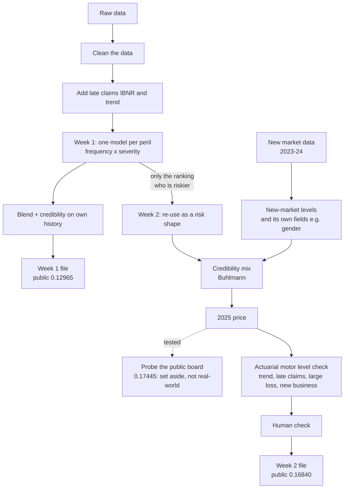
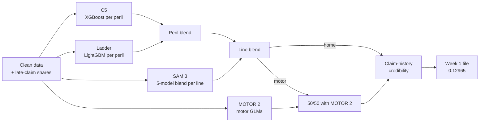
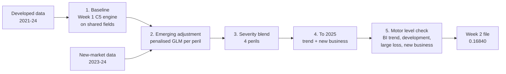

# IAA AI-Assisted Actuarial Hackathon 2026

**Team SnorlaxCode:** Samuel Lim, Wendy Low, Benedict Tan

---

## Part 1. The story on one page

**The task.** Predict the 2025 claim cost of every policy. Three products: car (motor), house (buildings) and house contents. Week 1 was a developed market with four years of data. Week 2 was a new emerging market with only two years of data, and most 2025 customers were new.

**Our scores.**

| | Public | Private |
|---|---|---|
| Week 1 | 0.12965 (5th) | 0.13923 (1st) |
| Week 2 | 0.16840 | – |

**The short version.**

1. **Week 1:** we built one careful model with frequency and severity for each peril using only the parameters that make sense individually.
2. **Week 2:** we take the Week 1 model and re-tune it to the available parameters with the same methodology as week 1 and created a developed market basis. Then we take the emerging market experience to perform credibility blending with ridge penalty to make the emerging market model. The price level came from the new market's own data.
3. **Probing, tried and set aside:** we tested probing the public board for price levels. It scored higher (0.17445), but no insurer can see next year's claims before setting a price, so we treated it as cheating and did not use it.
4. **Final motor level check:** instead, we went back to the model and asked what an actuary would check before signing off a new-market price. Four motor items were under-stated: the bodily injury trend, late-reported large injury claims, the large-loss load and the new-customer load. Fixing them raised motor by 9.4% and the public score to 0.16840.
5. **AI:** AI agents did most of the heavy work like coding and testing. Humans prompted sensible suggestions to push further modelling adjustments, checked the testing results, and approved every file before it went to Kaggle, in both weeks.

**Technical guide and citations.** The full peril-by-peril specification of both final models, for actuarial readers, is in `dummy_guide/dummy_guide_for_the_final_models.md` (with a source map in `dummy_guide/dummy_guide_for_the_final_models_Workbook.xlsx`). It contains all the citations for the methodology used within each model: GLMs, gradient boosting, Tweedie deviance, chain-ladder IBNR, Bühlmann and Bühlmann-Straub credibility, ridge penalisation, trend, large-loss loading, Bornhuetter-Ferguson / Cape Cod development and the complement of credibility.

**Flowchart.**

### Week 1: one careful model

**The idea.** Cost = how often a policy claims (frequency) × how much each claim costs (severity). We model the two parts separately for every type of claim (peril), then add them up. The blocks and blend are in Part 2.

**Data work.**
- We fixed bad values, for example house values that were a thousand times too big, removed double claims and handled one giant car claim.
- We used a simple chain-ladder method to work out the IBNR for each peril (IBNR), and we added them in.
- Customers with past claims were moved a little towards their own history, using a credibility weight.

**How we got there (public score).**

| Step | Public |
|---|---|
| First model | 0.11904 |
| Second AI session | 0.12224 |
| Assumptions workbook, per-peril frequency × severity, late claims | 0.12671 (+0.0045, the biggest jump) |
| Chain-ladder IBNR | 0.12924 |
| Final blend with a motor model | 0.12965 |

**What worked: asking the AI the right question.** We did not say "build a model". We said: *look at every column, for every peril and line, and write in an Excel sheet whether it really changes claims in real life.* Actuary thinking first, code second. This gave our biggest jump.

**What did not work.**
- Heavy tuning with mixed-year testing scored worse (0.12636).
- The last push on motor (the biggest line). Most ideas gave no gain, some were worse, one failed our held-out rule and was never sent. A GAM gave no gain.
- Our final blend was expected to give +0.0016 on our test but gave +0.00001 on the public board. We kept it because it was harmless and passed the rule.

**Full detail:** `week1/final_week1_R_Script/MODEL_METHODOLOGY.md`; peril-by-peril settings and citations: `dummy_guide/dummy_guide_for_the_final_models.md`, Section 3.

### Week 2: a new market

**What went wrong first.** We thought the Week 1 model would do well on the new market. It scored 0.1486. The new market has different customers, climate and costs, and we only had two years of its data.

**The new plan** (layers in Part 3).
1. **Use Week 1 for the ranking only.** It tells us who is riskier than who. We call this the *risk shape*.
2. **Learn the level from the new market.** How expensive things really are comes from the 2023-24 emerging data, after late claims and trend.
3. **Mix them with credibility (Bühlmann), per peril.** Many claims in a group: trust the new market. Few claims: stay close to the Week 1 shape.
4. **Use the new market's own fields.** Gender exists only in this market and is allowed here. Gender plus a few other settings took us from 0.156 to 0.166 (+0.0096, our biggest Week 2 jump). Gender alone was worth about +0.0020 on our local test.

**Probing: tried, then set aside.** The public board scores us on one third of the 2025 policies. If we make one product a bit more expensive and the score goes up, our price was too low. We sent 14 planned files, each changing one product or peril by a fixed step, and a small piece of maths turned the scores into price levels. The best probed file scored 0.17445.

Then we stepped back. In real life an insurer cannot see next year's claims before it sets the price. Probing uses the answers to the test, even if only for the level. So we decided it was cheating, and **we did not use any probed level in our final file**, even though it scored higher. The probed files stay in our log as a record (Part 6).

**The final motor adjustment: what an actuary would check.** We went back to the honest model from before probing (public 0.16690). We asked one question: *with no leaderboard, what would an actuary check before signing off a price for a new market?* We focused on motor, the biggest line (42% of exposure).

| Check | What we found | What we did |
|---|---|---|
| Is the spread right (cheap vs expensive policies)? | Yes. We tried stretching the spread to match Week 1, and the best stretch was none in both markets. | Kept the model's ranking exactly as it was |
| Bodily injury (BI) cost trend | The model used 0%. The −8.8% from the developed market came from 2023-24 injury claims that are still open and not yet at full cost. On mature years (2021-23), injury claims grew about +4% a year, and the new market showed +4.9%. | Trend +4.5% a year (×1.045 to 2025, ×1.027 to bring 2023 claims to 2024) |
| Late-reported injury claims | Injury claims reported late are bigger (19.6k within 30 days, 28.0k after two years). Recent new-market years have not seen their late claims yet. | Severity development ×1.017 |
| Large injury claims | A small new book has not had time to show its big claims. Its large-loss load is 1.024, against 1.048 in the developed market. | Borrow the developed load: ×1.023 |
| New customers | 77% of 2025 policies are new customers, against 6-9% in the data we trained on. New customers claimed 24% more than expected (A/E 1.237), but credibility shrank the load to 1.165. When three-quarters of the book is new, this load sets the price level. | Full new-customer A/E: new-customer rows ×1.061 |

Together, these raise motor cost by 9.4% (BI ×1.116, new customers ×1.061). Buildings and contents are unchanged. Every factor was set from the data and standard actuarial practice **before** we submitted. These are: trend fitted on mature years, development for late claims, a benchmark large-loss load for a thin book, and a new-business load. Our 2024 back-test could not judge them, because 2024 claims are not yet fully developed and only 9% of 2024 was new business. So we sent three files to check that each part pointed the right way:

| File | Public |
|---|---|
| BI only | 0.16793 |
| New customers only | 0.16769 |
| Both (final) | 0.16840 |

All three beat the pre-probing model, and we kept the full version we had built as our best estimate.

**Public score ladder.**

| Step | Public |
|---|---|
| First try (Week 1 model) | 0.14860 |
| New-market model | 0.15604 |
| Gender + other new-market settings | 0.16562 |
| Blend of two models | 0.16662 |
| Line ensemble (pre-probing model) | 0.16690 |
| ~~Probed levels (3 line levels, then halfway on peril level)~~ | ~~0.17192, 0.17445~~ set aside |
| Actuarial motor level check (final) | **0.16840** |

**The office premium.** The risk premium is turned into an office premium with the competition's expense table (Part 4).

**Full detail:** `week2/docs/final_model_method_week2.md`; peril-by-peril settings and citations: `dummy_guide/dummy_guide_for_the_final_models.md`, Section 4.

---

## Part 2. The Week 1 model, block by block

**The core idea.** There are 15 perils (types of claim): 5 for motor, 6 for buildings and 4 for contents. For each policy and each peril we predict **frequency** (how many claims per year) and **severity** (how much each claim costs). Cost = frequency × severity × exposure. The 15 peril costs are added up to give the policy's risk premium. The final file is a blend of four model "blocks", then a claim-history step.

**The four blocks.** The names are our internal run labels: the person who built it, then the iteration number.

| Block | What it is, in plain words | Frequency model | Severity model |
|---|---|---|---|
| **C5** (Wendy, iteration 7, candidate 5) | The main engine. One model per peril. Its settings for each peril (fields, tree size, claim cap) come from an Excel sheet that the AI filled in peril by peril and we reviewed. 5 copies with different random seeds are averaged ("bags"). | XGBoost Poisson (boosted trees for counts) | XGBoost Gamma, or a Gamma GLM for perils where trees were too noisy. Motor bodily injury uses one Tweedie model for the full cost. |
| **Ladder** (Wendy, iteration 9) | A second per-peril engine with very small frequency trees (1 to 3 levels deep), so it is close to a GLM. It is used for the 8 perils where it helped the blend. | LightGBM Poisson | LightGBM Gamma |
| **SAM 3** (Samuel, iteration 3) | A blend of 5 models per line: GLMs, per-peril trees, and one-model-per-line Tweedie trees. It gives a steady line-level view. | GLM / XGBoost / LightGBM | Gamma GLM |
| **MOTOR 2** (motor, iteration 2) | Motor only. Smooth GLMs with spline curves. Bodily injury is thin, so its frequency is partly borrowed from third-party property (both come from crashes with a third party). | Poisson GLM | Gamma GLM, shrunk towards the average (credibility Z = 0 to 1 per peril) |

**Shared settings in every block.**
- **Claim cap:** about the 99.5th percentile per peril. The cost above the cap is spread back as a small load (1.00 to 1.11).
- **Late claims (IBNR):** the chain-ladder reported share is used as a weight, so recent years are not under-counted.
- **Trend:** a yearly trend per peril, moved to 2025, with limits (in C5: frequency −5% to +3%, severity −2% to +10%). Bodily injury trend is switched off in C5.
- **Fields:** voluntary excess is in every model. Leaky or price fields are never used (written premium, renewal decision, service contacts).

**How the blocks are combined (per row).**

| Step | Formula | Weights |
|---|---|---|
| 1. Peril blend | w × Ladder + (1 − w) × C5 | w = 0, 0.25, 0.5, 0.75 or 1 per peril |
| 2. Line blend | LW × step 1 + (1 − LW) × SAM 3 | LW: motor 0.9, buildings 0.7, contents 0.9 |
| 3. Motor only | 0.5 × step 2 + 0.5 × MOTOR 2 | MOTOR 2 rescaled to the same total |
| 4. Claim history | × (A + N) ÷ (A + E), then rescaled so the line total does not change | A: motor 8, buildings 5, contents 5 |

In step 4, N is the policy's own past claims and E is how many the model expected. *Example:* a motor policy with 2 past claims where 0.5 were expected gets (8 + 2) ÷ (8 + 0.5) = 1.18, so it costs 18% more. One with no claims gets 8 ÷ 8.5 = 0.94. This is classic Bühlmann-style credibility: one policy's history only gets a small weight.

**Local test (D², fit on earlier years, scored on 2023 and 2024).**

| Stage | 2023 | 2024 |
|---|---|---|
| C5 alone | 0.10586 | 0.09924 |
| C5 + Ladder per peril | 0.10604 | 0.10054 |
| + SAM 3 line blend | 0.10621 | 0.10071 |
| + claim-history credibility | **0.10682** | **0.10208** |

Each step adds a little. One step alone is often within the noise (about 0.0011), but together the blending and the history step add +0.0010 (2023) and +0.0028 (2024) over C5 alone. Kaggle: public 0.12965, private 0.13923. The files are rebuilt by `week1/final_week1_R_Script/run_all.R`.

## Part 3. The Week 2 model, layer by layer

**The core idea.** The new market has only 2 years and about 9,100 claims over 15 perils. Some perils have only 50 to 90 claims, which is too few to build a model from scratch. So we build the price in layers: **shape** from the big developed market, **level** from the new market, then move to 2025.

**For each row and peril:**

cost = exposure × [ f_dev × L_f × adj_f ] × [ s_dev × L_s × adj_s × load ] × trend × NB load × C

| Part | Plain meaning |
|---|---|
| f_dev, s_dev | Developed-market frequency and severity for this kind of policy (the "shape") |
| L_f, L_s | New-market level: how much more or less often people claim, and how much claims cost, compared with the developed market |
| adj_f, adj_s | Small corrections for a few new-market fields, for example gender |
| load | Large-claim load from the developed market |
| trend, NB load | One year of trend to 2025, and an extra load for new customers |
| C | Motor level adjustment (layer 5): BI severity ×1.116, new-customer rows ×1.061; 1 for buildings and contents |

**The five layers.**

| Layer | Model | Key settings |
|---|---|---|
| **1. Baseline** | The Week 1 **C5** engine, refitted on developed 2021-24 data using only the fields both markets have. XGBoost Poisson × XGBoost Gamma (or Gamma GLM), 5 bags. | **Motor** uses the component `x20_tblend` (our run label), which is C5 on shared fields. **Buildings and contents** use a re-tuned version (`rt_var_b8`): trees one level shallower, and location and payment fields used in place of region and credit band, which the new market does not have. |
| **2. Emerging adjustment** | One **penalised GLM per peril** (Poisson for frequency, Gamma for severity), with the baseline as a fixed offset. The intercept is the new-market level. | Level credibility Z = n ÷ (n + K): K = 200 claims for frequency and 400 for severity (1,200 for severity of the 5 thinnest perils). Up to 4 extra fields per peril, kept only if they improve the 2024 test (for example gender, new business, self-employed). A ridge penalty of 30 claims stops small groups from jumping. |
| **3. Severity blend** | For 4 perils (motor own damage, glass, bodily injury; contents escape of water), a 50/50 mix with a Gamma GLM fitted on new-market claims only. | Chosen by 5-fold cross-validation (gain above 1.5 standard errors). Rescaled, so it changes who pays, not the peril total. |
| **4. To 2025** | One year of trend, plus a new-business load (77% of 2025 policies are new customers). | Trend: blend of developed and new-market trends, Z = n ÷ (n + 2,000). New-business load: motor 1.165, buildings 0.967, contents 1.049. |
| **5. Motor level check** | Actuarial review of the motor level; the ranking is not changed. | BI severity ×1.116 = trend +4.5% (×1.045 × 1.027) × late-claim development 1.017 × large-loss 1.048 ÷ 1.024. New-customer rows ×1.061 (full A/E 1.237 ÷ applied 1.165). |

**Why "a different market" mattered.** Compared with the developed market, a claim in the new market costs only 35% to 87% as much (motor 51% to 65%), and car claims happen 12% to 41% more often. The shape mostly carried over. Only 0 to 5 of about 58 fields behaved differently per peril, so we kept the Week 1 shape and re-learned the level.

**Final 2025 motor cost per policy-year (layer 5), CU.**

| Motor peril | Before | Final | Change |
|---|---|---|---|
| Bodily injury | 232.5 | 272.7 | +17.3% (BI ×1.116, new customers) |
| Third-party property | 205.2 | 215.8 | +5.2% (new customers) |
| Own damage | 107.6 | 113.1 | +5.1% |
| Theft | 50.1 | 52.7 | +5.2% |
| Glass and hail | 29.7 | 29.7 | 0 (new-customer factor already in the model) |
| **Motor total** | **625.1** | **684.0** | **+9.4%** |

Buildings (357.1) and contents (109.4) are the same as the pre-probing model. The whole file is 6.4% above it.

**What each layer is worth (motor, local test on 2024).** Developed model unchanged 0.127. Levels only 0.146. Full model (layers 1 to 3) 0.151. New-market data alone 0.101. Shape from the big market plus level from the small one beats either one alone. Public board: pre-probing model 0.16690, final 0.16840.

## Part 4. From risk premium to office premium (20 reference policies)

**What it is.** Our model gives the **risk premium**: the expected claim cost. The **office premium** is the price the customer pays. It adds expenses, commission, tax, catastrophe reinsurance and profit. The 20 reference policies were not used to fit or tune the model.

**The formula.**

Office premium = ( Risk premium × (1 + cat reinsurance) + Fixed expense × exposure ) ÷ ( 1 − variable expense − commission − premium tax − profit margin )

- **Divided out (bottom):** variable expense, commission, tax and profit are each a share of the price the customer pays. So the price must be grossed up until, after taking them out, enough is left for the costs on the top.
- **Added on (top):** reinsurance and the fixed expense are costs in CU.

**Assumptions (emerging market, from the `expenses` file).**

| Item | Value | Applies to |
|---|---|---|
| Catastrophe reinsurance | 12% of the risk premium | Buildings and contents only (not motor) |
| Fixed expense | 85 CU per policy-year, times exposure | All |
| Variable expense | 15% of the office premium | All |
| Commission | Broker 20%, direct 0% | By channel |
| Premium tax | 8% of the office premium | All |
| Target profit margin | 8% of the office premium | All |

The bottom of the formula is 1 − 0.15 − 0.20 − 0.08 − 0.08 = **0.49 for broker** and **0.69 for direct**.

**Worked example: M00161473** (motor, broker, exposure 0.964, risk premium 1,442.78 CU).

( 1,442.78 × 1.00 + 85 × 0.9644 ) ÷ 0.49 = 1,524.76 ÷ 0.49 = <b>3,111.75 CU</b>

Of that, variable expense is 466.76, commission 622.35, tax 248.94 and profit 248.94. Adding the parts back up gives the office premium to the cent, and the script checks this for every row.

**Results (CU, final model `motorlevel_l_full`).**

| Row | Line | Channel | Exposure | Risk premium | Cat RI | Fixed | Variable | Comm. | Tax | Profit | **Office** | ÷ risk |
|---|---|---|---|---|---|---|---|---|---|---|---|---|
| M00118569 | motor | direct | 0.940 | 600.69 | 0.00 | 79.87 | 147.95 | 0.00 | 78.91 | 78.91 | **986.33** | 1.64 |
| M00129413 | motor | broker | 0.332 | 165.54 | 0.00 | 28.18 | 59.30 | 79.07 | 31.63 | 31.63 | **395.33** | 2.39 |
| M00153851 | motor | broker | 0.962 | 315.81 | 0.00 | 81.74 | 121.70 | 162.26 | 64.91 | 64.91 | **811.31** | 2.57 |
| M00161473 | motor | broker | 0.964 | 1,442.78 | 0.00 | 81.97 | 466.76 | 622.35 | 248.94 | 248.94 | **3,111.75** | 2.16 |
| M00167496 | motor | broker | 0.984 | 585.59 | 0.00 | 83.61 | 204.86 | 273.14 | 109.26 | 109.26 | **1,365.71** | 2.33 |
| M00176777 | motor | broker | 0.992 | 1,084.66 | 0.00 | 84.30 | 357.85 | 477.13 | 190.85 | 190.85 | **2,385.63** | 2.20 |
| M00185311 | motor | direct | 0.964 | 1,019.11 | 0.00 | 81.97 | 239.37 | 0.00 | 127.66 | 127.66 | **1,595.77** | 1.57 |
| B00215707 | buildings | broker | 0.986 | 216.70 | 26.00 | 83.84 | 99.96 | 133.28 | 53.31 | 53.31 | **666.42** | 3.08 |
| B00215809 | buildings | direct | 0.975 | 360.70 | 43.28 | 82.90 | 105.84 | 0.00 | 56.45 | 56.45 | **705.62** | 1.96 |
| B00217584 | buildings | broker | 0.967 | 893.03 | 107.16 | 82.20 | 331.35 | 441.79 | 176.72 | 176.72 | **2,208.97** | 2.47 |
| B00218282 | buildings | broker | 0.973 | 282.15 | 33.86 | 82.67 | 122.04 | 162.73 | 65.09 | 65.09 | **813.63** | 2.88 |
| B00223369 | buildings | broker | 0.995 | 320.16 | 38.42 | 84.53 | 135.65 | 180.86 | 72.34 | 72.34 | **904.31** | 2.82 |
| B00229821 | buildings | broker | 0.992 | 223.78 | 26.85 | 84.30 | 102.53 | 136.71 | 54.68 | 54.68 | **683.55** | 3.05 |
| B00250679 | buildings | broker | 0.110 | 33.02 | 3.96 | 9.32 | 14.17 | 18.90 | 7.56 | 7.56 | **94.49** | 2.86 |
| C00259568 | contents | broker | 1.000 | 40.13 | 4.82 | 85.00 | 39.78 | 53.04 | 21.22 | 21.22 | **265.19** | 6.61 |
| C00270331 | contents | broker | 0.973 | 39.50 | 4.74 | 82.67 | 38.85 | 51.80 | 20.72 | 20.72 | **258.99** | 6.56 |
| C00283470 | contents | broker | 0.973 | 69.91 | 8.39 | 82.67 | 49.28 | 65.70 | 26.28 | 26.28 | **328.51** | 4.70 |
| C00286287 | contents | broker | 0.967 | 141.51 | 16.98 | 82.20 | 73.68 | 98.24 | 39.30 | 39.30 | **491.22** | 3.47 |
| C00302985 | contents | broker | 0.992 | 49.63 | 5.96 | 84.30 | 42.82 | 57.10 | 22.84 | 22.84 | **285.48** | 5.75 |
| C00314425 | contents | broker | 0.068 | 4.44 | 0.53 | 5.82 | 3.30 | 4.41 | 1.76 | 1.76 | **22.03** | 4.96 |

**Reading the table.**
- **Cheap contents policies:** their office premium is 3.5 to 6.6 times the risk premium, because the fixed 85 CU is large compared with a risk premium of 4 to 140 CU.
- **Motor and buildings broker policies:** about 2.2 to 3.1 times, because 51% of the price goes on the percentage loadings.
- **Direct policies:** 1.57 to 1.96 times, because they pay no commission.

**Assumptions we made.** Contents counts as property for the reinsurance load. The fixed expense is pro-rated for part-year policies; charging it in full would add about 116 to 162 CU to the three short policies. No reference policy came through a comparison site. Script: `week2/R/24_office_premium.R`; full precision: `week2/output/office_premium_reference_policies.csv`.

---

## Part 5. How we used AI, and how we checked it

**Tools.** Claude Code (most coding, running and checking), Claude chat and Cowork (thinking, planning, writing), GitHub Copilot (code help). Mostly Claude.

**What AI did.** Data checks, cleaning code, feature ideas, model code, scoring and comparison, docs and logs, this write-up and the video.

**The lesson: one big prompt makes the AI lazy.** It is like asking a cleaner to "put everything in one box". The job is done, but now you cannot find your sunscreen. One order gives you *a* model, not the best model. So we worked in small steps, one question at a time.

**How we pushed it.**
- We told it to think like an actuary.
- We made it study late claims (IBNR) with chain-ladder.
- We made it look at every column and write down the real-life reason it should affect claims.
- We made it try new columns and new market fields.
- We asked it for a plan before code, and for a test after code.

**How we checked it (never trust, always test).**
- **Local test before Kaggle.** Every idea was scored on past years with actual claims first. The gain must be bigger than about two bootstrap standard errors.
- **A rule set before we looked.** A change is sent only if it passes the gate. The tests caught ideas that looked great but did not hold up: the heavy tuning in Week 1 (0.12636) and a Week 2 candidate that lost 0.00189 on public.
- **The AI's numbers were re-checked.** The probe maths predicted one probed file at 0.17445 before it was sent, and the score was 0.17445. The maths worked, but we still chose not to use it (Part 6).
- **Humans made the judgement calls.** The AI built the probing. The humans decided it was not real-world practice and set it aside, then directed the actuarial motor review that replaced it.
- **Human decisions are logged.** Each choice (for example "gender is allowed" or "no probed levels in the final") has an entry in the decision register, so humans decided what to keep.

**How we used AI to make the video.**
1. **Script.** We gave Claude our rough idea of the video: the flow of how we worked through the Week 1 and Week 2 differences, and the key points to include. We also described ourselves a little so Claude could animate us better. Claude wrote an animated script from this.
2. **Style.** We found [Lemo Opuscar](https://lemomo-ai.github.io/lemo-opuscar/) and chose a style we liked to stick to.
3. **Voices.** Each of us recorded about 30 seconds of ourselves talking. We then asked Claude Code to put our voices onto the script with [Fish Audio](https://fish.audio).
4. **Fitting.** We went back and forth between Claude and Claude Code until the voiceover and the animation lined up.

---

## Part 6. Guardrails and limits

**Guardrails.**

1. **Human approval.** Every file was approved by a person before it was sent to Kaggle, in both weeks.
2. **Reproducible runs.** Each final file can be rebuilt by one script. The Week 2 final file `submission_20261030_0905_week2_motorlevel_l_full.csv` has the fingerprint (MD5) `90120c605cee98bb3545e0b7b4b9a128`. It is rebuilt in seconds by `powershell -File week2\run\build_final_motorlevel.ps1`. That runs `week2/R/30_final_from_components.R`, which rebuilds the pre-probing model (`submission_20261028_week2_optionB_line_ensemble.csv`, MD5 `bbd5ca2dbe6327161d93dad5dc36edbd`) from its two saved components, applies the motor level factors and checks both fingerprints (verified byte for byte). Adding `-Full` rebuilds the model components from raw data first. The Week 1 rebuild is `week1/final_week1_R_Script/run_all.R`.
3. **Logs.** Every run, every submission (42 or more across both weeks) and every decision is written in `week1/docs/workflow.md`, `week2/docs/week2_workflow.md` and `week2/docs/workflow_w2.md`.
4. **Automated checks.** `week1/tests/` has R test scripts for the model input/output code (ensemble, peril sum, row share) and for the 2024 validation. The scripts also stop with an error if row counts, totals or office-premium reconciliation do not match. Week 2 starts with read-only data checks (`week2/R/1_checks_w2.R`).
5. **Local validation protocol and gate** (Part 5).
6. **Cite the study.** We always asked the AI to cite the published study or actuarial practice that supports a method, so it never goes off the rails. A method with no support was not used.

**Why we set probing aside (Week 2).**

**The AI wants to win for us.** Given a goal of a higher score, the AI went straight to probing the public board, because it works. We do not believe it is a statistically supported modelling method. In the real world there is no answer key to try prices against. So we chose the statistically sound method and did not use the probing results.

We built probing with careful guardrails: level only, never shape; segments fixed before probing; an exact formula for the board; only halfway to the fitted level; every multiplier between 0.6 and 1.8. It reached 0.17445. But a guardrail limits *how much* you use the answers, not *whether* you use them. In real pricing, nobody can score next year's prices against next year's claims before setting them. So we did not use any probed level in the final file. The probed files (14 to 27 in our log) are kept as a record only.

**Guardrails for the final motor adjustment.**

1. **Level only.** The motor ranking (who is riskier than whom) is exactly the pre-probing model's. Buildings and contents are not touched.
2. **Every factor comes from the data and standard practice:**
   - trend fitted on mature loss years;
   - development for late-reported injury claims;
   - the developed market's large-loss load as a benchmark for a thin book;
   - the new market's own new-customer A/E.
   None was tuned on the board.
3. **Factors were fixed before submitting.** The board was used only to confirm direction, with three files: BI only, new customers only, and both. All three improved; we kept the full version, our actuarial best estimate.
4. **Spread was tested, not assumed.** Stretching the spread to Week 1's was checked and rejected (the best stretch is none).
5. Kaggle lets us pick **one final file**. We pick `motorlevel_l_full` (public 0.16840). The pre-probing model (`line_ensemble`, public 0.16690) is our fallback.

**Limits we chose.**
- The fixed expense of 85 CU is pro-rated by exposure (3 part-year policies change by about 116 to 162 CU if charged in full).
- No probed level is used in the final file.
- Our 2024 back-test cannot judge the motor level factors: 2024 claims are not fully developed and only 9% of 2024 was new business. The development part could be too high if the 2025 answers are claims reported so far rather than final cost.
- Open injury claims: 58% of new-market injury claims are still open, and less of their reserve has been paid than in the developed market (0.49 vs 0.69). Case reserves in a new market may be too low, but one snapshot cannot measure it, so we added nothing for it.
- With only two years of data, small groups are noisy and part-year and new-business behaviour is thin. Credibility reduces this but cannot remove it.

**Plan if something looks wrong.** Stop, go back to the last logged file, ask a human. The pre-probing file (`line_ensemble`) is our fallback.

---

## Part 7. What we could have done better

**Documentation across the team.** Working as a team made documentation and record keeping hard. We split into different directions, so each person's AI could not easily pick up the methods and tests the others had run. In Week 2 we fixed this with shared instruction files (`.md`) that every one of our Claude sessions follows. They make everyone record tests and results the same way. The repo stays tidy and the documentation stops being written in many places.

**Where to find everything.** Code: `week1/`, `week2/`. Method: `week2/docs/final_model_method_week2.md`. Technical guide to both final models, with all methodology citations: `dummy_guide/dummy_guide_for_the_final_models.md` (+ workbook). Logs: `week2/docs/week2_workflow.md`. Office premium: `week2/output/office_premium_reference_policies.csv`. Video script: `report/video_script.md`.
