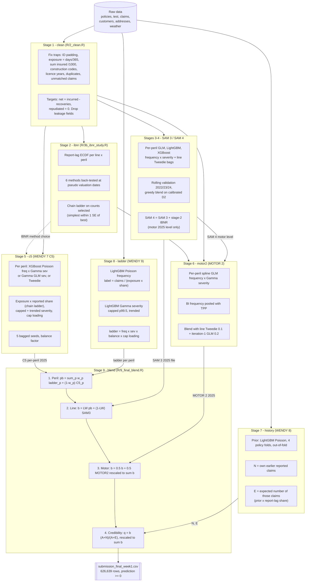
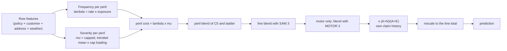
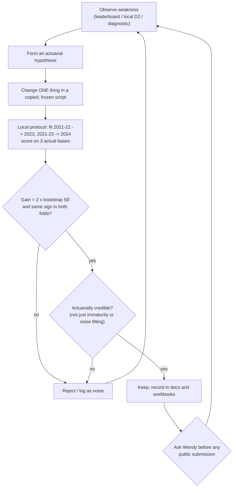

# Final Week 1 model – methodology, guardrails and actuarial rationale

Scope: the model that `run_all.R` rebuilds, i.e. submission `submission_20261023_1636_w9_motor2_pre_m0.5.csv`
(public D² 0.12965, private 0.13923). It predicts the **expected ultimate net claim cost for each 2025 policy row** of
motor, buildings and contents (net of excess and recoveries, repudiated claims = 0), scored by Tweedie D² (p = 1.5).

Sources of fact: [README.md](./README.md), the scripts in [R/](./R), [inputs/](./inputs), the model cards under
[models/](./models), [output/3b_ibnr/report.md](./output/3b_ibnr/report.md) and the project logs in
`../docs/` (`workflow.md`, `wendy07_experiment_log.md`, `HANDOFF_claude_code.md`). Numbers quoted are taken from those
files. References are listed in section 13; they were added from the literature the methods correspond to – please
verify page ranges before external use (see the note there).

---

## 1. One-page summary

The final prediction is a **layered ensemble**, with every layer chosen for an actuarial reason:

| Layer | What | Why it exists |
|---|---|---|
| 0 | Data cleaning with documented traps | Remove errors that bias exposure, sums insured and claim matching |
| 1 | Report-lag (IBNR) study, chain ladder on claim counts | The target is *ultimate*; 2024 is immature so claims are under-reported |
| 2 | **SAM 3** – GLM / LightGBM / XGBoost frequency × severity + line Tweedie, greedy-blended | Diverse, stable base model with claim-history features |
| 3 | **WENDY 7 C5** – per-peril XGBoost frequency × severity (or Tweedie), chain-ladder IBNR, 5 bags | Peril-level engine driven by an assumption workbook |
| 4 | **MOTOR 2** – per-peril spline GLMs, BI frequency pooled with TPP | Smooth, credible motor relativities |
| 5 | **WENDY 8** – own-policy claim history as a Poisson–Gamma credibility factor `(A+N)/(A+E)` | Recovers persistent policy-level risk not in the rating factors |
| 6 | **WENDY 9 ladder** – LightGBM Poisson frequency × Gamma severity for 8 perils | Peril-specific, heavily regularised challenger |
| 7 | Final blend (peril → line → motor member → credibility) | Variance reduction; the loss is convex so averaging helps |

Local validation (mean 2023/2024 D², "reported_raw", all lines) as each layer was added
(`inputs/assemble_weights.json`, `stages`):

| Stage | D² 2023 | D² 2024 |
|---|---|---|
| C5 alone | 0.10586 | 0.09924 |
| Ladder alone | 0.10120 | 0.09864 |
| C5 × ladder per-peril blend | 0.10604 | 0.10054 |
| + SAM 3 line blend | 0.10621 | 0.10071 |
| + credibility (WENDY 8) | 0.10682 | 0.10208 |

(The motor MOTOR 2 member was a further +0.0016 locally, but was flat on the public board: 0.12965 vs 0.12964.)

---

## 2. Flowchart of the whole model



### 2.1 How one 2025 row gets its prediction



### 2.2 Model-improvement decision loop used throughout



---

## 3. Problem framing and actuarial decisions that apply everywhere

| Decision | Choice | Rationale |
|---|---|---|
| Target | Net cost = `incurred_to_date − recoveries`; repudiated = 0 | Matches the organisers' definition (confirmed on recoveries for open claims, `docs/workflow.md`) |
| Ultimate vs reported | Model **ultimate frequency** by putting the reported share into the exposure | 2024 claims are still being reported; training on reported counts would trend 2025 downwards (Lawless 1994; Wüthrich & Merz 2008) |
| Decomposition | Frequency × severity per peril rather than one Tweedie per line | Perils have different drivers (flood: river distance; theft: area; fire: construction) and different tails (Ohlsson & Johansson 2010; Henckaerts et al. 2021) |
| Distributions | Poisson (counts), Gamma (severity), Tweedie p = 1.5 (line, benchmark and score) | Standard GLM family for insurance; Tweedie 1.5 is the compound Poisson–Gamma in the metric (Jørgensen & de Souza 1994; Smyth & Jørgensen 2002) |
| Exposure | `(period_end − period_start + 1)/365`, as a Poisson offset / weight | Frequency is a rate per exposure-year |
| Large losses | Cap each claim at the **p99.5** of its line×peril; add a **loading** = total/capped cost | Stabilises severity while preserving expected cost (increased-limits logic, Klugman, Panjer & Willmot) |
| Trend to 2025 | Log-linear fit on capped yearly mean severity, clamped (SAM 3: ±10 %; ladder: 0 %–10 %, S6 fixed 5 %) | Claims inflation to the prediction year; clamp avoids extrapolating noise (Werner & Modlin 2016) |
| Excess | `voluntary_excess` is a feature in every peril (frequency monotone-decreasing) | An excess removes small claims and shaves every claim; ignoring it mis-states both parts |
| Training window | Expanding 2021-24 for the final fit; no rolling windows | Rolling windows lost data and were worse in earlier iterations |
| Level discipline | **No downward scaling of the BI level to fit immature actuals** | Local actuals share the immaturity (IBNER); Kaggle scores ultimate 2025 cost |
| Governance | Earlier scripts frozen; copy-then-change; never overwrite another iteration's folder; never submit without asking Wendy | Reproducibility and a limited public-submission budget |

---

## 4. Guardrails (all in one place)

### 4.1 Data guardrails (`R/2_clean.R`)

| # | Guardrail | Implementation | Actuarial reason |
|---|---|---|---|
| G1 | `customer_id` left-padded to 8 characters | `pad_id()`; 98,110 motor train + 25,554 test | Lost leading zeros would break joins to customers and cross-line history |
| G2 | Exposure recomputed from dates | `(end − start + 1)/365`; raw kept as `exposure_raw`; flags rows that disagreed | Inconsistent exposure (days/360, rounding) biases every rate |
| G3 | `sum_insured` unit error | > 5m (buildings) / 2m (contents) **and** divisible by 1000 → ÷1000; non-divisible ones only reported | Prevents a 1000× outlier dominating a rating factor |
| G4 | `construction_type` normalised | Upper-case, `T`/`W` → `timber` | Same risk class under inconsistent codes |
| G5 | `years_licensed` ≤ `driver_age − 16` | Capped | Physically impossible values |
| G6 | `renewal_decision` dropped | Describes the row's own outcome | **Leakage** |
| G7 | Duplicate claims removed | 9-digit `claim_id` with same policy/peril/dates/status/incurred (604) | Double-booked claims inflate frequency |
| G8 | Unmatched claims excluded | Loss date in no policy row (296 motor, 67 buildings, 50 contents; plus the 2020-12-01 spike of 252) | Cannot be attributed to a row; documented in `unmatched_claims.csv` |
| G9 | One policy row per claim, overlap checks | Asserts no claim matches > 1 row, no overlapping rows | Prevents double counting |
| G10 | Row count preserved through every join | `stop()` if it changes | Silent join explosion |
| G11 | Categorical `NA` → explicit `"missing"` level | Numeric `NA` left to the tree models | Missingness may itself be informative |
| G12 | Unseen test levels logged | `levels unseen in train` check | Avoids silent extrapolation |

### 4.2 Feature guardrails

Never used as features (`R/0_setup.R`, `R/w89_core.R`, SAM 3): `row_id`, `policy_id`, `customer_id`, `address_id`, raw
dates, `renewal_decision`, `surname`, `date_of_birth`, `customer_service_contacts` (≈3 per claim row vs 0.4 without –
leakage), `written_premium` and `discount_applied` (current price, not risk), `compulsory_excess` (constant),
`noise_probe`, and marketing / administrative fields (`email_domain`, `marketing_consent`, `document_preference`,
`campaign_code` – it tracks calendar time –, `branch_id`, `marketing_segment`, `vehicle_colour`).
Ladder frequency also drops `previous_insurer` and `occupation` (high-cardinality, unstable).

### 4.3 Estimation guardrails

| # | Guardrail | Where |
|---|---|---|
| G13 | Early stopping on a **10 % policy-grouped holdout** (whole policies, not rows) – prevents a policy's other years leaking | SAM 3, C5, MOTOR 2, ladder |
| G14 | Refit on all training rows with the early-stopped rounds (min 10 freq / 5 sev) | ladder |
| G15 | **Balance factor**: scale predictions so the training total equals the observed total | ladder, C5, SAM 3 |
| G16 | Monotone constraint: `voluntary_excess` decreasing in frequency | C5, MOTOR 2 |
| G17 | Report-share floors (0.03 ladder shares, 0.05 history / SAM / IBNR study) | Prevents 1/share explosions on immature periods |
| G18 | Trend clamps (SAM 3 ±10 %, ladder [0 %, 10 %]); BI trend off | Limits extrapolation |
| G19 | Severity credibility: gated to few features when claims < `SEV_MIN_CLAIMS`; MOTOR 2 credibility Z per peril; Z = 0 for BI (peril average) | C5 / MOTOR 2 |
| G20 | GLM bins: 6 quantile bins, levels < 0.5 % of exposure merged into base | SAM 3 |
| G21 | Lag curve for the ladder uses **2021-22 losses only** (fully developed) | `w_ladder_data` |
| G22 | Seed bagging (5 bags C5; 3–5 SAM 3) | Lowers variance on unseen 2025 rows |
| G23 | Structural zeros only applied if training shows no claims there | C5 |
| G24 | Final assertions: row count = sample submission, no NA, all ≥ 0 | `R/9_final_blend.R` |
| G25 | Missing component values stop the run | `R/9_final_blend.R` |
| G26 | Component and final checks against the submitted file | `component_check.csv`, `final_check.csv` |

### 4.4 Model-selection / over-fitting guardrails

| # | Guardrail | Detail |
|---|---|---|
| G27 | **Time-ordered folds** | fit 2021-22→2023, 2021-23→2024 (optionally →2022); no random CV that mixes years (it made WENDY 5 worse) |
| G28 | **Three actual bases** | `reported_raw`, `reported_adj`, `developed` (reported ÷ report share) |
| G29 | **Primary score** = mean of 2023 & 2024 on `reported_raw` | It ranked WENDY 4 < SAM 3 correctly; 2024 alone did not |
| G30 | **Noise threshold** | Paired policy bootstrap (200 draws): a change counts only if gain > 2 SE (≈0.0011 on ALL for a single change) |
| G31 | **Cross-fold honesty check** | Choose on one fold, score the other; weights that fail are dropped |
| G32 | **Actuarial screen of winners** | A variant that only wins through immaturity, or removes a physically meaningful driver, is rejected |
| G33 | **Ceiling check** | Simulated perfect-model D² ≈ the achieved D² → no missing signal, so large "wins" are suspect |
| G34 | **Public-submission discipline** | Never submit without asking Wendy; post-hoc calibrations that won locally but lost publicly were discarded |

---

## 5. Stage 1 – Cleaning (`R/2_clean.R`)

**Steps**

1. Read customers, addresses, weather, claims; check duplicates in each key.
2. `clean_policy()` – the *same* function for train and test (so both are consistent): G1–G5, G6, joins to customers,
   addresses and weather (calendar year of `period_start`), derived `customer_age`, `years_with_insurer`,
   `premium_index`, 2021-24 address-average weather.
3. Claims: drop duplicates, compute `net_cost`, match each claim to the policy row whose period contains the loss date
   (`policy_id`, `period_start ≤ loss_date ≤ period_end`).
4. Build per-row targets (`y_cost`, `y_n_claims`, per-peril cost/count) and write `data/clean/`.
5. Plot every column raw vs cleaned and train vs 2025 (`output/2_1_clean_eda/`).

**Thought process.** The handover warned of data "traps". Rather than fix silently, each was turned into a logged check
with an expected count from the handover (`matches_handover`), so a deviation is visible. Clean data made *no*
difference to WENDY 4's local reported 2024 D² (an experiment noted in `docs/workflow.md`), which confirmed cleaning is
necessary hygiene, not a source of lift.

**Actuarial note.** Claims are *not* capped here – large-loss treatment is a modelling decision (Section 3).

---

## 6. Stage 2 – IBNR (late-reporting) study (`R/3b_ibnr_study.R`)

**Problem.** Valuation is 31 Dec 2024. Claims from late 2024 are still being reported, so reported 2024 frequency
understates ultimate. The model needs the *share reported* for every row.

**Candidate methods (6)**: M0 current ECDF of 2021-22 lags read at the row mid-date; M1 right-truncated Kaplan–Meier /
Lynden-Bell reverse-time product limit; M2 **chain ladder on counts** (loss quarter × development quarter,
volume-weighted age-to-age factors, tail = 1 after the longest observed lag); M3 parametric; M4 credibility-weighted;
M5 recent-years only; M6 stratified by covariates.

**Back-test.** Four pseudo-valuation windows (2022-12-31 + 12m / 24m; 2023-06-30 + 12m; 2023-12-31 + 12m). Fit on
claims reported by the pseudo date; predict late-reported counts; compare with what was actually reported by
2024-12-31. Primary metric: cost-weighted mean |log((A+0.5)/(E+0.5))|. Standard errors by Poisson bootstrap.

**Result.**

| method | primary error | vs M0 (SE) |
|---|---|---|
| **M2 chain ladder** | **0.0996** | −0.0796 (0.0189) |
| M0 current | 0.1792 | 0 |
| M1 truncation KM | 0.1809 | +0.0018 |
| M5 recent | 0.1832 | +0.0040 |
| M4 credibility | 0.1890 | +0.0098 |
| M3 parametric | 0.1922 | +0.0130 |

**Decision rule.** Choose the *simplest* method within 1 SE of the best (parsimony); override per peril only if another
method wins by > 2 SE (15 perils × 6 methods = multiplicity). The override was needed for **motor bodily injury**
(M0 beats M2 by 0.058, SE 0.013; BI report share is only ≈0.56–0.63, factor ≈1.7–1.78). Buildings subsidence A1
(ECDF averaged over every day of the row) in WENDY 7 because the sparse subsidence triangle made the chain ladder
over-project (1.12 vs 0.999–1.06).

**Why this was triggered.** WENDY 7 step 2 showed A0 (mid-date ECDF) said 2024 was ~99.5 % reported while the chain
ladder said 95–98 %. The ECDF is convex near zero, so F(mean lag) > mean F(lag) – a Jensen-type bias. Step 6's
back-test: projected/actual 0.971 (A0) vs 0.998 (A1) vs 0.999 (chain ladder) for 2023 losses.

**Caveats recorded.** Only counts are testable (case-estimate development cannot be reconstructed from one snapshot);
tails beyond ≈4 years untested; credibility *k* and covariate split use all data (mild look-ahead).

**Actuarial decisions.** Counts-based chain ladder (not incurred) because paid / incurred history is unavailable.
Share floor 0.05. Severity IBNER not adjusted (see 12.3).

---

## 7. Stages 3-4 – SAM 3 / SAM 4 (`R/4_models_itersam03.R`, `…sam04.R`)

**Role.** The diversified base model and the SAM-3 line blend member (weight 0.1–0.3 depending on line).

**Phases**

0. Diagnose earlier framework (levels vs public D², replay of iteration 1 and 2 under the new validation, level sensitivity).
1. Re-ingest and re-clean from raw; every trap re-checked.
2. Per-peril targets: claim cap p99.5; per-peril report-lag IBNR; long-tail perils (buildings subsidence, motor BI
   whose 2023 open share > 15 %) use severity from years < 2023 and a 2024 dummy in frequency; fitted trend ±10 %.
3. Features: engineered fields (e.g. `property_age`, `log_sum_insured`, flood / subsidence scores), plus **claim
   history** for the policy, customer's other lines and address (`hist_pol_n`, `hist_cust_other_n`, `hist_addr_*`),
   with Bühlmann-style relativity `hist_pol_rel = (n + k·f0)/(f0·(min(exposure,4)+k))`, k = 2 years.
4. Rolling validation 2022/2023/2024; ranking (calibrated D²) and level (A/E) judged **separately**.
5. Candidates: per-peril quasi-Poisson GLM × Gamma GLM (binned factors), per-peril LightGBM / XGBoost frequency × GLM
   severity, line Tweedie LightGBM / XGBoost bags (3 seeds per peril, 5 per line); **greedy forward blend** per line
   (10 × 0.1 steps) on mean calibrated D² over the three folds.
6. Final fit on 2021-24; saved blend; replication check (max abs diff 0).

**Key design decisions and their triggers**

* *Frequency exposure = exposure ÷ IBNR factor* (weight, not offset) – SAM 3's +0.00022 over SAM 2 came from
  **down-weighting immature 2024 rows** while keeping the same expected rate.
* *Tree models take the GLM level* – trees extrapolate trend poorly; the GLM carries the policy-year term.
* *Rare perils use short, physically motivated feature lists* (fire: construction, alarms; flood: elevation,
  river distance; subsidence: soil, trees, dry-summer index). Parsimony where claims are few.
* *Phase 0 discovery:* iteration 1's GLM scored similarly to iteration 2's XGBoost locally, but public order was the
  reverse – the framework was judged on the wrong basis, which motivated separate ranking/level tests and the
  developed-actuals basis.
* *Reproducibility.* XGBoost tuning stops after a fixed number of configurations (`XGB_TUNE_N` motor 36, buildings 42,
  contents 23) instead of a 900-second budget, so results no longer depend on machine speed.

**SAM 4** is SAM 3 with the stage-2 chain-ladder shares; in this final model only its **2025 motor total** is used to
set MOTOR 2's "SAM-level" file. In the final blend MOTOR 2 is rescaled to the running motor total anyway
(Section 11), so SAM 4 does not otherwise change the prediction.

---

## 8. Stage 5 – WENDY 7 C5 (`R/4_models_iterwendy07.R` + `inputs/assumptions_wendy07_final2.xlsx`)

**Engine (WENDY 4, driven by the assumption workbook).** Per peril and line:

* *Frequency*: XGBoost Poisson on positive-claim counts, volume = exposure × reported share (so the model learns
  **ultimate** frequency); frequency trend optionally estimated and clamped.
* *Severity*: Gamma XGBoost (data-rich perils) or Gamma GLM on few factors (sparse / heavy perils), on claims capped at a
  per-peril quantile and trended to 2025; the excess over the cap is returned as a loading.
* *Challenger*: Tweedie XGBoost on the same capped, trended, IBNR-offset target; the better of the two per peril by mean
  D² over folds (scored against **developed** actuals).
* *Target adjustments*: expected recoveries deducted on **open** claims of perils that recover; single claims limited
  at 2 m (`outlier_claim_limit`).
* *Guards*: structural zeros, monotone excess, seed bagging (5), early stopping on a policy holdout.

**WENDY 7 improvement chain and the reasoning for each step** (`docs/wendy07_experiment_log.md`)

| Step | Trigger / hypothesis | Test | Decision |
|---|---|---|---|
| Ceiling (Step 3) | A local target of 0.25 was proposed; is it attainable? | Simulate Poisson×Gamma from the model's own predictions; widen log-relativities by *k* | A perfect model scores ≈ what we score unless true risk spread is ≈2.2× wider → **irreducible noise**; expect +0.001–0.005 gains only |
| A0 reproduction (4) | A change can only be attributed if the baseline is reproduced | Re-run WENDY 4 | Environment noise ≈ 0.001 on one fold; today's A0 is the baseline |
| IBNR A1/A2 (5–6) | Mid-date ECDF may under-state 2024 | Local D² (flat) **and** one-year-ahead count back-test | Local D² cannot rank IBNR methods; back-test can → chain ladder except subsidence (A1) |
| Excess everywhere (7, B6) | An excess belongs in both frequency and severity | Add `voluntary_excess` where missing | ALL 0.1014 → 0.1024; largest gains where it was missing (BI, fire, flood) |
| BI "over-prediction" (8) | Motor predictions 1.04×/1.09× developed actuals; excess is BI | Examine BI severity, open share (49 % / 80 %) | **No downward scaling** – immature case estimates (IBNER), would fit immature actuals |
| Method blend (9, 12) | freq×sev and Tweedie make independent errors | Coordinate-ascent weights; cross-fold test | Gain did not survive on the bagged run; best method flips by year (motor freq×sev wins 2023, Tweedie 2024) → keep WENDY 4's per-peril mix, **no method blend** |
| Bootstrap threshold (10) | Need a noise floor | 200 policy draws | ≈ 0.0011 on ALL |
| Combinations & bags (11) | Do gains stack? | Several combos | Everything within ±0.0006; gains don't stack; bags kept for variance |
| BI trend (13–14) | C3 fitted BI freq −2.7 %/yr, sev −2 %/yr, giving burn 177 vs mature 240-245 | Compare to development | **BI trend off** (C4): project no uncertain decline; BI burn 177 → 200 |
| SAM 3 blend (15) | Different builds, correlation ≈ 0.95 | Line weights on grid 0.1 | 0.5 each, all folds positive (+0.00093, 2 SE 0.00047) |
| Richer stack (17) | SAM 3 GLM is the most different member | Stack weights | Cross-fold negative for motor → plain 50/50 kept (extra weights fit year noise) |
| Per-peril lab (18) | Which features/settings help each peril? | 269 variants × 15 perils, rule gain > 0.00005 and no year losing > 0.0001 | 10 perils pass; **actuarial screen** (below) → C5 (+0.0011 on ALL) |

**Actuarial screen of lab winners (Step 18)**

* Rejected – BI trend back on (+0.00057): wins only because local actuals share the IBNER the trend picks up.
* Rejected – storm without wind/hail/rainfall: a storm model without wind is not credible.
* Rejected – contents escape-of-water without freezing days: frost bursts pipes.
* Accepted – motor own damage freq×sev instead of Tweedie; TPP without freezing days/rainfall; Gamma GLM severity for
  buildings escape of water, motor theft, contents theft; fire `min_child_weight` 30→15; buildings flood without
  `days_quote_to_inception` / `start_month` (administrative timing).

**Reproducibility note.** On Windows/x86 C5 cannot reproduce the original Apple-M4 fit exactly (different early-stopping
rounds in 57 of 60 validation fits); it moves the final file by ≈0.5 % per row (median) and line totals ≤ 0.15 %.

---

## 9. Stage 6 – MOTOR 2 (`R/4_models_itermotor02.R`)

**Why a motor-specific model.** Motor has the lowest D² (≈0.05) and the most peril heterogeneity; smooth GLMs with
splines are interpretable and credible for age, years licensed, and vehicle effects.

**Method**

* Per peril: spline GLM frequency with offset `log(exposure × reported share)` × Gamma severity; MOTOR 1's per-peril
  feature ladder (`inputs/motor01_features_used.csv`); optional XGBoost with GLM as base margin.
* **Bodily-injury frequency pooled with third-party property**: BI rate = TPP rate × a short BI relativity GLM, then
  a 50/50 mix with BI's own GLM (Poisson D² mix 0.0496/0.0466/0.0431 vs own 0.0479/0.0455/0.0421). BI has few claims, so
  borrowing strength from the closely related TPP peril (shared driver features) is a credibility argument.
* **Severity credibility** Z per peril: OD 1, TPP 0.5, BI 0 (peril average), theft 1, glass 0.75, chosen on Gamma D²
  (BI's own severity model had *negative* D², so Z = 0).
* **Level choices on developed actuals** (frequency trend on/off, severity trend 1/0.5/0, robust large-loss loading
  with `LOAD_MULT` = 5, BI severity on all years): level cannot be judged on immature 2024 reported cost.
* **Final blend**: line Tweedie 0.1 + iteration-1 GLM 0.2.
* Keep rule: mean gain > 0.0005 and better in ≥ 2 of 3 folds (level choices: no fold worse).

**Result.** Raw D² 2022/2023/2024 0.0626/0.0539/0.0534 vs SAM 4 0.0596/0.0435/0.0463.

**Further motor experiments that did not make it** (MOTOR 3-7, `docs/workflow.md`): split claim history (+0.00002),
LightGBM-from-GLM versions (fail held-out rule), BI GAM (no gain), telematics (+0.00025, SE 0.00036), version averaging
(public 0.12904, private 0.13933 but not selected). Recording these negative results is itself a guardrail against
re-trying them.

---

## 10. Stages 7-8 – WENDY 8 credibility and WENDY 9 ladder (`R/5_history.R`, `R/6_ladder.R`, `R/w89_core.R`)

These two are R ports of Wendy's Python models, matched to the submitted predictions to ≈1e-14 (Section 12.5).

### 10.1 WENDY 8 – own-claim history as credibility

**Idea.** After rating factors, a policy that has had more claims than the model expected is, on average, a worse risk
(unobserved heterogeneity). Standard remedy: Poisson–Gamma credibility.

* **Prior** λ̂: LightGBM Poisson claim-count model per row, **without** history features, produced **out-of-fold** over 4
  policy folds (so a policy's own claims never predict its own expectation).
* **N** = the policy's own earlier claims (net > 0) with `loss_date < period_start` **and** `report_date < min(period_start, 1 Jan 2025)`.
* **E** = expected number of those claims: λ̂ grossed up to ultimate (÷ reported share at 1 Jan 2025, floor 0.05) × the share
  reported by the cut-off, from the line's report-lag ECDF averaged over 16 points of each earlier row.
* **Multiplier** `M = (A + N)/(A + E)`, with A = 8 (motor), 5 (buildings), 5 (contents).

**Actuarial interpretation.** With a Gamma(A, A) prior on a policy's relative risk (mean 1, variance 1/A) and Poisson
claims, the posterior mean is exactly (A+N)/(A+E): the Bühlmann-type credibility factor is Z = E/(A+E). A = 8 means a
relativity CV of ≈35 %; smaller A would trust history more. The **leakage guard** is the double time condition on N
(loss *and* report before the cut-off) and the out-of-fold prior. Totals are preserved by the rescale in Section 11.

### 10.2 WENDY 9 ladder – LightGBM frequency × Gamma severity

* **Frequency**: LightGBM Poisson, label = claims ÷ (exposure × reported share), weight = exposure × share, shallow
  trees by recipe (e.g. `G5` = 2 leaves, depth 1, i.e. an additive model; `G4`/`G6` depth 2), early stopping on the
  10 % policy holdout, refit on all 2021-24 rows, balanced to the claim count. Motor categoricals are replaced by the
  **rank of their credibility-weighted training rate** (`(n + 20)/(w + k)`; target-encoding with shrinkage).
* **Severity**: LightGBM Gamma on claims capped at p99.5, trended to 2025 (log-linear, clamped to [0, 10 %] for `SA`/`S4`;
  fixed 5 % for `S6`), early stopped on the same holdout, refit, scaled by a balance factor and the cap loading.
* **Ladder** = frequency × severity per 2025 row. Fitted only for the 8 perils with ladder weight > 0
  (motor TPP, glass; buildings storm, subsidence, fire, accidental damage; contents escape of water, flood).
* **Recipe choice** (`inputs/assemble_combo.json`): very low-capacity frequency recipes (G4–G6) for sparse perils,
  because with few claims the signal is mostly additive and complexity is mostly noise.

**Thought process for adding the ladder.** After C5 and SAM 3, the remaining ranking gain had to come from a
*different* model family. The ladder is a lightweight, heavily regularised GBM with a different IBNR weighting scheme
and different encodings, so its errors are only partly correlated with C5's. The per-peril weights w_p (Section 11)
were chosen by local protocol and cross-fold checks.

---

## 11. Stage 9 – Final blend (`R/9_final_blend.R`, weights in `inputs/assemble_weights.json`)

```
1. Peril:    pb  = Σ_p [ w_p · ladder_p + (1 − w_p) · C5_p ]
2. Line:     b   = LW · pb + (1 − LW) · SAM3
3. Motor:    b   = 0.5 · b + 0.5 · MOTOR2 · Σb / ΣMOTOR2
4. Cred.:    q   = b · (A + N)/(A + E),  then q ← q · Σb / Σq   (line totals preserved)
```

**Weights**

| Line | Peril | w (ladder) | | Line | LW (peril blend) | A (credibility) |
|---|---|---|---|---|---|---|
| motor | own_damage / BI / theft | 0 | | motor | 0.9 | 8 |
| motor | third_party_prop, glass_hail | 1 | | buildings | 0.7 | 5 |
| buildings | storm | 1 | | contents | 0.9 | 5 |
| buildings | subsidence | 0.5 | | | | |
| buildings | fire, accidental_damage | 0.25 | | | | |
| buildings | flood, escape_of_water | 0 | | | | |
| contents | escape_of_water, flood | 0.75 | | | | |
| contents | theft, accidental_damage | 0 | | | | |

**Actuarial reasoning**

* *Linear opinion pool.* Tweedie deviance is convex in the prediction, so a weighted average of two unbiased but
  partly independent predictions has an expected deviance no greater than the weighted mean of the two (Jensen). That
  also covers *level* risk: when the right BI level is uncertain (180–240 per exposure-year) the average of two levels
  is safer than either (Timmermann 2006).
* *Rescale to Σb* in steps 3–4 so that ranking components (MOTOR 2, credibility) **cannot shift the line level**; the
  level is decided only by the blend of C5, ladder and SAM 3. This separates the *ranking* question from the *level* question.
* *Ladder zero weights* where it did not help (e.g. motor own damage / BI, flood).
* Final rows: `prediction ≥ 0`, ordered as the sample submission.

---

## 12. Further actuarial decisions, what failed, and why

### 12.1 What worked (kept)

Per-peril frequency × severity; ultimate-level frequency (IBNR inside exposure); trend to 2025; claim-history features
and credibility; expanding window; light tuning; bagging; diverse blends; excess everywhere; chain-ladder IBNR.

### 12.2 What was deliberately stopped

LightGBM in SAM 3 (weight 0); Tweedie-only per-peril trees; heavy random-search tuning (WENDY 5, public 0.12636 < WENDY 4
0.12671); method choice on CV that mixes years; rolling windows; choosing on the 2023 fold alone; downward level scaling;
per-peril or dispersion post-calibration (see 12.4).

### 12.3 Reserving-style judgements

* **IBNER vs IBNR.** Only *counts* are developed. Open BI claims rise to 49 % (2023) and 80 % (2024) with falling average
  severity. Because fast-closing claims are smaller, part of the apparent BI decline is selection. One valuation date
  cannot separate it; the ultimate BI level is judged uncertain between ≈180 and 240. Hence: BI trend off, no downward
  scaling, level set by blending.
* **Open vs closed BI severity** (excluding the 11.9 m claim) ≈ 0.97/0.91/1.04 by loss year – case estimates look
  unbiased, so WENDY 9's BI level (~200) was kept.

### 12.4 Post-hoc calibrations that were rejected (public score reality check)

| Experiment | Local change | Public change |
|---|---|---|
| WENDY 9 + MOTOR 2 per peril + dispersion k | +0.0023 / +0.0018 | **−0.00139** |
| 0.12965 file + buildings dispersion k = 1.075 | +0.0003 / +0.0005 (z 3.5) | **−0.00077** |
| WENDY 7 final2 + MOTOR 2 motor (rescaled) | – | −0.00038 |
| Lower motor to WENDY 4 level | – | −0.00102 |

*Lesson.* Weights or exponents tuned on the same two validation folds did not transfer; the final model therefore uses
only coarse, pre-registered knobs (grid 0.1, one MOTOR 2 weight 0.5) and treats local gains as optimistic.

### 12.5 Reproducibility safeguards

* Frozen scripts, run in separate R sessions with logs and `run/done` markers.
* Float-level equivalence: polars divides by constants as `x·(1/c)`, uses Kahan sums and a specific hash for folds; the R
  port reproduces these (`kahan_by`, `f32`, `inputs/polars_policy_hash.parquet`).
* Verified: feature tables identical; claim-frequency prior matches to 2e-15; ladder 2025 predictions match to 1e-14.
* Final vs submitted: totals 0.9986 (motor), 0.9999 (buildings), 0.9999 (contents); median row difference 0.5–0.7 %;
  Spearman 0.9999 (C5 is the only non-exact component).

---

## 13. Mapping of each step to the literature

> **Verification note.** These citations were assembled from the methodology each step uses and from general
> knowledge of the actuarial / statistical literature, *not* retrieved from a database in this session. Author, title,
> journal and year should be correct, but volume/page numbers should be checked before external publication. The
> project's own documents do not themselves cite papers.

| Section | Method / decision | Reference(s) |
|---|---|---|
| 3, 7, 9 | GLM framework, Poisson / Gamma | Nelder & Wedderburn (1972); McCullagh & Nelder (1989); de Jong & Heller (2008); Ohlsson & Johansson (2010) |
| 3, 7 | Tweedie / compound Poisson–Gamma, p = 1.5 | Jørgensen & de Souza (1994); Smyth & Jørgensen (2002) |
| 3, 8, 10 | Gradient boosting; XGBoost; LightGBM | Friedman (2001); Chen & Guestrin (2016); Ke et al. (2017) |
| 3, 7, 8 | Frequency–severity ML for tariffs | Henckaerts, Côté, Antonio & Verbelen (2021); Wüthrich & Merz (2023) |
| 3 | Large-loss cap and loading (increased-limits logic) | Klugman, Panjer & Willmot, *Loss Models* |
| 3 | Trend and ratemaking basics | Werner & Modlin (2016) |
| 4.3, 11 | Early stopping, regularisation | Hastie, Tibshirani & Friedman (2009) |
| 4.4 | Time-ordered validation | Bergmeir & Benítez (2012) |
| 4.4, 12 | Gini / ordered Lorenz curve for insurance scores | Frees, Meyers & Cummings (2011) |
| 4.4 | Paired bootstrap thresholds | Efron & Tibshirani (1993) |
| 6 | Reporting delays and IBNR counts | Lawless (1994); Wüthrich & Merz (2008) |
| 6 | Chain ladder, volume-weighted age-to-age factors | Taylor (2000); Mack (1993); England & Verrall (2002) |
| 6 | Right-truncated product-limit (reverse-time KM) | Lynden-Bell (1971); Kaplan & Meier (1958) |
| 6 | IBNR vs IBNER, BF method | Bornhuetter & Ferguson (1972); Friedland (2010) |
| 7 | Greedy forward ensemble selection | Caruana, Niculescu-Mizil, Crew & Ksikes (2004) |
| 7, 10 | Credibility on claim history; Bühlmann–Straub | Bühlmann (1967); Bühlmann & Straub (1970); Bühlmann & Gisler (2005) |
| 8 | Seed bagging | Breiman (1996) |
| 9 | Spline / additive effects | Hastie & Tibshirani (1990) |
| 9, 10 | Credibility pooling of sparse perils | Ohlsson & Johansson (2010); Bühlmann & Gisler (2005) |
| 10.1 | Poisson–Gamma exact credibility `(A+N)/(A+E)` | Mayerson (1965); Jewell (1974) |
| 10.2 | Target encoding with shrinkage | Micci-Barreca (2001) |
| 11 | Forecast combination / linear opinion pool | Bates & Granger (1969); Timmermann (2006) |
| 12.5 | Compensated summation (Kahan) | Kahan (1965) |

### References

* Bates, J. M. & Granger, C. W. J. (1969). The combination of forecasts. *Operational Research Quarterly* 20(4), 451–468.
* Bergmeir, C. & Benítez, J. M. (2012). On the use of cross-validation for time series predictor evaluation. *Information Sciences* 191, 192–213.
* Bornhuetter, R. L. & Ferguson, R. E. (1972). The actuary and IBNR. *Proceedings of the Casualty Actuarial Society* 59, 181–195.
* Breiman, L. (1996). Bagging predictors. *Machine Learning* 24(2), 123–140.
* Bühlmann, H. (1967). Experience rating and credibility. *ASTIN Bulletin* 4(3), 199–207.
* Bühlmann, H. & Straub, E. (1970). Glaubwürdigkeit für Schadensätze. *Mitteilungen der Vereinigung Schweizerischer Versicherungsmathematiker* 70, 111–133.
* Bühlmann, H. & Gisler, A. (2005). *A Course in Credibility Theory and its Applications*. Springer.
* Caruana, R., Niculescu-Mizil, A., Crew, G. & Ksikes, A. (2004). Ensemble selection from libraries of models. *Proceedings of the 21st ICML*.
* Chen, T. & Guestrin, C. (2016). XGBoost: a scalable tree boosting system. *Proceedings of KDD 2016*, 785–794.
* de Jong, P. & Heller, G. Z. (2008). *Generalized Linear Models for Insurance Data*. Cambridge University Press.
* Efron, B. & Tibshirani, R. J. (1993). *An Introduction to the Bootstrap*. Chapman & Hall.
* England, P. D. & Verrall, R. J. (2002). Stochastic claims reserving in general insurance. *British Actuarial Journal* 8(3), 443–518.
* Frees, E. W., Meyers, G. & Cummings, A. D. (2011). Summarizing insurance scores using a Gini index. *Journal of the American Statistical Association* 106(495), 1094–1106.
* Friedland, J. (2010). *Estimating Unpaid Claims Using Basic Techniques*. Casualty Actuarial Society.
* Friedman, J. H. (2001). Greedy function approximation: a gradient boosting machine. *Annals of Statistics* 29(5), 1189–1232.
* Hastie, T. & Tibshirani, R. (1990). *Generalized Additive Models*. Chapman & Hall.
* Hastie, T., Tibshirani, R. & Friedman, J. (2009). *The Elements of Statistical Learning* (2nd ed.). Springer.
* Henckaerts, R., Côté, M.-P., Antonio, K. & Verbelen, R. (2021). Boosting insights in insurance tariff plans with tree-based machine learning methods. *North American Actuarial Journal* 25(2), 255–285.
* Jewell, W. S. (1974). Credible means are exact Bayesian for exponential families. *ASTIN Bulletin* 8(1), 77–90.
* Jørgensen, B. & de Souza, M. C. P. (1994). Fitting Tweedie's compound Poisson model to insurance claims data. *Scandinavian Actuarial Journal* 1994(1), 69–93.
* Kahan, W. (1965). Further remarks on reducing truncation errors. *Communications of the ACM* 8(1), 40.
* Kaplan, E. L. & Meier, P. (1958). Nonparametric estimation from incomplete observations. *Journal of the American Statistical Association* 53(282), 457–481.
* Ke, G. et al. (2017). LightGBM: a highly efficient gradient boosting decision tree. *Advances in Neural Information Processing Systems* 30.
* Klugman, S. A., Panjer, H. H. & Willmot, G. E. *Loss Models: From Data to Decisions*. Wiley.
* Lawless, J. F. (1994). Adjustments for reporting delays and the prediction of occurred but not reported events. *Canadian Journal of Statistics* 22(1), 15–31.
* Lynden-Bell, D. (1971). A method of allowing for known observational selection in small samples applied to 3CR quasars. *Monthly Notices of the Royal Astronomical Society* 155, 95–118.
* Mack, T. (1993). Distribution-free calculation of the standard error of chain ladder reserve estimates. *ASTIN Bulletin* 23(2), 213–225.
* Mayerson, A. L. (1965). A Bayesian view of credibility. *Proceedings of the Casualty Actuarial Society* 51, 85–104.
* McCullagh, P. & Nelder, J. A. (1989). *Generalized Linear Models* (2nd ed.). Chapman & Hall.
* Micci-Barreca, D. (2001). A preprocessing scheme for high-cardinality categorical attributes in classification and prediction problems. *ACM SIGKDD Explorations* 3(1), 27–32.
* Nelder, J. A. & Wedderburn, R. W. M. (1972). Generalized linear models. *Journal of the Royal Statistical Society A* 135(3), 370–384.
* Ohlsson, E. & Johansson, B. (2010). *Non-Life Insurance Pricing with Generalized Linear Models*. Springer.
* Smyth, G. K. & Jørgensen, B. (2002). Fitting Tweedie's compound Poisson model to insurance claims data: dispersion modelling. *ASTIN Bulletin* 32(1), 143–157.
* Taylor, G. (2000). *Loss Reserving: An Actuarial Perspective*. Kluwer.
* Timmermann, A. (2006). Forecast combinations. In *Handbook of Economic Forecasting*, Vol. 1, Elsevier, 135–196.
* Werner, G. & Modlin, C. (2016). *Basic Ratemaking* (5th ed.). Casualty Actuarial Society.
* Wüthrich, M. V. & Merz, M. (2008). *Stochastic Claims Reserving Methods in Insurance*. Wiley.
* Wüthrich, M. V. & Merz, M. (2023). *Statistical Foundations of Actuarial Learning and its Applications*. Springer.

---

## 14. Known limits and risks

1. **C5 platform sensitivity** (Section 8): exact reproduction needs Apple Silicon.
2. **2025 motor BI level** is the largest unresolved uncertainty; local validation cannot test it.
3. **Immature validation actuals**: 2024 local D² is depressed and cannot judge level; "developed" basis corrects counts only.
4. **Noise floor**: single-change effects are ±0.0001–0.0006; combined gains are often optimistic after selection.
5. **Credibility parameter A** (8/5/5) and the blend weights were chosen on the same 2023/2024 folds that score them.
6. **Only counts are IBNR-tested**; case-estimate development (IBNER) is assumed neutral.
7. **No external 2025 information** (e.g. rate changes, weather events, claims-inflation shocks) is available.
