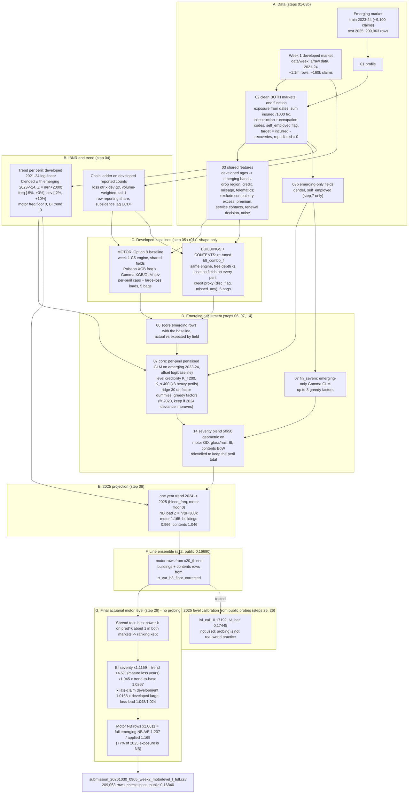

# Week 2 final model: full method (emerging market 2025, `motorlevel_l_full`)

Written 29 Oct 2026; final changed 30 Oct 2026. This document describes the final week 2 model from raw data to the submitted file:
- how the week 1 (developed-market) data is adjusted and reused;
- the frequency and severity model for every peril;
- the emerging-market adjustment and the 2025 projection;
- the final actuarial motor level adjustment that took the pre-probing model from 0.16690 to 0.16840 (section 8A);
- the public-probe level calibration (0.17445) that was built, tested and **set aside** because probing is not available in real-world pricing (section 9, kept as a record);
- the script that rebuilds the file.

| Item | Value |
|---|---|
| Final file | `week2/output/submission/submission_20261030_0905_week2_motorlevel_l_full.csv` |
| MD5 | `90120c605cee98bb3545e0b7b4b9a128` |
| Rows | 209,063 (all sample ids, no NA, no negatives, no duplicates) |
| Build | `powershell -File week2\run\build_final_motorlevel.ps1` (last step only, seconds; or `Rscript week2/R/30_final_from_components.R`) or `... -Full` (from raw data) |
| Public score | **0.16840** (submission #31) |
| Base model | `line_ensemble` #12, public 0.16690 (pre-probing; also the fallback) |
| Set aside | `lvl_half` #27 0.17445 and `lvl_cal1` #17 0.17192 (probed levels, section 9) |

Related records:
- [week2_workflow.md](week2_workflow.md): submission log, including every probe.
- [workflow_w2.md](workflow_w2.md): run log.
- [optionB/final_model_week2.md](optionB/final_model_week2.md): the Option B parameters in full.
- [final_submission_writeup_week2.md](final_submission_writeup_week2.md): plain-language report.

---

## 1. The model in one formula

For every 2025 emerging row and every peril the row is covered for:

```
pred(row, peril) = exposure
                 x f_dev(x)  x Lf  x adj_f(x)                      frequency
                 x s(x)                                            severity (see below)
                 x (1 + g_f) x (1 + g_s)                           one year of trend, 2024 -> 2025
                 x NB_line                                         new-business rows only, where NB is not a factor
                 x M(row, peril)                                   final actuarial motor level (section 8A); 1 for buildings, contents

s(x) = s_dev(x) x Ls x adj_s(x) x load_dev                         mature shape x emerging level (11 perils)
s(x) = [s_dev x Ls x adj_s x load_dev]^0.5 x s_em(x)^0.5 x k       50/50 blend, relevelled (4 perils)

row prediction = sum over the line's perils (structural zeros, i.e. no cover, give 0)
```

| Symbol | Meaning | Where it comes from |
|---|---|---|
| `f_dev`, `s_dev` | developed-market frequency and severity for the risk profile x (the shape) | step 5, week 1 engine refitted on shared fields |
| `Lf`, `Ls` | emerging level vs developed, per peril, credibility-weighted | step 7 |
| `adj_f`, `adj_s` | emerging correction factors (ridge-shrunk) | step 7 |
| `s_em` | emerging-only severity GLM | step 7 (`fin_sevem`) |
| `k` | relevelling constant: the blend keeps the core model's peril total | step 14 |
| `g_f`, `g_s` | annual trend | step 4, applied in steps 7 and 8 |
| `NB_line` | residual new-business load | step 8 |
| `M` | motor level: BI severity x 1.1159; motor new-business rows (where NB is not a factor) x 1.0611 | step 29 (`29_motor_level.R`) |

Two versions of `f_dev` / `s_dev` are used:
- **Motor** comes from the Option B developed baseline (component `x20_tblend`).
- **Buildings and contents** come from the week 1 engine re-tuned on emerging-available fields (component `rt_var_b8_floor_corrected`).

This "line ensemble" was submission #12 (public 0.16690).

---

## 2. Flowchart



---

## 3. Data: how the week 1 data is reused and adjusted (steps 01-03b)

The week 1 data (`data/week_1/raw data/`) is the developed market in week 2. It is byte-identical to the week 2 `developed/` folder. Week 1 files and models are never edited: week 2 copies the week 1 cleaning code (`week2/R/02_clean_week2.R`, adapted from `week1/R/2_clean.R`).

### 3.1 Cleaning applied to both markets (`02_clean_week2.R`, one `clean_policy()` with a market argument)

| # | Rule | Developed (week 1 data) | Emerging |
|---|---|---|---|
| 1 | Exposure recomputed as (end - start + 1) / 365 for every row | week 1 trap, same rule | 254 motor, 155 buildings, 200 contents rows fixed (`emerging_exposure_fixes.csv`) |
| 2 | Sum insured above 5m (buildings) / 2m (contents) and divisible by 1000 is divided by 1000 | week 1 rule | 53 + 57 train rows, 104 + 135 test rows |
| 3 | `construction_type` to one set of levels: brick / stone / timber / non_standard | casing and T/W variants fixed as in week 1 | BRK / STN / WOD / MIX mapped |
| 4 | `occupation` lower-cased and trimmed; "self-employed <job>" becomes the job plus a `self_employed` flag | | 80 spellings to 20 occupations; 8.8% self-employed |
| 5 | Target `y_cost` = sum of (incurred_to_date - recoveries) over non-repudiated claims; repudiated = 0 cost and 0 count; amounts already net of excess; no cap at cleaning | as week 1 | same |
| 6 | Claims that match no policy row are excluded | week 1 duplicates and traps handled as in week 1 | 34 pre-2023 claims, 2 in gaps |
| 7 | Missing categories become a level `missing`; missing numbers stay NA | | about 12% missing in several fields |
| 8 | Ids are never joined across markets | | 752 customer and 8,046 address ids overlap by coincidence |

### 3.2 Claim basis C5 (week 1 final basis, kept)

- The expected recovery on open claims is deducted, using the closed-claim recovery ratio by peril.
- A single claim is limited to 2,000,000 before any cap.
- Per-peril caps and large-loss loads are set in the baseline (section 5).

### 3.3 Shared feature set (`03_harmonise_features.R`)

The emerging market lacks some week 1 fields, so the developed model is refitted on the fields both markets share. This is the main change to the week 1 data.

| Change | Fields |
|---|---|
| Developed exact ages banded to the emerging 5 bands; exact ages kept with a `_developed` suffix (not used) | `driver_age` -> `driver_age_band`, `policyholder_age` -> `policyholder_age_band` |
| Dropped (developed only) | `region`, `credit_band`, `annual_mileage`, `telematics_opt_in`, `telematics_score` |
| Always excluded | `compulsory_excess`, `written_premium`, `customer_service_contacts` (outcome leak), `renewal_decision` (own outcome), `noise_probe` and marketing fields |
| Kept everywhere | `voluntary_excess` and every other shared rating field (lists in section 5.3) |
| Emerging only, step 7 only (`03b_emerging_extra.R`) | `gender` (approved by Wendy, D027), `self_employed` |
| Bands for step 7 factors | `_b` = quintile bands from emerging training data (e.g. `hail_days_b`, `vehicle_value_group_b`) |
| Weather | realised weather for the row's year (2025 weather is in the test file) |

Re-checked on 28 Oct and rejected again:
- `region` (X21b / X21i lost; a 2023-fitted region level loses on 2024 at every credibility weight);
- `credit_tier` / `n_lines` (x21c, public -0.0019);
- `written_premium` (an outcome-linked leak, and no signal);
- marketing and campaign fields (noise, or driven by fire claims).

---

## 4. IBNR and trend (step 04, `04_ibnr_trend_week2.R`)

### 4.1 IBNR (late-reported claims)

- Chain ladder on developed reported counts per peril:
  - grid: loss quarter x development quarter, 2021Q1-2024Q4;
  - factors: volume-weighted, tail 1.
- Subsidence uses the empirical lag distribution, averaged over the row's days at risk.
- Emerging report lags were tested and are the same speed, so the developed pattern is borrowed.
- Each row gets a reporting share. Frequency is modelled on ultimate claims (count / share), so recent rows are not treated as safer.

### 4.2 Trend (annual, applied for one year 2024 -> 2025, and to bring 2023 to 2024 terms in step 7)

- **Severity:** developed 2021-24 log-linear trend (capped p99.5), blended with the emerging 2023->24 change at Z = n/(n+2000), clamped to [-2%, +10%].
- **Frequency (`TREND_MODE=blend_freq`, from x20):** the same credibility blend per peril, clamped to [-5%, +3%].
- Overrides:
  - motor frequency is floored at 0 (`TREND_FLOOR_FREQ=motor`, public evidence #3 / #5);
  - motor bodily injury trend is 0 for both frequency and severity (week 1 C5 rule).

| Line | Peril | Freq trend | Sev trend |
|---|---|---|---|
| motor | own_damage | 0 (evidence -5.0%, floored) | +3.75% |
| motor | third_party_prop | 0 (evidence -3.4%, floored) | +4.16% |
| motor | bodily_injury | 0 | 0 |
| motor | theft | 0 (floored) | +6.01% |
| motor | glass_hail | +3.0% | +9.21% |
| buildings | storm | +3.0% | +8.77% |
| buildings | flood | -3.1% | +7.16% |
| buildings | escape_of_water | +0.8% | +7.32% |
| buildings | subsidence | +3.0% | +1.48% |
| buildings | fire | +3.0% | -2.00% |
| buildings | accidental_damage | +3.0% | +2.76% |
| contents | theft | +3.0% | +4.12% |
| contents | escape_of_water | +1.6% | +1.62% |
| contents | accidental_damage | +1.1% | +1.54% |
| contents | flood | -3.9% | +6.23% |

---

## 5. Developed baselines: the risk shape (step 05 and the re-tune `r05`)

Both baselines are the week 1 C5 engine (`week1` WENDY 7 settings, copied to `week2/`), fitted on developed 2021-24 using shared fields only. Per peril there is a frequency model and a severity model:
- frequency is always a Poisson XGBoost, on ultimate counts;
- severity is a Gamma XGBoost, or a Gamma GLM where developed claims are too few for trees.

Severity is capped at the peril cap quantile, and the capped-away excess is returned as a flat large-loss load. The baseline supplies only the shape; the level is reset in step 7.

### 5.1 Global settings (both baselines)

| Setting | Value | Setting | Value |
|---|---|---|---|
| bags | 5 (averaged) | early_stopping_rounds | 50 |
| max_rounds | 3000 | holdout_share (by policy) | 0.10 |
| subsample | 0.8 | colsample_bytree | 0.8 |
| reg_lambda | 5 | glm_min_level_claims | 30 |
| glm_log_features | sum_insured, distance_to_river_km | history_features | Y (prior claims on policy / other lines) |
| ibnr_method | chain_ladder | model_selection | freq_sev for every peril |

### 5.2 Per-peril models (Option B baseline, used for motor; the re-tune uses the same spec with depth -1)

| Line | Peril | Severity model | Cap quantile | Freq depth / eta / mcw | Sev depth / eta / mcw | Cap | Large-loss load | Developed claims |
|---|---|---|---|---|---|---|---|---|
| motor | own_damage | Gamma XGB | 0.999 | 4 / 0.05 / 50 | 3 / 0.05 / 100 | 19,895 | 1.0025 | 48,258 |
| motor | third_party_prop | Gamma XGB | 0.999 | 4 / 0.05 / 50 | 3 / 0.05 / 100 | 30,908 | 1.0014 | 32,963 |
| motor | bodily_injury | Gamma GLM (latest year excluded) | 0.995 | 3 / 0.05 / 100 | GLM | 187,506 | 1.0478 | 7,512 |
| motor | theft | Gamma GLM | 0.999 | 3 / 0.05 / 50 | GLM | 55,462 | 1.0017 | 6,119 |
| motor | glass_hail | Gamma XGB | 0.999 | 3 / 0.05 / 50 | 3 / 0.05 / 100 | 9,593 | 1.0009 | 15,643 |
| buildings | storm | Gamma XGB | 0.999 | 3 / 0.05 / 50 | 3 / 0.05 / 100 | 35,330 | 1.0021 | 7,762 |
| buildings | flood | Gamma GLM | 0.995 | 3 / 0.05 / 30 | GLM | 241,228 | 1.0069 | 2,219 |
| buildings | escape_of_water | Gamma GLM | 0.999 | 4 / 0.05 / 50 | GLM | 57,352 | 1.0015 | 10,065 |
| buildings | subsidence | Gamma GLM (latest year excluded) | 0.995 | 3 / 0.05 / 30 | GLM | 129,205 | 1.0052 | 1,288 |
| buildings | fire | Gamma GLM | 0.990 | 3 / 0.05 / 15 | GLM | 293,016 | 1.0193 | 1,107 |
| buildings | accidental_damage | Gamma XGB | 0.999 | 3 / 0.05 / 30 | 3 / 0.05 / 100 | 9,514 | 1.0010 | 3,825 |
| contents | theft | Gamma GLM | 0.999 | 4 / 0.05 / 50 | GLM | 32,661 | 1.0031 | 7,626 |
| contents | escape_of_water | Gamma XGB | 0.999 | 3 / 0.05 / 50 | 3 / 0.05 / 100 | 23,973 | 1.0025 | 5,366 |
| contents | accidental_damage | Gamma XGB | 0.999 | 3 / 0.05 / 50 | 3 / 0.05 / 100 | 6,197 | 1.0017 | 9,063 |
| contents | flood | Gamma GLM | 0.995 | 3 / 0.05 / 30 | GLM | 67,335 | 1.0089 | 1,615 |

(mcw = min_child_weight. Rounds are set by early stopping on the 10% policy holdout.)

### 5.3 Baseline features (shared, used by both baselines)

- **Motor:**
  - driver: driver_age_band, years_licensed, ncb_years, occupation, marital_status, prior_claims_5y, licence_points, years_at_address;
  - vehicle: vehicle_value_group, vehicle_age, make_model, engine_size_cc, body_type, transmission, seats, fuel_type, driver_assist;
  - cover and usage: cover_type, overnight_parking, vehicle_use, named_young_driver, voluntary_excess;
  - account: channel, payment_method, missed_payments_12m, new_business, renewal_count, days_quote_to_inception, start_month;
  - location and weather: urban_density, hail_days, wind_exposure_index, freezing_days, rainfall_mm;
  - claims history: hist_policy_claims_prev, hist_customer_claims_other_lines_prev.
- **Buildings:**
  - policyholder: policyholder_age_band, occupancy, days_unoccupied, household_size, prior_claims_5y, years_at_address;
  - cover: sum_insured, accidental_damage_cover, voluntary_excess;
  - account: channel, payment_method, missed_payments_12m, new_business, renewal_count, days_quote_to_inception, start_month;
  - property: construction_type, smoke_alarms, year_built, property_type, roof_type, basement, trees_within_5m, listed_building, bedrooms, energy_rating, solar_panels;
  - location: urban_density, flood_zone, distance_to_river_km, elevation_m, soil_type;
  - weather: hail_days, wind_exposure_index, freezing_days, dry_summer_index, wildfire_index, rainfall_mm, mean_temperature_c;
  - claims history: hist_policy_claims_prev, hist_customer_claims_other_lines_prev.
- **Contents:**
  - policyholder: policyholder_age_band, tenure, works_from_home, lodgers, household_size, prior_claims_5y, years_at_address;
  - cover: sum_insured, accidental_damage_cover, security_level, high_value_items, bicycle_cover, voluntary_excess;
  - account: channel, payment_method, missed_payments_12m, new_business, renewal_count, days_quote_to_inception, start_month;
  - property and location: year_built, property_type, roof_type, basement, bedrooms, urban_density, flood_zone, distance_to_river_km, elevation_m;
  - weather: freezing_days, rainfall_mm, mean_temperature_c;
  - claims history: hist_policy_claims_prev, hist_customer_claims_other_lines_prev.

### 5.4 The re-tuned baseline for buildings and contents (`b8_combo_f`, `week2/week1_retune/`)

The re-tuned baseline replaces the region and credit information the emerging market lacks with fields it does have. Every variant was screened against the reference on developed 2023 and 2024 folds (`retune_register.csv`).

| Switch | Change vs 5.2 / 5.3 | Why |
|---|---|---|
| `HP_DEPTH_ADD=-1` | frequency and severity tree depth minus 1 on every peril | without region the deeper trees overfit |
| `LOC_ALL=1` | urban_density, flood_zone and the address weather averages (`wx_avg_*`) offered on every motor and home peril | location proxy for the dropped `region` |
| `PROXY=credit` | `disc_flag` (any discount), `missed_any` (any missed payment) | proxy for the dropped `credit_band` |
| `BAGS=5`, `-Final` | final fit on 2021-24, hand-off files `data/week_2/week1_retune/b8_combo_f/` | |

Developed validation (mean 2023/24 fold D2, ALL lines): 0.1031, against 0.1027 for the reference.

It is used only for buildings and contents. For motor the re-tuned shape lost about 0.0018 on public (#11), so motor keeps the Option B baseline.

---

## 6. Emerging adjustment (steps 06, 07, 14)

### 6.1 Step 06: score the emerging rows

- Every emerging 2023-24 and 2025 row is scored with the baseline, giving `f_dev` and `s_dev`.
- Actual vs expected is tabulated by field. Fields with a different emerging slope become step 7 candidates.

### 6.2 Step 07 core: credibility-weighted emerging levels and factors

Per peril there is a penalised Poisson GLM for frequency (offset log(exposure x f_dev x reporting share x trend)) and a penalised Gamma GLM for severity (offset log s_dev).

| Parameter | Value | Meaning |
|---|---|---|
| `K_FREQ_LEVEL` | 200 | frequency level Z = n/(n+200), toward the line's pooled level |
| `K_SEV_LEVEL` | 400; x3 = 1,200 for buildings fire, flood, subsidence, motor BI, contents flood | severity level credibility |
| `LAMBDA`, `LAMBDA_SEV` | 30 | ridge on each factor dummy (credibility m/(m+30), m = expected claims in the group) |
| `MAX_FACTORS` | 4 (frequency) | greedy forward selection |
| Severity factors | only perils with >= 1,000 emerging claims, at most 2 | |
| Selection rule | fit 2023, keep a factor only if the 2024 deviance falls by more than 1 | out-of-time test |
| Severity prior | claim-weighted mean of the line's peril log levels | |
| Fit weights | 1 (as-is) | |

Fitted levels and factors in the final components (2023-24 fit; level = emerging / developed after credibility):

| Line | Peril | Component | Emerging claims | Freq level | Sev level | Frequency factors | Severity factors |
|---|---|---|---|---|---|---|---|
| motor | own_damage | x20_tblend | 2,672 | 1.123 | 0.626 | gender, voluntary_excess, occupation | voluntary_excess |
| motor | third_party_prop | x20_tblend | 2,193 | 1.200 | 0.569 | gender, vehicle_value_group_b, self_employed | self_employed |
| motor | bodily_injury | x20_tblend | 449 | 1.195 | 0.579 | gender, ncb_years_b, voluntary_excess | (level only) |
| motor | theft | x20_tblend | 389 | 1.277 | 0.636 | occupation, self_employed | |
| motor | glass_hail | x20_tblend | 1,345 | 1.339 | 0.606 | hail_days_b, voluntary_excess, vehicle_value_group_b, new_business | years_licensed_b |
| buildings | storm | re-tune | 464 | 1.280 | 0.642 | hail_days_b, self_employed, construction_type, voluntary_excess | |
| buildings | flood | re-tune | 80 | 0.953 | 0.654 | construction_type | (level only) |
| buildings | escape_of_water | re-tune | 268 | 0.969 | 0.619 | hail_days_b | |
| buildings | subsidence | re-tune | 52 | 1.060 | 0.651 | | (level only) |
| buildings | fire | re-tune | 70 | 1.094 | 0.681 | | (level only) |
| buildings | accidental_damage | re-tune | 122 | 0.953 | 0.660 | construction_type | |
| contents | theft | re-tune | 406 | 1.044 | 0.794 | gender | |
| contents | escape_of_water | re-tune | 171 | 0.904 | 0.778 | | |
| contents | accidental_damage | re-tune | 335 | 0.874 | 0.773 | new_business | |
| contents | flood | re-tune | 86 | 0.902 | 0.786 | | (level only) |

Sources:
- `week2/output/07_adjust/levels_x20_tblend.csv`
- `week2/week1_retune/output/var_b8_chosen/07_adjust/levels_rt_var_b8_chosen.csv`
- coefficients in the `coefficients_*.csv` files next to them.

### 6.3 Step 07 `fin_sevem`: emerging-only severity

- A Gamma GLM on emerging claims only, with no developed offset and an unpenalised intercept.
- Ridge 30, up to 3 greedy factor steps (fit 2023, keep if the 2024 claim deviance improves).

### 6.4 Step 14: severity blend

- **Rule:** s = s_core^0.5 x s_em^0.5, then rescaled (`BLEND_RELEVEL=1`) so each peril keeps the core total. Only the shape changes.
- **Perils:** chosen by 5-fold policy CV of claim Gamma deviance, z > 1.5 after relevelling.

| Peril | Emerging-only severity factors |
|---|---|
| motor own_damage | vehicle_value_group_b, vehicle_age_b, voluntary_excess |
| motor glass_hail | vehicle_value_group_b, vehicle_age_b, years_licensed_b |
| motor bodily_injury | occupation, years_licensed_b, gender |
| contents escape_of_water | sum_insured_b, gender |

The other 11 perils use the mature shape x emerging level.

---

## 7. 2025 projection (step 08)

- **Trend:** one year at the section 4.2 trends.
- **IBNR:** already inside frequency (ultimate), so nothing is added.
- **Large losses:** the developed load x the emerging cap level.
- **New-business residual load:** Z = n_NB / (n_NB + 300) per line. It is applied only to new-business rows of perils where step 7 did not keep `new_business` as a factor.

| Line | NB claims 2023-24 | NB residual A/E | Z | Load used | Perils without the load |
|---|---|---|---|---|---|
| motor (x20_tblend) | 697 | 1.238 | 0.699 | 1.165 | glass_hail |
| buildings (re-tune) | 77 | 0.837 | 0.204 | 0.967 | none |
| contents (re-tune) | 102 | 1.195 | 0.254 | 1.049 | accidental_damage |

`rt_var_b8_floor_corrected` reruns step 8 on the `rt_var_b8_chosen` step 7 fit with the x20 trend (`TREND_MODE=blend_freq`, `TREND_FLOOR_FREQ=motor`), so both components use the same trend.

---

## 8. Line ensemble (#12, public 0.16690)

- Motor rows come from `x20_tblend`.
- Buildings and contents rows come from `rt_var_b8_floor_corrected`.

The re-tuned baseline ranked buildings and contents better locally and on public (#12 vs #8: +0.00028), while its motor lost (#11).

---

## 8A. Final step: actuarial motor level (step 29, `week2/R/29_motor_level.R`)

### 8A.1 Why we went back to #12

The probed levels (section 9) scored up to 0.17445, but they use the public answers to set the price level. In real-world
pricing there is no leaderboard: next year's claims are not known when the price is set. We judged probing to be cheating, even
with guardrails, and set it aside (decision D035). We went back to the pre-probing model #12 and asked: *with no leaderboard,
what would an actuary check before signing off a price for a new market?* We focused on motor, the largest line (42% of
exposure).

### 8A.2 What we checked

| Check | Evidence | Decision |
|---|---|---|
| Spread (Week 1 spread as a proxy for Week 2) | Best power k on pred^k (total kept) is about 1.0 on the emerging 2024 fold (perils 0.95-1.05) and 0.95-1.0 on developed folds | Ranking kept exactly. A motor-ranking round (#28-30) also lost about 0.002 public |
| Reporting pattern | Emerging and developed reporting lags match (KS p 0.16-0.99) | IBNR counts unchanged |
| BI severity trend | Chosen 0 in step 4: the developed estimate (-8.8%) uses capped / closed severities of immature 2023-24 loss years. Mature developed loss years: uncapped BI severity 21.4k, 22.2k, 23.3k (2021-23), about +4% a year; emerging 2023-24 +4.9% | +4.5% a year: x1.045 to 2025, and x1.0267 because the 266 of 449 emerging BI claims from 2023 were brought to the 2024 base at 0 trend |
| BI severity development | Late-reported BI claims are larger (developed: reported within 30 days 19.6k; after 2 years 28.0k). Mature-year factors (all claims / claims reported by age a): 1.047 at 90 days, 1.024 at 180 days, 1.029 at 1 year, 1.004 from 18 months. At the emerging claim ages: 2023 1.007, 2024 1.031 | x1.0168 (claim-weighted) |
| BI large-loss load | Emerging capped-excess load 1.024 vs developed 1.048: a thin book has not yet shown its large claims | Benchmark (developed) load as the complement of credibility: x1.0230 |
| New business | 77% of 2025 motor exposure is new business (2023-24: 6-9%). Emerging NB relative A/E 1.237 (z 0.70), applied load 1.165 | Full emerging A/E: NB rows x1.0611 (perils where NB is already a model factor, e.g. glass, unchanged) |
| Case-reserve adequacy (IBNER) | 58% of emerging BI claims open; paid / incurred 0.49 vs 0.69 developed | Not measurable from one snapshot; nothing added (limitation) |
| BI frequency trend | Emerging +7.8% a year, floored at 0 (X18) | Not changed |

Total: BI severity x1.1159; motor 2025 burn 625.1 -> 684.0 (+9.4%); file total x1.0640 vs #12. Buildings and contents unchanged.

| Motor peril | #12 burn | Final burn |
|---|---|---|
| Bodily injury | 232.5 | 272.7 |
| Third-party property | 205.2 | 215.8 |
| Own damage | 107.6 | 113.1 |
| Theft | 50.1 | 52.7 |
| Glass / hail | 29.7 | 29.7 |

Actuarial basis:
- trend selected on mature, fully developed years (immature years excluded);
- severity development for late-reported claims (as in Bornhuetter-Ferguson / Cape Cod with benchmark patterns);
- benchmark large-loss / ILF loads from a mature market as the complement of credibility for a thin new book;
- a new-business load for a book that is three-quarters new customers, with partial credibility (z 0.70) replaced by the
  emerging market's own A/E.

### 8A.3 How it was judged

- The 2024 fold cannot judge these levers: its actuals are reported at the snapshot (not ultimate) and only 9% of 2024 is new
  business. On it, #12's motor A/E is 1.012 and the levers lower motor D2 slightly (0.0446 -> 0.0441 / 0.0444 / 0.0439).
- Every factor was set from data before any submission. Three files were submitted only to check that each lever pointed the right way:

| Submission | Levers | Motor vs #12 | Public |
|---|---|---|---|
| #33 L1 `l_bi` | BI only | +4.3% | 0.16793 |
| #32 L2 `l_nb` | NB only | +4.9% | 0.16769 |
| **#31 L3 `l_full` (final)** | both | +9.4% | **0.16840** |

- All three beat #12 (0.16690). The final is the full version that was built as the actuarial best estimate.
- Risk: if the 2025 actuals are reported at a snapshot rather than ultimate, the development part (x1.0168) overstates.

Outputs: `week2/output/29_motor_level/{factors,results,burn_by_peril}.csv`, MLV_* rows in `week2/output/scores/model_scores.csv`.

---

## 9. 2025 level calibration from public probes (steps 25 and 26): built, tested, SET ASIDE

**Status (30 Oct 2026): not used in the final file (decision D035).** It is kept here as a record of what was tried. The
guardrails below limited how much of the public answers were used, but not whether they were used, and real-world pricing has
no leaderboard. Final: section 8A.

### 9.1 Why the level

- **Public and private are the same book.** The 2025 test rows are split at random: 33% public, 67% private, same year, same book, same weather. A wrong 2025 cost level for a line or peril is wrong in both parts, so a level correction learned on public carries over.
- **Shape changes did not transfer.** Over 13 earlier submissions they moved public by noise only (±0.002). Several local winners lost on public (x21c, re-tuned motor).
- **Every earlier level increase gained on public, and every cut lost.**
- **Local data cannot set this level.** The 2024 back-test fold is a different year, quiet for home perils.
- **Spread and splits checked locally.** On the 2024 fold the prediction spread is right: μ' = c·μ^β gives β within 1 SD of 1. Peril, new business/renewal and region splits fitted in-sample flip between 2023 and 2024.

  So the correction is a multiplicative level per line and then per peril, not a reshaping.

### 9.2 The maths (`week2/R/26_probe_solver.R`)

Row Tweedie deviance with p = 1.5:

```
d(y, mu) = 4 y / sqrt(mu) + 4 sqrt(mu) - 8 sqrt(y)
```

- Suppose the true 2025 expected cost of a row is the sum over segments s (line or line/peril) of θ_s x μ_s,row, where μ is the base (#12) prediction.
- For a probe file with predictions μ_f, the expected public change against the base is then:

  ```
  ΔD2_f = - K x Σ_rows [ 4 E_row (μ_f^-0.5 - μ_0^-0.5) + 4 (μ_f^0.5 - μ_0^0.5) ],   E_row = Σ_s θ_s μ_s,row
  ```

  where K = public share / public null deviance.
- This is **linear in θ**, so each probe score is one linear equation. The solver fits θ (one per segment) and K by least squares on all probe scores.
- Tweedie-optimal multipliers are C_s = θ_s: the prediction equals the expected cost.

Checks:
- K = 3.70e-8 (fitted). The model reproduces all 13 probe scores to the 5th decimal.
- `lvl_cal1` was predicted at 0.1718 and scored 0.17192.
- Kaggle rounds scores to 5 decimals. Simulating that rounding moves θ by 0.003-0.05 SD.

### 9.3 Probes submitted (all on top of #12 or `lvl_cal1`)

| # | Tag | Change | Public | vs reference |
|---|---|---|---|---|
| 12 | line_ensemble | base | 0.16690 | |
| 14 | lvl_m115 | motor x1.15 | 0.16816 | +0.00126 |
| 15 | lvl_b130 | buildings x1.30 | 0.17041 | +0.00351 |
| 16 | lvl_c130 | contents x1.30 | 0.16444 | -0.00246 |
| 17 | lvl_cal1 | motor 1.14, buildings 1.35, contents 0.93 (solved from #14-16) | 0.17192 | +0.00502 vs #12 |
| 18 | lvl_bfire18 | #17 + buildings fire x1.8 | 0.17156 | -0.00036 vs #17 |
| 19 | lvl_bflood16 | #17 + buildings flood x1.6 | 0.17194 | +0.00002 |
| 20 | lvl_bstorm16 | #17 + buildings storm x1.6 | 0.17188 | -0.00004 |
| 21 | lvl_beow16 | #17 + buildings EoW x1.6 | 0.17178 | -0.00014 |
| 22 | lvl_bsub16 | #17 + buildings subsidence and AD x1.6 | 0.17190 | -0.00002 |
| 23 | lvl_mbi13 | #17 + motor BI x1.3 | 0.17203 | +0.00011 |
| 24 | lvl_mtpp13 | #17 + motor TPP x1.3 | 0.17200 | +0.00008 |
| 25 | lvl_mod13 | #17 + motor OD x1.3 | 0.17147 | -0.00045 |
| 26 | lvl_ctheft13 | #17 + contents theft x1.3 | 0.17134 | -0.00058 |
| 27 | **lvl_half (set aside)** | halfway peril levels (section 9.4) | **0.17445** | +0.00253 vs #17, +0.00755 vs #12 |

The registry of all probe scores is `week2/output/25_level/probes.csv`. `lvl_half` is included as the 14th probe; re-solving with it leaves every θ unchanged to the 3rd decimal.

### 9.4 Fitted public A/E (θ) and the halfway rule

The perils of a line share rows, so the solver separates them through which rows carry the large public claims. The full θ therefore describe the public 33% exactly but include noise (motor OD cannot really be negative). The `lvl_half` multipliers sit **halfway on the log scale** between the robust line-level calibration `lvl_cal1` and θ, bounded to [0.6, 1.8]:

```
C_s = clamp( sqrt(C_cal1,line x θ_s), 0.6, 1.8 )
```

| Segment | lvl_cal1 | θ (SD from rounding) | C (lvl_half) | 2025 burn #12 | 2025 burn lvl_half |
|---|---|---|---|---|---|
| motor bodily_injury | 1.14 | 1.741 (0.029) | 1.41 | 232.5 | 327.8 |
| motor third_party_prop | 1.14 | 1.261 (0.033) | 1.20 | 205.2 | 246.2 |
| motor own_damage | 1.14 | -0.040 (0.038) | 0.60 (bound) | 107.6 | 64.6 |
| motor glass_hail, theft | 1.14 | 0.658 (0.053) | 0.87 | 29.7 / 50.1 | 25.8 / 43.6 |
| buildings fire | 1.35 | 1.829 (0.030) | 1.57 | 93.1 | 146.2 |
| buildings flood | 1.35 | 1.497 (0.003) | 1.42 | 100.5 | 142.7 |
| buildings storm | 1.35 | 1.583 (0.035) | 1.46 | 53.7 | 78.4 |
| buildings escape_of_water | 1.35 | 0.222 (0.042) | 0.60 (bound) | 66.2 | 39.7 |
| buildings subsidence, accidental_damage | 1.35 | 1.628 (0.043) | 1.48 | 38.4 / 5.3 | 56.8 / 7.8 |
| contents theft | 0.93 | 1.254 (0.003) | 1.08 | 51.9 | 56.1 |
| contents EoW, AD, flood | 0.93 | 0.527 (0.004) | 0.70 | 16.2 / 10.3 / 30.9 | 11.4 / 7.2 / 21.6 |
| **motor all** | | | x1.133 | 625.1 | **708.0** |
| **buildings all** | | | x1.320 | 357.1 | **471.6** |
| **contents all** | | | x0.880 | 109.4 | **96.3** |

(Burn = expected cost per exposure-year. Total vs #12: x1.154.)

Expected public under the fitted θ (`EVAL` option in `26_probe_solver.R`):

| Candidate | Expected public |
|---|---|
| lvl_cal1 (line levels only) | 0.17192 (scored 0.17192) |
| conservative (direction only, bounds 0.8-1.6) | 0.17368 |
| **lvl_half (set aside)** | **0.17445 (scored 0.17445)** |
| full θ | 0.17539 |

### 9.5 Why halfway and not full θ (overfitting)

- The public split was simulated on emerging 2023 and 2024: fit levels on a random 69,688-row sample and score an independent 139,375-row sample.

  | Level type | Year with a real level shift (2023) | Year with no shift (2024) |
  |---|---|---|
  | Line levels | private gain +0.009 (10-90%: +0.004 / +0.014) | -0.0006 (-0.0024 / +0.0009) |
  | Peril levels | same mean | same mean, wider spread |

- Shrinking toward the robust level (θ^0.75 in the simulation) kept the shift gain and cut the no-shift loss to -0.0002.
- The halfway rule applies that shrinkage to the peril split only. The line levels are kept close to `lvl_cal1`: line totals x1.13 / x1.32 / x0.88, against the cal1 levels of 1.14 / 1.35 / 0.93.
- **Private transfer is most reliable** for weather perils (flood, storm, subsidence), because the 2025 weather is shared by public and private.
- **It is least reliable** for fire and motor BI (a few large claims) and for the bounded cuts (motor OD, buildings EoW). Those cuts sit at the 0.6 bound because θ is implausible.

### 9.6 Guardrails against overfitting the public leaderboard

Probing the public board is a form of fitting to the public 33%. It is only worthwhile if what it learns also holds on the private 67%. The probed files had ten guardrails. On 30 Oct 2026 we decided that even with them, probing is not real-world practice, and set it aside (section 8A.1).

**A. What we allow the public board to decide**

1. **Level only, never shape.**
   - The probes only multiply whole perils or lines. They never change who is ranked above whom within a peril: no features, trees, factors or new-business splits are chosen on public scores.
   - The reason is that public and private are random parts of the same 2025 book.
     - A level error (2025 dearer than modelled) is shared by both parts, so it transfers.
     - Ranking differences between models are mostly split noise: about ±0.0008 (1 SD) on a one-third split, and shape changes sat inside ±0.002 on public.
2. **Segments fixed before probing.**
   - The 11 segments are lines and perils defined by the product, not chosen after seeing scores.
   - No region, channel, NB/renewal or other data-mined cells were used.
   - The analog test on emerging 2023 and 2024 showed those in-sample splits flip sign between years (motor NB 1.91 vs 0.77), and region levels lost on the 2024 fold at every credibility weight.

**B. How the levels are measured**

3. **A physical model of the score, not trial and error.**
   - For Tweedie p = 1.5, a probe's public change is an exact linear function of the segment levels θ, with one scale constant K.
   - Every probe is therefore a measurement, not a guess.
   - The solver reproduces all 14 scores to the 5th decimal.
   - It predicted `lvl_half` at 0.17445 **before** it was submitted, and it scored 0.17445. The model of the board is right, and we are not chasing lucky draws.
4. **Planned, large, one-at-a-time probes.**
   - Each probe moves a single segment by a fixed step (x1.15 to x1.8), large enough to read above the 5-decimal rounding.
   - Fourteen probes for 12 unknowns (11 θ plus K).
   - The rounding error of every θ is measured (SD 0.003 to 0.046).

**C. How far the probed file was allowed to follow the measurements**

5. **Two-stage evidence, with the robust stage as the anchor.**
   - Stage 1 is three line levels (motor 1.14, buildings 1.35, contents 0.93).
   - These are large aggregates with many claims behind them. The simulation shows they transfer (gain +0.009 on the private-size sample in a year with a real shift).
   - Stage 2, the peril split, is only allowed to move away from stage 1 partially.
6. **Shrinkage: halfway on the log scale.**
   - C = sqrt(C_cal1 x θ), which is credibility Z = 0.5 on the peril deviation.
   - The simulation showed that shrinking toward the robust level kept the shift-year gain and cut the loss in a no-shift year from -0.0006 to -0.0002.
   - The halfway file gives up 0.0009 of public (0.17445 vs 0.17539 at full θ) in exchange for half the exposure to public noise.
7. **Hard bounds [0.6, 1.8] on every multiplier.**
   - No peril is cut by more than 40% or raised by more than 80% on public evidence.
   - Motor own damage (θ -0.04, a negative cost is impossible) and buildings EoW (θ 0.22) are exactly the "too good to be true" readings driven by a few large public claims. Both sit at the bound.
8. **Line totals stay at the robust level.**
   - After the peril split, the line totals are x1.13 / x1.32 / x0.88 against the stage 1 levels of 1.14 / 1.35 / 0.93.
   - The peril step mainly re-allocates cost within a line. It does not bet further on the total.

**D. Checks on the probed choice**

9. **The guardrails were not loosened to hit a target.** The table below shows what loosening would buy, under the fitted θ. Within the bounds, no amount of un-shrinking reaches 0.175 (the best is 0.17469). The public target could only be met by removing guardrail 7: cutting motor OD and buildings EoW by 70% or more on the public 33% alone. That would most likely lose on private, so the target was not chased past the guardrails.

   | Variant | Expected public | Total vs #12 |
   |---|---|---|
   | lvl_cal1 (stage 1 only) | 0.17192 | 1.170 |
   | **halfway, bounds [0.6, 1.8] (lvl_half, set aside)** | **0.17445** | **1.154** |
   | C_cal1^0.3 θ^0.7, bounds [0.6, 1.8] (best within bounds) | 0.17469 | 1.192 |
   | full θ, OD and EoW at 0.6 | 0.17420 | 1.261 |
   | full θ, OD and EoW at 0.3 | 0.17507 | 1.213 |
   | full θ, OD 0, EoW 0.22 (no guardrails) | 0.17539 | 1.175 |

10. **Final selection with a documented fallback.**
    - Superseded 30 Oct 2026: the Kaggle final selection is `motorlevel_l_full` (#31, section 8A); neither probed file is selected.
    - `lvl_cal1` (stage 1 only, public 0.17192) is kept as the documented fallback. If the peril split turns out to be public noise, `lvl_cal1` keeps the line-level gain, which is the part shown to transfer.

### 9.7 Expected private score (`week2/R/27_private_sim.R`)

How the simulation works:
- The whole calibration is re-run on random disjoint 33/67 splits of the emerging 2024 validation fold: 59k rows from the line ensemble components, 300 splits.
- Steps per split:
  1. Line levels, then levels for the 11 segments, both measured on the "public" part with the probe estimating equation.
  2. Apply the halfway rule and bounds.
  3. Score both parts.
- Results are rescaled to the 2025 test size:
  - optimism (public gain minus private gain) scales with 1/n;
  - split-noise SD scales with 1/√n.
- Two worlds:
  - `SHIFT=cal1`: 2024 actuals x the line levels, i.e. a real 2025-like level shift;
  - `SHIFT=none`: 2024 as is.

| Candidate | Optimism (public - private gain) | Private gain vs #12 | Public | **Expected private** |
|---|---|---|---|---|
| #12 line_ensemble | 0 | 0 | 0.16690 | 0.1669 |
| lvl_cal1 | 0.0017-0.0018 | +0.0015 to +0.0025 | 0.17192 | 0.1702 |
| **lvl_half (set aside)** | **0.0022-0.0023** | **+0.0040 to +0.0056** | **0.17445** | **0.1722** |
| full θ (not submitted) | 0.0038-0.0040 | +0.0033 to +0.0054 | 0.17539 (expected) | 0.1714 |

- **Central estimate: private about 0.172** (public 0.17445 minus about 0.0023 optimism).
- `lvl_half` has the best expected private gain in both worlds:
  - full θ gains more on public but less on private;
  - `lvl_cal1` loses about 0.003 against `lvl_half`.
  - This is the guardrails working as intended.
- **Split noise is large and shared by every model:**
  - the absolute private score differs from the public one by SD about 0.011, because a handful of large claims decide which part looks easy;
  - 80% range for the private `lvl_half` score: about 0.158 to 0.187.
  - The ranking between our files is much more stable: the SD of the `lvl_half` vs #12 private gain is 0.0024-0.0028.
- Output: `week2/output/25_level/private_sim_{cal1,none}.csv`.

---

## 10. How to run

All commands run from the repo root in PowerShell, with R 4.6.1 (`Rscript`).

```powershell
# Final file only, from the two cached components: seconds, rebuilds #12 and #31 and checks both MD5s
powershell -File week2\run\build_final_motorlevel.ps1

# Everything from raw data: steps 01-06, the x20_tblend motor chain, the re-tuned b8_combo_f chain, then the final step
powershell -File week2\run\build_final_motorlevel.ps1 -Full
```

[build_final_motorlevel.ps1](../run/build_final_motorlevel.ps1) runs `week2/R/30_final_from_components.R` (stage E below). It
needs only `data.table` and `arrow`, no Kaggle data: it sums the two cached components into #12 `line_ensemble` (motor rows =
`x20_tblend` `pred_B`, buildings / contents rows = `rt_var_b8_floor_corrected` `pred_B`, MD5 `bbd5ca2dbe6327161d93dad5dc36edbd`),
applies the section 8A factors in the same order as step 29, and stops if either MD5 differs from the submitted file.
With `-Full` it first runs [build_final_halfway.ps1](../run/build_final_halfway.ps1) `-Full` for stages A-C (that script also
writes the set-aside `lvl_half` file at the end, stage D), and after stage E runs `29_motor_level.R` (stage F: the factor
derivation, the 2024 back-test scorecard and the three candidate files L1-L3).

| Stage | Script(s) | Settings |
|---|---|---|
| A data | `01_profile_emerging.R`, `02_clean_week2.R`, `03_harmonise_features.R`, `03b_emerging_extra.R`, `04_ibnr_trend_week2.R` | |
| B motor | `05_developed_baseline.R`, `06_score_emerging_baseline.R` | `BAGS=5 RUN_TAG=baseline` |
| | `07_emerging_adjust.R` | `RUN_TAG=fin_sevem SEV_MODE=em_select TREND_FLOOR_FREQ=motor` |
| | `07_emerging_adjust.R` | `RUN_TAG=x20_tblend_core TREND_MODE=blend_freq TREND_FLOOR_FREQ=motor` |
| | `14_blend_severity.R` | `BLEND_A=x20_tblend_core BLEND_B=fin_sevem BLEND_W=0.5 BLEND_RELEVEL=1 BLEND_PERILS=motor/own_damage,motor/glass_hail,motor/bodily_injury,contents/escape_of_water` |
| | `08_loadings_2025.R`, `09_validate_compare.R` | `RUN_TAG=x20_tblend` |
| C buildings / contents | `week1_retune/run/run_retune.ps1 -Tag b8_combo_f -Final -Bags 5` | `HP_DEPTH_ADD=-1 LOC_ALL=1 PROXY=credit` |
| | `run_retune_stageB.ps1`, `run_candidate_variants.ps1`, `run_corrected_floor.ps1` | gives `rt_var_b8_floor_corrected` |
| D (set aside) | `25_level_calibration.R` | `TAG=lvl_half`, `MULT` as in section 9.4 |
| **E final** | **`30_final_from_components.R`** | writes `week2/output/final_rebuild/submission_week2_{line_ensemble_12,motorlevel_l_full_31}.csv` |
| F scorecard | `29_motor_level.R` | factors in the script header; 2024 scores; writes `l_bi`, `l_nb`, `l_full` |

Verified on 30 Oct 2026: the default run reproduced #12 and the final file byte for byte (MD5 `90120c605cee98bb3545e0b7b4b9a128`); so does `29_motor_level.R`.

Probed levels (record only, not part of the final):
Re-solving the levels after new probe scores:
1. Add a row (tag, mult, public) to `week2/output/25_level/probes.csv`.
2. Run:

   ```powershell
   $env:SEGS = "motor,buildings,contents,buildings/fire,buildings/flood,buildings/storm,buildings/escape_of_water,buildings/subsidence+accidental_damage,motor/bodily_injury,motor/third_party_prop,motor/own_damage,contents/theft"
   $env:EVAL = "half:motor=0.87;motor/bodily_injury=1.41;..."   # optional: expected public of candidate multiplier sets
   & $R week2/R/26_probe_solver.R
   ```

Verified on 29 Oct 2026: `build_final_halfway.ps1` reproduced `lvl_half` byte for byte (MD5 `eb9f6bbd24ed6b2cc7873fddf2af63c3`).

## 11. Files

| What | Where |
|---|---|
| Component predictions per peril | `data/week_2/optionB/final/{x20_tblend,rt_var_b8_floor_corrected}/pred_2025_peril.parquet` |
| Final motor level script | `week2/R/29_motor_level.R` (derivation and scorecard; outputs `week2/output/29_motor_level/`); `week2/R/30_final_from_components.R` (quick rebuild) |
| Level calibration script (set aside) | `week2/R/25_level_calibration.R` |
| Probe solver | `week2/R/26_probe_solver.R` |
| Probe registry, burn tables | `week2/output/25_level/` |
| Final run script | `week2/run/build_final_motorlevel.ps1` (components: `week2/run/build_final_halfway.ps1 -Full`) |
| Option B parameters in full | `week2/docs/optionB/final_model_week2.md` |
| Re-tune plan, register, run guide | `week2/week1_retune/docs/` |
