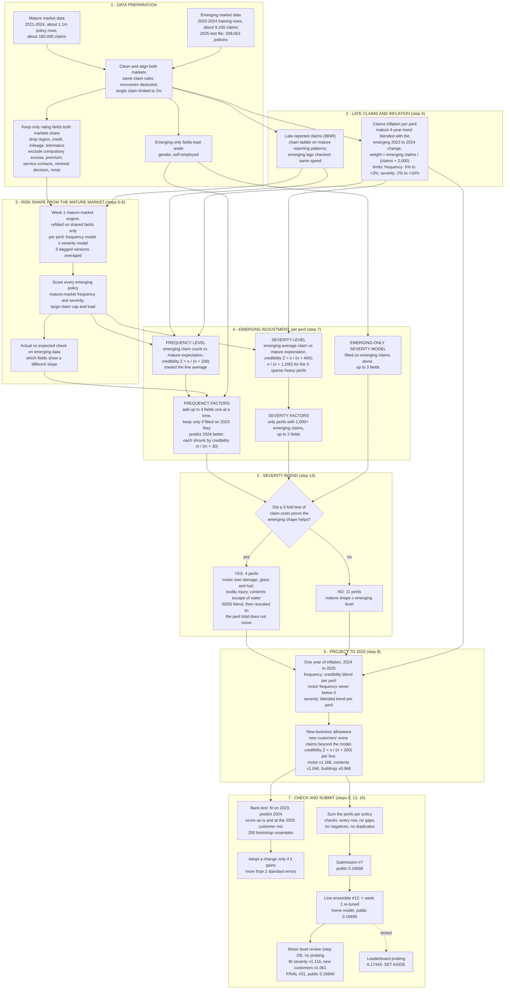
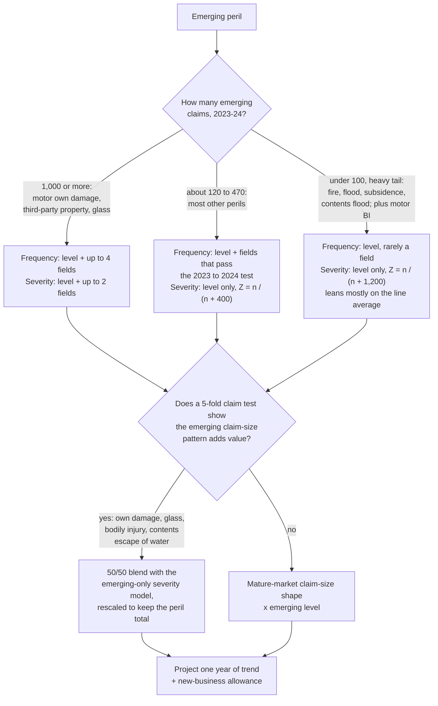

# Week 2 final submission: the emerging-market pricing model

**Final selection (updated 30 Oct 2026): `motorlevel_l_full` (submission #31), public score 0.16840.** The rules allow one final selection; the line ensemble `line_ensemble` (#12, public 0.16690) is the documented fallback.

- **File:** `week2/output/submission/submission_20261030_0905_week2_motorlevel_l_full.csv` (209,063 rows, all checks pass), MD5 `90120c605cee98bb3545e0b7b4b9a128`.
- **What it is:**
  - The line ensemble (#12, public 0.16690): motor from `x20_tblend`, home from the re-tuned week 1 baseline. This is the last model built without any leaderboard probing.
  - On top of it, an actuarial review of the **motor** cost level (section 2B): bodily-injury severity x1.116 and new-customer rows x1.061. Motor burn cost +9.4%; buildings and contents unchanged.
- **Not used:** the probed level files `lvl_cal1` (#17, 0.17192) and `lvl_half` (#27, 0.17445). They scored higher, but they were tuned to the public leaderboard, which a real insurer never has. Section 2A is kept as a record.
- **Rebuild:** `powershell -File week2\run\build_final_motorlevel.ps1` (add `-Full` to rebuild from raw data).
- **Full technical method, flowchart and parameters:** [final_model_method_week2.md](final_model_method_week2.md) (section 8A for the final step).
- **History:** sections 1-2 below were written on 26 Oct, when `x20_tblend` (#8, public 0.16662) was the recommendation. Its model is still the motor component of the final file. Section 2.3 is superseded by section 2B.

Earlier recommendation (26 Oct): `x20_tblend`.
- **File:** `week2/output/submission/submission_20261027_1305_week2_optionB_x20_tblend.csv` (Windows rebuild, 209,063 rows, all checks pass)
  - MD5 `7bd45d7065937a2fa6267264088b5532`.
  - The original Mac-mini run (`..._20261026_1827_..._x20_tblend_mactest.csv`, MD5 `6668491e0ea8ea71ea2f48d6c1aab702`) scored 0.16658. The xgboost baseline differs slightly between machines (total +0.02%).
- **Rebuild:** steps 05-09 with `TREND_MODE=blend_freq TREND_FLOOR_FREQ=motor` (tag `x20_tblend`), then `SOURCE_TAG=x20_tblend Rscript week2/R/15_candidate_from_tag.R`.
- **Written:** 26 Oct 2026; numbers refreshed 28 Oct 2026 from the Windows rebuild.
- **Audience:** readers who are not pricing specialists. Technical terms are explained where they first appear, and there is a glossary at the end.
- **Scope:** the week 1 model of the established (developed) market is taken as known. Here it is called the "mature-market model" and is not described again.

---

## 1. The short version

We were asked to price home and motor insurance for an **emerging market**: a new market with only two years of claims history (2023 and 2024). The task is to predict the expected claims cost of every policy written in **2025**.

Two years of data from a small, young book is not enough to price on its own. It holds about 9,100 claims across 15 perils, and some perils have only 50 to 90 claims. An actuary in this position does what the profession has always done with thin data: **borrow strength from a larger, related body of experience, and trust the local data only as far as its volume earns.**

The model therefore works in three layers:

1. **Who is riskier than whom (the shape).** This comes from the mature-market model, which learned it from four years and about 160,000 claims. A young driver is riskier than an experienced one in both markets, and a house near a river floods more often in both.
2. **How expensive the emerging market is overall (the level).** This comes from the emerging data, peril by peril. For example: emerging drivers claim 12% more often than the mature model expects for the same profile, but each claim costs about 37% less. Each of these numbers is weighted by **credibility**, meaning how much the emerging data can be believed given how many claims sit behind it.
3. **What 2025 will look like.** We project one year of claims inflation (trend) and add an allowance for the large share of new customers in 2025. New customers are typically riskier than renewing ones.

**Why #7.** It is the best of our 11 public submissions. Its one change from #5 rests on a sound actuarial reason, not on tuning to the leaderboard: each peril's claim-frequency trend is now a credibility-weighted blend of the mature and emerging evidence, instead of being assumed zero. The public leaderboard is also consistent across all 11 submissions about which direction the 2025 cost level should move. #7 follows that direction, and the cuts we rejected went against it. Section 2 explains the choice in full.

**Final step (30 Oct).** After #7 we combined it with the re-tuned week 1 home model (#12, 0.16690). We then tested "probing" the public leaderboard for price levels (section 2A). It scored higher, but we decided it is cheating: no insurer can see next year's claims before setting a price. So we set it aside, went back to the pre-probing model, and reviewed the motor cost level the way a pricing actuary would before entering a new market (section 2B). That review raised motor by 9.4% and gives the final file, public 0.16840.

---

## 2. Choosing the model for the private leaderboard

### 2.1 How the leaderboard works and what that implies

The 2025 test policies are split at random:
- **33%** are scored on the public leaderboard, which we can see;
- **67%** are scored on the private leaderboard, which decides the final ranking and which we cannot see.

Both parts come from the **same year, the same market and the same claims environment.** That matters for which public results carry over to private:

- **Ranking noise does not carry over.** Whether a model happens to rank a few hundred particular policies well is largely luck of the split. On our own data, a random one-third split moves a model-to-model difference by about ±0.0008 (one standard deviation). Small public differences are mostly noise.
- **The overall cost level does carry over.** If 2025 is a more expensive year than our 2024 data suggests, it is more expensive for every policy, in the public third and in the private two-thirds. A model whose 2025 level is closer to the truth gains on both.

### 2.2 What eleven public submissions tell us

| # | What changed | Effect on 2025 cost level | Public | vs #5 |
|---|---|---|---|---|
| 5 | Motor claim frequency no longer projected to fall | motor up 3% | 0.16612 | (reference) |
| **7** | **Frequency trend: credibility blend of mature and emerging** | **up 0.6%** | **0.16662** (Mac run 0.16658) | **+0.0005** |
| 6 | Sparse home perils pooled to the line average | buildings down 1.8% | 0.16562 | −0.0005 |
| 11 | Average of #4, #5 and #6 | down 0.2% | 0.16580 | −0.0003 |
| 9 | Catastrophe perils pulled toward the mature level | fire and subsidence about 5% lower | 0.16526 | −0.0009 |
| 8 | #7 plus catastrophe perils pulled toward the "everyday" home perils | down 0.8% | 0.16413 | −0.0020 |
| 10 | Catastrophe perils pulled toward the "everyday" home perils | down 1.7% | 0.16353 | −0.0026 |
| 3 | Motor severity model changed, which also lowered motor | motor down | 0.16432 | −0.0018 |
| 12 | #7 plus emerging-only factors `credit_tier` and `n_lines` (x21c) | level unchanged (+0.1%) | 0.16473 | −0.0014 |

Submission x21c gained locally (+0.0007) but lost 0.0019 against #7 on the public board, so its extra factors do not hold on the 2025 book. A further candidate, `nb1b_devonly` (2025 new-business load changed, total −6.6%), is built and its public score is pending.

The pattern holds across every submission:
- **every change that lowered the 2025 level lost**, and the bigger the cut, the bigger the loss;
- **every change that raised it gained.**

That is a systematic signal about the level, and the level is the part of the public score that transfers to the private score.

There is also an actuarial explanation for why our own back-test pointed the other way on the catastrophe perils. We tested on 2024, which was a quiet year for home fire and subsidence after a heavy 2023. A back-test on one quiet year rewards cutting catastrophe rates, but one quiet year is not evidence that the long-run rate is lower. The public board says 2025 is not quiet.

### 2.3 The decision (26 Oct; superseded by section 2B)

| Candidate | For | Against | Verdict |
|---|---|---|---|
| **#7 `x20_tblend`** | Best public score. The change is principled: the trend comes from a calculation already made at the trend-setting step (step 4), with nothing fitted to the leaderboard. It moves the level in the direction the public board consistently rewards. Neutral to slightly positive on our own back-test (+0.0005 at the 2025 customer mix, −0.0001 as-is). | The public gain over #5 (+0.0005) is inside the noise of the split. | **Select** |
| #5 `x18b` | Previous best, fully documented, reproducible byte for byte. | Assumes zero frequency trend for 13 of 15 perils, which is a simplification rather than an estimate. | Superseded by `motorlevel_l_full` |
| Catastrophe-level cuts (#8, #9, #10) | Best on our own back-test | Lost on public, in reverse order of their back-test gains. The back-test is biased by the quiet 2024. | Reject |
| Averages (#11) | Lower variance | Lowered the level and scored below #5 | Reject |

**Expected private outcome.** #7 and #5 share more than 99% of their structure, so their private scores should be within about ±0.001 of each other. On the evidence, #7 is the better estimate of 2025. We do not expect it to win on private by a large margin, and it would be wrong to promise that.

---

## 2A. Probing the public leaderboard (29 Oct): tested, then SET ASIDE

**Status (30 Oct 2026): not used in the final file (decision D035).** This section is kept as an honest record of what we tried. Even with the guardrails below, the method learns the price level from the public leaderboard, i.e. from 2025 claims that a real insurer would not see until after the year. Section 2B describes what we did instead.

### 2A.1 What was done

Section 2 showed that the public board consistently rewards a higher 2025 cost level, and that the level is the part of the score that carries over to private. So the next step was to **measure the level directly**:
- We uploaded **probe** files: the same model with one line or one peril scaled up by a known amount.
- For the scoring rule used here, the change in score from such a scaling follows an exact formula. Each probe score can therefore be turned into a measurement: "on the public policies, peril X costs θ times what we predicted".
- Fourteen probes measured eleven segments (each line, then the main perils within it).

| Step | Public score |
|---|---|
| Line ensemble (#12), no level correction | 0.16690 |
| Line levels only (`lvl_cal1`: motor x1.14, buildings x1.35, contents x0.93) | 0.17192 |
| Line and peril levels, halfway shrunk and bounded (`lvl_half`, set aside) | 0.17445 |

The formula predicted 0.17445 for `lvl_half` before it was submitted, and it scored exactly that.

### 2A.2 The risk: fitting the public third

Every probe teaches us something about the 33% of policies on the public board. The danger is learning facts that are true of *those particular policies* but not of the 67% on the private board. The peril measurements show this danger clearly:
- motor own damage came out at **-0.04**, a negative cost, which is impossible;
- buildings escape of water came out at **0.22**.

These readings are driven by which public policies happened to have a few large claims, and would not repeat on private.

### 2A.3 The guardrails

| # | Guardrail | What it protects against |
|---|---|---|
| 1 | **Level only.** The probes only scale whole lines or perils up or down. Which policies are riskier than others still comes only from our own data and the mature market. | Ranking differences are mostly the luck of the split (about ±0.0008) and do not carry over. A level shift is shared by public and private. |
| 2 | **Segments fixed in advance.** Only lines and perils were measured. No regions, channels or new/renewing customer cells were probed. | Data-mined cells. On our own 2023 and 2024 data such splits reversed direction from one year to the next. |
| 3 | **An exact formula, not trial and error.** Each probe is a measurement, and the formula reproduces all 14 scores. It predicted the final score before submission. | Chasing lucky scores. |
| 4 | **Planned, large, one-at-a-time probes.** The rounding error of each measurement was calculated. | Reading meaning into differences in the 5th decimal. |
| 5 | **Two stages, with the robust one as anchor.** The three line levels are measured first. They rest on thousands of claims, and a simulation on our own data showed they carry over (about +0.009 on a private-sized sample in a year with a real level shift). | Trusting the thin peril split as much as the solid line totals. |
| 6 | **Shrinkage halfway.** Each peril moves only halfway (on a multiplicative scale) from its line level toward its public measurement: a credibility weight of 0.5. | The simulation showed shrinking keeps the gain when the level really shifted and cuts the loss when it did not (-0.0006 to -0.0002). |
| 7 | **Bounds 0.6 to 1.8.** No peril is cut by more than 40% or raised by more than 80%. Motor own damage and buildings escape of water sit at the 0.6 bound. | The implausible readings in 2A.2. |
| 8 | **Line totals barely move from stage 1.** Final line totals are x1.13 / x1.32 / x0.88, against the stage 1 levels of 1.14 / 1.35 / 0.93. | The peril step mostly re-allocates cost within a line instead of betting further on the total. |
| 9 | **The guardrails were not loosened to reach a target.** See 2A.4. | Overfitting under deadline pressure. |
| 10 | **One final selection, with a documented fallback.** Was: select `lvl_half`, keep `lvl_cal1`. Superseded: neither is selected (section 2B). | If the peril split proves to be public noise, `lvl_cal1` still keeps the line-level gain. |

### 2A.4 Why we stopped at 0.17445 and not 0.175

Under the measured levels, the best expected public score **within** the bounds is 0.17469. Reaching 0.175 needs:
- taking almost every public reading at face value;
- cutting motor own damage and buildings escape of water by 70% or more (full θ with those two at 0.3: 0.17507; no guardrails at all: 0.17539).

That extra 0.0006 of public score would come from exactly the readings we believe are noise. It would most likely cost more on the private board than it gains on the public one. At the time we judged the guardrailed file to be the better estimate of the 2025 cost. On 30 Oct we set the whole probing approach aside (section 2B).

**Expected private outcome (of the probed file, for the record).**
- We simulated the whole probing procedure 300 times on our own 2024 data, split at random into a 33% public and a 67% private part (`week2/R/27_private_sim.R`; details in section 9.7 of the method document).
- **Expected private score: about 0.172**, i.e. about 0.002 below the public 0.17445. That drop is the part of the public gain that came from fitting the public third.
- The final file is still expected to beat:
  - #12 by about +0.004 to +0.0055;
  - `lvl_cal1` by about +0.003;
  - an unguarded full-θ file, narrowly.
- The absolute private score is uncertain by about ±0.011 (1 SD), because a few very large claims decide how "easy" each part of the book is. This uncertainty hits every team's model alike, so it moves the score more than the rank.

Which perils carry over:
- The line-level part of the gain is the most likely to carry over.
- Within the peril part:
  - weather perils (flood, storm, subsidence) are shared by the whole 2025 book and should carry over best;
  - fire and motor bodily injury, which hinge on a few large claims, carry over least.

---

## 2B. The final decision (30 Oct): no probing, an actuarial motor level review instead

### 2B.1 Why we set probing aside

Probing works by uploading deliberately changed files and reading the price level off the public score. It did raise our public score from 0.16690 to 0.17445. But:
- **It is not available in real life.** An insurer sets 2025 prices before 2025 claims exist. There is no leaderboard to ask. A method that needs one is not a pricing method.
- **It fits the public third.** Some readings were impossible (motor own damage at -0.04). Our own simulation expected about 0.002 of the public gain to disappear on the private board.
- **The Tweedie metric punishes level errors on large claims.** A level tuned to a few large public claims can backfire on private, where different large claims fall.

So we decided it is, in spirit, cheating, and did not use it, even though its public score is higher. We went back to the last model built without probing: #12 `line_ensemble` (0.16690). That model is the week 1 method re-fitted on the shared fields (the developed-market basis), credibility-blended with the emerging experience.

### 2B.2 What we reviewed instead: the motor cost level

Motor is the biggest line (42% of exposure). We asked the questions a pricing actuary asks before entering a new market, using only our own 2021-2024 data:

| Check | Finding | Action |
|---|---|---|
| Is the spread right? (risky vs safe drivers) | Week 1 spread used as a proxy for week 2: best stretch power k is about 1.0 in both markets. | None: spread kept. |
| Bodily-injury (BI) cost trend | We had assumed 0% for 2024 to 2025. Mature years show about +4%/yr; emerging +4.9%. Injury awards rise faster than prices. | BI severity x1.045 x 1.027 (trend +4.5%, rebased) |
| Late-reported injury claims | BI claims reported late are larger than those reported early, so a young book's averages are too low (development of severity). | BI x1.017 |
| Large-claim load for injury | The developed market's load is 1.048; the emerging book, too young to have seen its large claims, gives 1.024. | BI x1.023 (1.048 / 1.024) |
| New customers | 77% of 2025 policies are new business. The full emerging A/E for new customers is 1.237; we had applied a credibility-shrunk 1.165. | New-customer motor rows x1.061 (1.237 / 1.165), not where new business is already a model factor (glass and hail) |
| Not used | IBNER on reported claims, BI frequency trend | Evidence too thin. |

All factors come from our own training data and standard actuarial practice (trend, development, large-loss and new-business loads). None comes from the leaderboard. The ranking of policies is unchanged.

### 2B.3 Result

| Line / peril | #12 burn cost (CU) | Final burn cost (CU) | Change |
|---|---|---|---|
| Motor, all perils | 625.1 | 684.0 | +9.4% |
| of which bodily injury | | | +17.3% |
| of which own damage | | | +5.1% |
| Buildings | 357.1 | 357.1 | 0 |
| Contents | 109.4 | 109.4 | 0 |

| File | What changes | Public score |
|---|---|---|
| #12 `line_ensemble` | (base, pre-probing) | 0.16690 |
| #33 `l_bi` | BI severity only | 0.16793 |
| #32 `l_nb` | new-customer load only | 0.16769 |
| **#31 `l_full` (final)** | **both** | **0.16840** |

- Both parts help on their own and add up when combined, which is what we would expect if they correct a real under-pricing rather than noise.
- We built all three before seeing any score and picked the full version as the actuarial best estimate; the score confirmed it, it did not choose it.
- On the 2024 back-test (reported claims, only 9% new business) the change is neutral (motor D2 0.0439 vs 0.0441), as expected: that year cannot show 2025 trend or new-business effects.

### 2B.4 Risks of the final file

- If the 2025 actuals are claims reported at a snapshot rather than ultimate, the development factor (x1.017) overstates.
- The BI trend rests on a few hundred emerging injury claims.
- Fallback: #12 `line_ensemble` (0.16690), the same model without the motor review.

---

## 3. The problem in plain terms

For every 2025 policy we predict the **expected claims cost for the year**: the average amount the insurer should expect to pay, before expenses and profit. This is the "pure premium".

- **Products:**
  - motor: own damage, third-party property, bodily injury, theft, glass and hail;
  - buildings: storm, flood, escape of water, subsidence, fire, accidental damage;
  - contents: theft, escape of water, accidental damage, flood.
- That makes **15 perils.** We model each one separately, because what drives a theft claim is not what drives a flood claim.
- For each peril, the expected cost is:

  > **expected cost = how often claims happen (frequency) × how much each claim costs (severity)**

  A policy's prediction is the sum over the perils it covers.
- **Scoring.** Kaggle uses Tweedie deviance D2, the share of the variation in actual claims cost that the model explains, compared with charging everyone the average. 0 means no better than the average. Because most policies have no claim in a year, scores around 0.15 are good for this kind of data.

---

## 4. The workflow, step by step

### 4.1 Flowchart of the full model



### 4.2 How one prediction is built

For each policy and peril:

```
expected 2025 cost = exposure (fraction of the year insured)
                   x mature-market frequency for this profile
                   x emerging frequency level
                   x emerging frequency factors
                   x mature-market claim size for this profile  (or a 50/50 blend with the emerging-only model)
                   x emerging severity level
                   x emerging severity factors
                   x one year of frequency trend  x  one year of severity trend
                   x new-business allowance                   (new customers only)
```

**Worked illustration: motor own damage.** The mature-market multipliers below are made up for illustration; the emerging multipliers are the fitted values.

| Ingredient | Value | Meaning |
|---|---|---|
| Mature model for this driver | expects 10 claims per 100 cars a year, average claim 1,000 | the shape: this driver relative to others |
| Emerging frequency level | × 1.119 | emerging drivers claim 12% more often than the mature model expects |
| Emerging factors (gender, voluntary excess, occupation) | e.g. × 0.95 | small, credibility-shrunk corrections where the emerging market differs |
| Emerging severity level | × 0.629 | each emerging claim costs about 37% less than in the mature market |
| Severity trend 2024 → 2025 | × 1.037 | repair cost inflation |
| Frequency trend | × 1.00 | the evidence says falling, but motor frequency is never projected to fall (section 4.7) |
| New-business allowance | × 1.166 | only if this is a new customer |
| **Result** | 0.10 × 1.119 × 0.95 × 1,000 × 0.629 × 1.037 × 1.166 ≈ **81** | expected own-damage cost for 2025 |

### 4.3 Step 1: preparing the data

- **Common rules for both markets:**
  - the same claim definitions;
  - the expected recoveries on open claims are deducted;
  - a single claim is limited to 2 million, so that one freak claim does not distort the averages.
- **Shared fields only.** The emerging market does not record some of the mature market's fields: region, credit score, annual mileage and telematics. The mature model was refitted without them, so that every rating field it uses exists in both markets.
- **Fields we deliberately do not use:**
  - compulsory excess;
  - written premium (it would leak the old price into the new one);
  - customer-service contacts and the renewal decision (both are recorded after the fact);
  - marketing and noise fields.
- **Fields only the emerging market has:** gender and self-employment status. These were used only in the emerging adjustment, with Wendy's approval for gender (decision D027).

### 4.4 Step 2: late claims and inflation

- **Late-reported claims.** At 31 December 2024, some 2024 accidents have not been reported yet. Those are IBNR claims: incurred but not reported.
  - We estimated how many are missing with the standard **chain-ladder** method, using the mature market's reporting patterns, which rest on four years of data.
  - We checked that emerging claims are reported at the same speed.
  - The model is then fitted on the ultimate number of claims, so a recent policy is not treated as safer just because its claims have not arrived yet.
- **Inflation (trend).** For each peril we estimated the yearly change in claim frequency and in claim size.
  - The evidence is the mature market's 2021-24 trend, blended with the emerging change from 2023 to 2024.
  - The emerging evidence gets weight claims / (claims + 2,000). With 2,672 emerging claims, motor own damage takes 57% of its trend from the emerging data; with 52 claims, subsidence takes 3%.
  - Limits keep one odd year from producing an extreme projection: frequency between −5% and +3% a year, severity between −2% and +10%.

### 4.5 Step 3: the risk shape from the mature market

- The week 1 engine was refitted on the shared fields and used to score every emerging policy, giving a mature-market view of its frequency and severity for each peril.
- The engine is gradient-boosted trees, averaged over 5 versions for stability, and its large-claim caps are kept.
- We then compared emerging actual claims with these expectations, field by field (an "actual vs expected" review). The fields where the emerging market's slope looks different become the candidates for adjustment in step 4.

### 4.6 Step 4: adjusting to the emerging market (the heart of the model)

We fitted each peril separately with a **credibility-weighted regression** (a generalised linear model with penalties). In plain terms, every emerging adjustment is a compromise between "what our emerging data says" and "what we would assume without it". The weight on the emerging data grows with the number of claims behind it.

**Frequency level.**
- How much more or less often emerging policyholders claim than the mature model predicts.
- The credibility is Z = n / (n + 200), where n is the number of emerging claims.
  - With 2,672 claims, motor own damage is 93% credible.
  - With 52 claims, subsidence is only 21% credible.
- The rest of the weight goes to the **line average**: the typical emerging level across all perils in motor, or in buildings, or in contents. A thin peril is assumed to behave like its siblings until the data proves otherwise.
- Without this step, levels fitted on one year over-predicted the next year by about 20%. It was the largest single improvement in the project.

**Frequency factors.**
- Where the emerging market's risk pattern differs from the mature one, for example by voluntary excess level, we allow a correction.
- Fields are added one at a time, up to 4 per peril. A field is kept only if a model fitted on 2023 predicts 2024 better with it. This is a genuine out-of-sample test, so a field earns its place by predicting, not by fitting.
- Each correction is itself credibility-shrunk, with weight m / (m + 30) where m is the expected number of claims in that group.

**Severity level.**
- How much more or less an emerging claim costs than the mature model predicts.
- The emerging market is uniformly cheaper per claim, at 57% to 79% of the mature cost, consistent with lower repair and rebuild costs.
- The credibility is Z = n / (n + 400), because claim sizes are far more volatile than claim counts.
- For the five sparse, heavy-tailed perils it is Z = n / (n + 1,200): home fire, flood and subsidence, motor bodily injury, and contents flood. For these perils one large claim can move a small average a long way.

**Severity factors.**
- These are allowed only for perils with at least 1,000 emerging claims, with at most 2 fields.
- Only motor own damage, third-party property and glass qualify.

**Emerging-only severity model (the challenger).**
- Separately, we fitted claim size on emerging claims alone, with no mature-market input.
- It is used only in the blend in step 5.

### 4.7 Step 5: the severity blend

For each peril we asked whether the emerging data's own view of which claims are expensive adds anything to the mature-market shape. We answered it with a 5-fold cross-validation on every emerging claim: fit on four-fifths, test on the rest, five times.

- **Four perils passed** (z-score above 1.5):
  - motor own damage;
  - glass and hail;
  - bodily injury;
  - contents escape of water.

  For these, claim size is a 50/50 geometric blend of the mature-shape model and the emerging-only model.
- The blend is then **rescaled so that each peril's total predicted cost is unchanged.** The blend may change who pays (the shape), but not how much the peril costs in total (the level). This lesson came from submission #3, which blended all motor perils without rescaling, moved the motor level, and lost on the public board.
- **The other 11 perils** keep the mature-market shape with the emerging level. Their emerging claim volumes cannot support a shape of their own.

### 4.8 Step 6: projecting to 2025

- **Trend.** One year of inflation, from 2024 to 2025, per peril.
  - **Severity:** the blended trend from step 2.
  - **Frequency:** the credibility blend of mature and emerging evidence. **This is the change that makes #7.** Before #7, frequency trend was set to zero for every peril except motor own damage and third-party property; that was a simplification carried over from week 1.
  - In #7, each peril takes the trend its own evidence supports, within the −5% / +3% limits. The trend is also used when fitting step 4, to bring 2023 claims up to 2024 terms before they are combined.
- **Motor frequency floor.** The motor frequency trend is never projected below zero.
  - The evidence says own damage is falling 5% a year and third-party property 3.4%.
  - Our 2024 back-test cannot tell 0% from −5% apart, and assuming falling motor accident rates into 2025 was punished on the public board (submissions #3 and #5).
  - Not banking an improvement until it is proven is the prudent position.
- **New-business allowance.** 77% of 2025 policies are new customers, against a much smaller share in 2023-24. New customers claim more than the model explains.
  - We measured the excess per line and credibility-weighted it with Z = n / (n + 300) on new-business claims.
  - The resulting loads: motor ×1.166 (697 claims, Z = 0.70), contents ×1.046, buildings ×0.966.
  - The load is not applied where step 4 already picked up new business as a factor (motor glass, contents accidental damage), to avoid counting it twice.

### 4.9 Step 7: checking and submitting

**Back-test.** Fit on emerging 2023, predict emerging 2024, and score with the same metric Kaggle uses. We score two ways:
- as the 2024 policies are;
- reweighted to the 2025 mix of new business and sales channel. This is our best stand-in for the leaderboard.

**Decision rule.** We resample policies 200 times (bootstrap) to measure noise, and adopt a change only if it beats the current model by more than 2 standard errors without losing on the other view.

**Final step.** The motor level review of section 2B (`week2/R/29_motor_level.R`) is applied to the line ensemble #12.

**Final file.** We sum the perils per policy and check:
- every test policy is present;
- no missing values;
- no negative values;
- no duplicates.

---

## 5. The approach for each peril

### 5.1 Approach table

- "Level" is emerging ÷ mature for the same risk profile, after credibility.
- The **frequency** column shows the level, followed by the fields the emerging adjustment kept.
- **Severity approaches:**
  - **Mature shape:** mature-market claim-size model × emerging level.
  - **Blend:** 50/50 with the emerging-only model, rescaled to keep the total.
  - **Heavy credibility:** level only, with credibility n / (n + 1,200).

| Line | Peril | Emerging claims 2023-24 | Mature-market model: frequency / severity | Emerging frequency: level × fields kept | Emerging severity: approach (level) | Trend 2024 → 25: frequency / severity | NB load |
|---|---|---|---|---|---|---|---|
| Motor | Own damage | 2,672 | Trees / trees | **1.12** × gender, voluntary excess, occupation | **Blend**: mature shape (0.63) with excess and hail-days corrections + emerging-only (vehicle value, vehicle age, excess) | 0% (evidence −5.0%, floored) / +3.7% | ×1.166 |
| Motor | Third-party property | 2,193 | Trees / trees | **1.20** × gender, vehicle value, self-employed | Mature shape (0.57) × self-employed | 0% (evidence −3.4%, floored) / +4.2% | ×1.166 |
| Motor | Bodily injury | 449 | Trees / GLM | **1.20** × gender, no-claims years, voluntary excess | **Blend**: heavy credibility (0.58) + emerging-only (occupation, years licensed, gender) | 0% / 0% (week 1 rule; see 6.2) | ×1.166 |
| Motor | Theft | 389 | Trees / GLM | **1.28** × occupation, self-employed | Mature shape (0.64) | 0% (evidence −0.9%, floored) / +6.0% | ×1.166 |
| Motor | Glass and hail | 1,345 | Trees / trees | **1.33** × hail days, voluntary excess, vehicle value, new business | **Blend**: mature shape (0.61) with years-licensed correction + emerging-only (vehicle value, vehicle age, years licensed) | **+3.0%** / +9.2% | none (NB is a factor) |
| Buildings | Storm | 464 | Trees / trees | **1.30** × self-employed, construction type | Mature shape (0.64) | **+3.0%** / +8.8% | ×0.966 |
| Buildings | Flood | 80 | Trees / GLM | **0.96** × construction type | Heavy credibility (0.65) | **−3.1%** / +7.2% | ×0.966 |
| Buildings | Escape of water | 268 | Trees / GLM | **0.92** × gender | Mature shape (0.62) | **+0.8%** / +7.3% | ×0.966 |
| Buildings | Subsidence | 52 | Trees / GLM | **1.07**, level only | Heavy credibility (0.65) | **+3.0%** / +1.5% | ×0.966 |
| Buildings | Fire | 70 | Trees / GLM | **1.09**, level only | Heavy credibility (0.68) | **+3.0%** / −2.0% | ×0.966 |
| Buildings | Accidental damage | 122 | Trees / trees | **0.96** × construction type | Mature shape (0.66) | **+3.0%** / +2.8% | ×0.966 |
| Contents | Theft | 406 | Trees / GLM | **1.03** × gender | Mature shape (0.79) | **+3.0%** / +4.1% | ×1.046 |
| Contents | Escape of water | 171 | Trees / trees | **0.89**, level only | **Blend**: mature shape (0.78) + emerging-only (sum insured, gender) | **+1.6%** / +1.6% | ×1.046 |
| Contents | Accidental damage | 335 | Trees / trees | **0.82** × new business | Mature shape (0.77) | **+1.1%** / +1.5% | none (NB is a factor) |
| Contents | Flood | 86 | Trees / GLM | **0.91**, level only | Heavy credibility (0.79) | **−3.9%** / +6.2% | ×1.046 |

- Bold frequency trends are the ones #7 changed. Each of those was 0% in #5.
- "Trees" means a gradient-boosted tree model. "GLM" is a generalised linear model, used where the mature market has too few claims for trees. Both are from the week 1 engine.

### 5.2 Result: 2025 expected cost per policy-year

| Line | Peril | 2025 expected cost per policy-year (#7) | vs #5 |
|---|---|---|---|
| Motor | Own damage | 107.6 | +0.4% |
| Motor | Third-party property | 205.2 | +0.1% |
| Motor | Bodily injury | 232.5 | −0.2% |
| Motor | Theft | 50.1 | +0.2% |
| Motor | Glass and hail | 29.7 | +4.2% |
| **Motor** | **All** | **625.1** | **+0.2%** |
| Buildings | Storm | 58.9 | +4.2% |
| Buildings | Flood | 95.1 | −3.8% |
| Buildings | Escape of water | 66.5 | +0.7% |
| Buildings | Subsidence | 36.9 | +4.4% |
| Buildings | Fire | 92.7 | +4.5% |
| Buildings | Accidental damage | 5.5 | +4.7% |
| **Buildings** | **All** | **355.5** | **+1.4%** |
| Contents | Theft | 52.4 | +4.3% |
| Contents | Escape of water | 16.7 | +2.4% |
| Contents | Accidental damage | 10.6 | +1.7% |
| Contents | Flood | 26.4 | −4.0% |
| **Contents** | **All** | **106.1** | **+1.5%** |

The changes from #5 are about one year of each peril's frequency trend. The fitted level also moves slightly, because the 2023 data is now brought up to 2024 terms with the same trend.

### 5.3 Why the perils are treated differently



The principle is the same throughout: **the more data a peril has, the more of its own story it is allowed to tell.**
- Motor own damage, with 2,672 claims, gets its own level, its own risk factors and partly its own claim-size pattern.
- Subsidence, with 52 claims, gets a level that is 79% the buildings average. Its risk pattern comes entirely from the mature market.

---

## 6. How well does it work?

### 6.1 Back-test results

Scored on emerging 2024, with the model fitted on 2023 only. The metric is the Kaggle D2, on claims developed to ultimate.

| Model | As the 2024 policies are | At the 2025 customer mix |
|---|---|---|
| **#7, this model** | **0.151** | **0.153** |
| The same, with levels but no emerging factors | 0.146 | 0.151 |
| Mature-market model applied unchanged | 0.127 | 0.130 |
| Emerging data alone (simple GLMs) | 0.101 | 0.135 |
| "Perfect" model ceiling (simulated from the model itself) | 0.149 | 0.170 |

What this shows:
- **Combining the two markets beats either alone by a wide margin.** The mature-market model applied as it is overcharges the emerging market by about 48%. The emerging data alone cannot rank risks reliably.
- **The model is close to the ceiling.** When we simulate claims from the model itself, a perfect model scores about 0.149 on one year of data like this (as-is), and we score 0.151 (inside the simulation's noise). At the 2025 mix the ceiling is 0.170, so there is more headroom on that view. That view is also noisier: its bootstrap standard errors are about 1.5 to 2 times the as-is ones. Most of the remaining gap to a "perfect" score is pure chance: who happens to claim in a given year.
- **Frequency does almost all the work.** Claim size barely separates good risks from bad in this data. Its D2 is between −0.05 and +0.03 for 12 of the 15 perils, under any model. Getting each peril's level right matters more than any refinement of claim size.

### 6.2 What we tried that did not work

Over 20 rounds of experiments, all of which are logged in `improvement_round_week2.md`.

**Simpler versions all lost.** Each component of the model earns its place:

| Simplification | Change in back-test score |
|---|---|
| no emerging factors | −0.0045 |
| at most 1 factor per peril | −0.0012 |
| no severity blend | −0.0006 |
| one severity trend per line | −0.0004 |

**Ideas that did not beat the model:**
- **Other credibility methods:**
  - limited fluctuation;
  - Bühlmann-Straub with estimated parameters, per peril and with drift;
  - Jewell's hierarchical model;
  - per-peril constants picked by cross-validation.

  None beat the simple fixed constants by a meaningful margin. Details: `credibility_study_week2.md`.
- **Fitting claim size on emerging data alone:** home perils lost about 0.03 every time. With 50 to 470 claims a year, there is not enough data to learn a pattern.
- **Pooling the two markets into one model:** the trees chased the unusual 2023 home year.
- **Stretching or flattening the predictions:** the best power was exactly 1, so the spread between low and high risks is already calibrated.
- **Cutting the catastrophe perils toward a long-run level:** best on our back-test, worst on the public board. See section 2.2.

---

## 7. Known limitations and judgement calls

1. **One year of emerging evidence.**
   - Every emerging level rests on 2023-24, and the back-test rests on 2024 alone.
   - The 90% uncertainty band of our back-test score is about 0.03 wide, so differences under about 0.001 cannot be called.
2. **Catastrophe perils** (home fire, flood, subsidence; contents flood) swing from year to year. Fire claimed three times its expected rate in 2023 and at its expected rate in 2024.
   - Their levels lean heavily on the line average.
   - A true long-run catastrophe view would need many more years than either market provides.
3. **Motor bodily injury has no trend.**
   - The mature market shows claim sizes falling 8.8% a year; the emerging data shows +4.9%.
   - We kept the week 1 rule of zero trend. This is the largest unresolved assumption.
4. **The motor frequency floor** is a judgement, not an estimate. The data points to falling accident rates; the public board and prudence point to not banking the fall.
5. **New business.**
   - 77% of 2025 is new business.
   - The motor new-business load (×1.166) rests on 697 claims (70% credible). If 2025 new customers differ from 2023-24 new customers, this is where it will show.
6. **Buildings escape of water** looks about 12% high against both years' actuals.
   - Credibility pulls it toward the buildings average.
   - Lighter credibility made no measurable difference, so it was left as is.
7. **Gender** is used as a rating factor in the emerging adjustment (approved, D027). That is acceptable for this exercise; in a real market it would need to be checked against anti-discrimination rules.

---

## 7A. From risk premium to office premium (20 reference policies)

The 20 reference policies are 2025 test rows. They are **not used to fit or tune the model** (decision D003). They only illustrate the premium build-up, using each row's predicted risk premium from the final submission (`motorlevel_l_full`, public 0.16840; updated 30 Oct 2026).

### Method

The office premium is the premium that, after the percentage loadings, leaves exactly enough to cover claims, fixed costs, reinsurance and profit. This is the standard expense-loading (gross-up) formula:

$$P = \frac{RP\,(1 + r_{cat}) + F \cdot e}{1 - v - c - t - m}$$

| Symbol | Meaning | Emerging value |
|---|---|---|
| $RP$ | Predicted risk premium for the row (expected ultimate claims, net of excess and recoveries) | from the model |
| $r_{cat}$ | Catastrophe reinsurance, a share of the **property risk premium** (buildings and contents; none for motor) | 12% |
| $F$, $e$ | Fixed expense per policy-year, scaled by the row's exposure | 85 CU × exposure |
| $v$ | Variable expense, share of office premium | 15% |
| $c$ | Commission, share of office premium, by channel | broker 20%, direct 0% |
| $t$ | Premium tax, share of office premium | 8% |
| $m$ | Target profit margin, share of office premium | 8% |

- The percentage items are shares of the **office** premium, so they are divided out in the denominator rather than added to the risk premium. The denominator is 0.49 for broker business and 0.69 for direct.
- Cat reinsurance and the fixed expense are costs in CU, so they sit in the numerator.
- Fixed expense is pro-rated by exposure, so a part-year row bears a part-year share.
- Check: for every row, risk premium + cat reinsurance + fixed expense + variable expense + commission + tax + profit equals the office premium to the cent (script asserts this).
- Assumptions: contents is treated as property for the cat reinsurance load; no comparison-site rows appear in the sample (the emerging market has no comparison-site commission).

**Source.** This is the pure premium (loss cost) method of ratemaking: the indicated premium is the pure premium plus the fixed expense per exposure, divided by the permissible loss ratio, which is one minus the variable expense and profit provisions (here commission and premium tax are variable provisions too).
- Werner, G. and Modlin, C. (2016). *Basic Ratemaking*, 5th edition. Casualty Actuarial Society. Chapter 7, "Overall Rate Level Indication" (pure premium method and fixed and variable expense provisions).
- Actuarial Standards Board. *Actuarial Standard of Practice No. 29, Expense Provisions in Property/Casualty Insurance Ratemaking*: expenses are split into those that vary with premium and those fixed per policy or exposure.
- The reinsurance load follows the expenses file's own definition (share of property risk premium); it is treated as a cost added to the loss cost, not as a share of premium.

### Worked example: M00161473 (motor, broker, exposure 0.964)

$$P = \frac{1{,}442.78 + 85 \times 0.9644}{1 - 0.15 - 0.20 - 0.08 - 0.08} = \frac{1{,}524.76}{0.49} = 3{,}111.75$$

Of that, variable expense 466.76, commission 622.35, tax 248.94, profit 248.94.

### Results (CU, per row; final model `motorlevel_l_full`)

| Row | Line | Exposure | Channel | Risk premium | Cat RI | Fixed | Variable | Commission | Tax | Profit | **Office premium** | Office ÷ risk | Office, x20_tblend | Change |
|---|---|---|---|---|---|---|---|---|---|---|---|---|---|---|
| M00118569 | motor | 0.940 | direct | 600.69 | 0.00 | 79.87 | 147.95 | 0.00 | 78.91 | 78.91 | **986.33** | 1.64 | 940.35 | +4.9% |
| M00129413 | motor | 0.332 | broker | 165.54 | 0.00 | 28.18 | 59.30 | 79.07 | 31.63 | 31.63 | **395.33** | 2.39 | 365.39 | +8.2% |
| M00153851 | motor | 0.962 | broker | 315.81 | 0.00 | 81.74 | 121.70 | 162.26 | 64.91 | 64.91 | **811.31** | 2.57 | 756.55 | +7.2% |
| M00161473 | motor | 0.964 | broker | 1,442.78 | 0.00 | 81.97 | 466.76 | 622.35 | 248.94 | 248.94 | **3,111.75** | 2.16 | 2,818.23 | +10.4% |
| M00167496 | motor | 0.984 | broker | 585.59 | 0.00 | 83.61 | 204.86 | 273.14 | 109.26 | 109.26 | **1,365.71** | 2.33 | 1,258.74 | +8.5% |
| M00176777 | motor | 0.992 | broker | 1,084.66 | 0.00 | 84.30 | 357.85 | 477.13 | 190.85 | 190.85 | **2,385.63** | 2.20 | 2,195.06 | +8.7% |
| M00185311 | motor | 0.964 | direct | 1,019.11 | 0.00 | 81.97 | 239.37 | 0.00 | 127.66 | 127.66 | **1,595.77** | 1.57 | 1,422.68 | +12.2% |
| B00215707 | buildings | 0.986 | broker | 216.70 | 26.00 | 83.84 | 99.96 | 133.28 | 53.31 | 53.31 | **666.42** | 3.08 | 693.77 | -3.9% |
| B00215809 | buildings | 0.975 | direct | 360.70 | 43.28 | 82.90 | 105.84 | 0.00 | 56.45 | 56.45 | **705.62** | 1.96 | 658.66 | +7.1% |
| B00217584 | buildings | 0.967 | broker | 893.03 | 107.16 | 82.20 | 331.35 | 441.79 | 176.72 | 176.72 | **2,208.97** | 2.47 | 1,996.06 | +10.7% |
| B00218282 | buildings | 0.973 | broker | 282.15 | 33.86 | 82.67 | 122.04 | 162.73 | 65.09 | 65.09 | **813.63** | 2.88 | 931.60 | -12.7% |
| B00223369 | buildings | 0.995 | broker | 320.16 | 38.42 | 84.53 | 135.65 | 180.86 | 72.34 | 72.34 | **904.31** | 2.82 | 879.37 | +2.8% |
| B00229821 | buildings | 0.992 | broker | 223.78 | 26.85 | 84.30 | 102.53 | 136.71 | 54.68 | 54.68 | **683.55** | 3.05 | 673.73 | +1.5% |
| B00250679 | buildings | 0.110 | broker | 33.02 | 3.96 | 9.32 | 14.17 | 18.90 | 7.56 | 7.56 | **94.49** | 2.86 | 94.19 | +0.3% |
| C00259568 | contents | 1.000 | broker | 40.13 | 4.82 | 85.00 | 39.78 | 53.04 | 21.22 | 21.22 | **265.19** | 6.61 | 257.90 | +2.8% |
| C00270331 | contents | 0.973 | broker | 39.50 | 4.74 | 82.67 | 38.85 | 51.80 | 20.72 | 20.72 | **258.99** | 6.56 | 253.87 | +2.0% |
| C00283470 | contents | 0.973 | broker | 69.91 | 8.39 | 82.67 | 49.28 | 65.70 | 26.28 | 26.28 | **328.51** | 4.70 | 326.47 | +0.6% |
| C00286287 | contents | 0.967 | broker | 141.51 | 16.98 | 82.20 | 73.68 | 98.24 | 39.30 | 39.30 | **491.22** | 3.47 | 479.83 | +2.4% |
| C00302985 | contents | 0.992 | broker | 49.63 | 5.96 | 84.30 | 42.82 | 57.10 | 22.84 | 22.84 | **285.48** | 5.75 | 280.72 | +1.7% |
| C00314425 | contents | 0.069 | broker | 4.44 | 0.53 | 5.82 | 3.30 | 4.41 | 1.76 | 1.76 | **22.03** | 4.96 | 22.08 | -0.2% |

- Full-precision results: `week2/output/office_premium_reference_policies.csv`.
  - Script: `week2/R/24_office_premium.R` (`SUB=` selects the submission file; default is the final `motorlevel_l_full`).
  - The earlier `x20_tblend` version is kept as `week2/output/office_premium_reference_policies_x20_tblend.csv`.
- **What changed vs x20_tblend.**
  - Only the risk premium changed; the expense and loading assumptions are the same.
  - Total risk premium over the sample rows: motor x1.10, buildings x1.03, contents x1.04. Office premium: x1.09, x1.03 and x1.02 respectively.
  - Buildings and contents moved with the re-tuned week 1 home model (#12); motor moved with the motor level review (section 2B), mostly on policies with a large bodily-injury share or new customers.
- **Reading the table.**
  - Low-risk contents policies carry an office premium 3.5 to 6.6 times the risk premium, because the fixed 85 CU expense is large against a risk premium of 4 to 140 CU.
  - Motor and buildings broker policies sit around 2.2 to 3.1 times, driven by the 51% of premium taken by percentage loadings.
  - Direct policies sit lower, at 1.57 to 1.96 times, as they pay no commission.
- **Sensitivity.** If the fixed expense were charged in full for part-year rows instead of pro-rated, the three short rows (M00129413, B00250679, C00314425) would rise by about 116 CU, 155 CU and 162 CU respectively ($F(1-e)/0.49$).

---

## 8. Glossary

| Term | Meaning |
|---|---|
| **Pure premium / expected cost** | Average claims cost per policy for the year, before expenses and profit |
| **Frequency** | How often claims happen: claims per policy-year |
| **Severity** | Average cost of one claim |
| **Peril** | A type of loss, such as fire, theft or storm |
| **Exposure** | The fraction of the year a policy was in force |
| **Mature (developed) market** | The established market from week 1, with 2021-24 data and a fitted model |
| **Level** | Emerging ÷ mature for the same risk profile: an overall up or down adjustment per peril |
| **Credibility (Z)** | Weight on our own data, Z = n / (n + K), where n is the claim count. The rest of the weight goes to a broader reference (the line average). A larger K means more data is needed before we believe it. |
| **IBNR** | Incurred but not reported: claims that have happened but are not yet known to the insurer |
| **Chain ladder** | Standard actuarial method for estimating IBNR from past reporting patterns |
| **Trend** | Yearly change in frequency or severity: claims inflation |
| **New-business load** | Extra allowance for new customers, who claim more than the model explains |
| **GLM** | Generalised linear model: the standard actuarial regression for pricing |
| **Gradient-boosted trees** | A machine-learning model that builds many small decision trees, used here for the mature-market shape |
| **Back-test** | Fitting on an earlier year and checking the predictions against a later one |
| **Bootstrap** | Resampling the policies many times to measure how much a score could move by chance |
| **D2 (Tweedie deviance explained)** | The Kaggle metric: the share of claims variation explained, compared with charging everyone the average |

---

## 9. Where to find more

| Document | What it holds |
|---|---|
| `final_model_method_week2.md` | The full method of the final file, incl. the motor level review (section 8A) and the set-aside probing (section 9) |
| `week2_workflow.md` | Submission log with every public score, incl. #31-33 |
| `output/29_motor_level/` | Motor level factors, back-test scores and burn cost by peril |
| `optionB/decision_register.csv` | Decisions D035 (probing set aside) and D036 (final = #31) |
| `final_model_week2.md` | Every parameter of #5. #7 differs only in the frequency trend (section 4.8 here). |
| `improvement_round_week2.md` | Every experiment, with its numbers. X20 covers #7. |
| `credibility_study_week2.md` | The credibility methods compared |
| `what_works_week2.md` | What works, what does not, and lessons learned |
| `submission_log_week2.md` | All 11 submissions with per-peril back-test scores |
| `output/08_loadings/x20_tblend/loadings_report.md` | #7's levels, trends and loads per peril |
| `output/09_validate/sub7/validate_report.md` | #7's full back-test scorecard |
