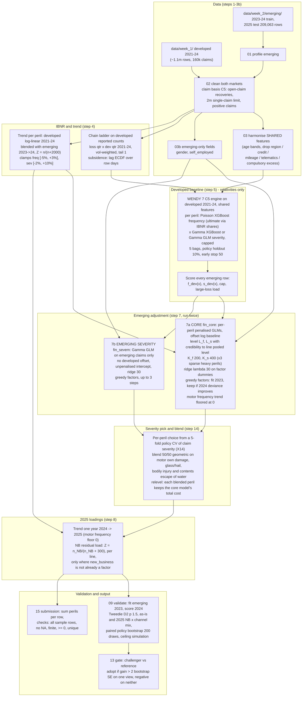

# Week 2 final model (emerging market, Option B): submission #5

> **Historical.** This was the final model as of 26 Oct 2026. The actual final submission is #31 `motorlevel_l_full` (public 0.16840): see [final_model_method_week2.md](../final_model_method_week2.md) and [final_submission_writeup_week2.md](../final_submission_writeup_week2.md).

**Public score 0.16612** (best of 5 week 2 submissions; 26 Oct 2026).
- **File:** `week_2/output/submission/submission_20261026_0737_week2_optionB_x18b.csv`, MD5 `6a5011cc9752fc1204c0056f0f4ec985`.
- **Rebuild:** `zsh week_2/run/build_final.sh` reproduces this file byte for byte (same MD5) from the step 5 baseline onwards.
  - It writes run tags `fin_core`, `fin_sevem` and `final`.
  - It writes `submission_<time>_week2_optionB_final.csv`.
- **All code** is R (data.table, arrow, xgboost) in `week_2/R/`.
- **What works and what does not:** `week_2/docs/what_works_week2.md`.

## 1. The model in one line

For each emerging row and peril, the 2025 expected ultimate cost is:

```
pred = exposure
     x [ f_dev(x) x L_f x adj_f(x) ]                 frequency: developed relativities x emerging level x emerging factors
     x [ s_core(x)^0.5 x s_em(x)^0.5 x k ]  or  s_core(x)   severity (blend only on 4 perils, k keeps the core total)
     x (1 + g_f) x (1 + g_s)                           one year of trend, 2024 -> 2025
     x NB                                              residual new-business load (new-business rows only)

s_core(x) = s_dev(x) x L_s x adj_s(x) x load_dev     developed severity shape x emerging level x factors x large-loss load
```

The row prediction is the sum over the line's perils. Structural zeros (no cover for the peril) give 0.

## 2. Flowchart of the full build



Script order:

| Step | Script | Run tag(s) in the final build |
|---|---|---|
| 1 | `01_profile_emerging.R` | |
| 2 | `02_clean_week2.R` | |
| 3 | `03_harmonise_features.R` | |
| 3b | `03b_emerging_extra.R` | |
| 4 | `04_ibnr_trend_week2.R` | |
| 5 | `05_developed_baseline.R` | `BAGS=5`, `RUN_TAG=baseline` |
| 6 | `06_score_emerging_baseline.R` | |
| 7 | `07_emerging_adjust.R` | `fin_core`, then `fin_sevem` |
| 14 | `14_blend_severity.R` | `final` |
| 8 | `08_loadings_2025.R` | `final` |
| 9 | `09_validate_compare.R` | `final` |
| 15 | `15_candidate_from_tag.R` | `final` |

## 3. Parameters

### 3.1 Data and claim basis (steps 2-3)

| Parameter | Value | Note |
|---|---|---|
| Developed training years | 2021-2024 | baseline fit |
| Emerging training years | 2023-2024 | levels, factors, loadings |
| Valuation date | 31 Dec 2024 (both markets) | |
| Single-claim limit | 2,000,000 | applied before caps |
| Open-claim recoveries | deducted (closed recovery ratio) | perils with recoveries |
| Excluded fields | `compulsory_excess`, `written_premium`, `customer_service_contacts`, `renewal_decision`, marketing / noise fields | always |
| Developed-only fields dropped | `region`, `credit_band`, `annual_mileage`, `telematics_opt_in`, `telematics_score` | not in emerging |
| Renamed to shared bands | `driver_age` -> `driver_age_band`, `policyholder_age` -> `policyholder_age_band` | |
| Emerging-only fields | `gender` (approved by Wendy, D027), `self_employed` | step 7 only, never in the baseline |
| Seed | `SEED` in `00_setup_week2.R` | all sampling |

### 3.2 IBNR and trend (step 4)

- **IBNR.** Chain ladder on developed reported counts per peril:
  - grid: loss quarter x development quarter, 2021Q1-2024Q4;
  - factors: volume-weighted, tail 1;
  - subsidence override: lag ECDF averaged over the row's days.
  - Emerging report lags were checked to be statistically the same as developed.
  - The row reporting share is day-weighted over the policy period. Frequency is modelled on the ultimate basis (claims / share).
- **Trend.** The developed log-linear trend (2021-24; capped p99.5 severity) is blended with the emerging 2023 -> 2024 change:
  - weight Z = n / (n + 2000);
  - clamps: frequency [-5%, +3%], severity [-2%, +10%];
  - frequency trend is used only for motor own damage and TPP (week 1 rule);
  - motor bodily injury has 0 trend for both frequency and severity (week 1 C5).

**Final model change (X18):** the motor frequency trend is floored at 0 in step 7 and step 8 (`TREND_FLOOR_FREQ=motor`).

Chosen trends in the final model (annual):

| Line | Peril | Frequency trend | Severity trend |
|---|---|---|---|
| motor | own_damage | **0** (blend -5.0%, floored) | +3.75% |
| motor | third_party_prop | **0** (blend -3.4%, floored) | +4.16% |
| motor | bodily_injury | 0 | 0 |
| motor | theft | 0 | +6.01% |
| motor | glass_hail | 0 | +9.21% |
| buildings | storm | 0 | +8.77% |
| buildings | flood | 0 | +7.16% |
| buildings | escape_of_water | 0 | +7.32% |
| buildings | subsidence | 0 | +1.48% |
| buildings | fire | 0 | -2.00% |
| buildings | accidental_damage | 0 | +2.76% |
| contents | theft | 0 | +4.12% |
| contents | escape_of_water | 0 | +1.62% |
| contents | accidental_damage | 0 | +1.54% |
| contents | flood | 0 | +6.23% |

### 3.3 Developed baseline (step 5, `inputs/assumptions_week2_baseline.xlsx`)

Global settings:

| Setting | Value | Setting | Value |
|---|---|---|---|
| bags | 5 (D028) | model_selection | freq_sev for every peril |
| max_rounds | 3000 | early_stopping_rounds | 50 |
| holdout_share (policies) | 0.10 | subsample | 0.8 |
| colsample_bytree | 0.8 | reg_lambda | 5 |
| glm_min_level_claims | 30 | glm_log_features | sum_insured, annual_mileage, distance_to_river_km |
| history_features | Y | ibnr_method | chain_ladder |

Per peril (Model_Spec sheet; frequency is always a Poisson GBM; the rounds and cap are from the final fit):

| Line | Peril | Severity model | Cap quantile | Freq depth / eta / mcw | Sev depth / eta / mcw | Rounds freq / sev | Cap | Large-loss load | Developed claims |
|---|---|---|---|---|---|---|---|---|---|
| motor | own_damage | Gamma GBM | 0.999 | 4 / 0.05 / 50 | 3 / 0.05 / 100 | 729 / 162 | 19,895 | 1.0025 | 48,258 |
| motor | third_party_prop | Gamma GBM | 0.999 | 4 / 0.05 / 50 | 3 / 0.05 / 100 | 391 / 20 | 30,908 | 1.0014 | 32,963 |
| motor | bodily_injury | Gamma GLM | 0.995 | 3 / 0.05 / 100 | GLM, latest year excluded | 325 / - | 187,506 | 1.0478 | 7,512 |
| motor | theft | Gamma GLM | 0.999 | 3 / 0.05 / 50 | GLM | 363 / - | 55,462 | 1.0017 | 6,119 |
| motor | glass_hail | Gamma GBM | 0.999 | 3 / 0.05 / 50 | 3 / 0.05 / 100 | 343 / 45 | 9,593 | 1.0009 | 15,643 |
| buildings | storm | Gamma GBM | 0.999 | 3 / 0.05 / 50 | 3 / 0.05 / 100 | 600 / 117 | 35,330 | 1.0021 | 7,762 |
| buildings | flood | Gamma GLM | 0.995 | 3 / 0.05 / 30 | GLM | 323 / - | 241,228 | 1.0069 | 2,219 |
| buildings | escape_of_water | Gamma GLM | 0.999 | 4 / 0.05 / 50 | GLM | 478 / - | 57,352 | 1.0015 | 10,065 |
| buildings | subsidence | Gamma GLM | 0.995 | 3 / 0.05 / 30 | GLM, latest year excluded | 62 / - | 129,205 | 1.0052 | 1,288 |
| buildings | fire | Gamma GLM | 0.990 | 3 / 0.05 / 15 | GLM | 182 / - | 293,016 | 1.0193 | 1,107 |
| buildings | accidental_damage | Gamma GBM | 0.999 | 3 / 0.05 / 30 | 3 / 0.05 / 100 | 192 / 16 | 9,514 | 1.0010 | 3,825 |
| contents | theft | Gamma GLM | 0.999 | 4 / 0.05 / 50 | GLM | 207 / - | 32,661 | 1.0031 | 7,626 |
| contents | escape_of_water | Gamma GBM | 0.999 | 3 / 0.05 / 50 | 3 / 0.05 / 100 | 243 / 184 | 23,973 | 1.0025 | 5,366 |
| contents | accidental_damage | Gamma GBM | 0.999 | 3 / 0.05 / 50 | 3 / 0.05 / 100 | 277 / 45 | 6,197 | 1.0017 | 9,063 |
| contents | flood | Gamma GLM | 0.995 | 3 / 0.05 / 30 | GLM | 245 / - | 67,335 | 1.0089 | 1,615 |

Baseline features (shared, `use = Y`):

- **Motor:**
  - driver: driver_age_band, years_licensed, ncb_years, occupation, marital_status, prior_claims_5y, licence_points, years_at_address;
  - vehicle: vehicle_value_group, vehicle_age, make_model, engine_size_cc, body_type, transmission, seats, fuel_type, driver_assist;
  - cover and usage: cover_type, overnight_parking, vehicle_use, named_young_driver, voluntary_excess;
  - account: channel, payment_method, missed_payments_12m, new_business, renewal_count, days_quote_to_inception, start_month;
  - location and weather: urban_density, hail_days, wind_exposure_index, freezing_days, rainfall_mm;
  - claims history: hist_policy_claims_prev, hist_customer_claims_other_lines_prev.
- **Buildings:**
  - policyholder: policyholder_age_band, occupancy, days_unoccupied, household_size, prior_claims_5y, years_at_address;
  - cover: sum_insured, accidental_damage_cover, voluntary_excess;
  - account: channel, payment_method, missed_payments_12m, new_business, renewal_count, days_quote_to_inception, start_month;
  - property: construction_type, smoke_alarms, year_built, property_type, roof_type, basement, trees_within_5m, listed_building, bedrooms, energy_rating, solar_panels;
  - location: urban_density, flood_zone, distance_to_river_km, elevation_m, soil_type;
  - weather: hail_days, wind_exposure_index, freezing_days, dry_summer_index, wildfire_index, rainfall_mm, mean_temperature_c;
  - claims history: hist_policy_claims_prev, hist_customer_claims_other_lines_prev.
- **Contents:**
  - policyholder: policyholder_age_band, tenure, works_from_home, lodgers, household_size, prior_claims_5y, years_at_address;
  - cover: sum_insured, accidental_damage_cover, security_level, high_value_items, bicycle_cover, voluntary_excess;
  - account: channel, payment_method, missed_payments_12m, new_business, renewal_count, days_quote_to_inception, start_month;
  - property and location: year_built, property_type, roof_type, basement, bedrooms, urban_density, flood_zone, distance_to_river_km, elevation_m;
  - weather: freezing_days, rainfall_mm, mean_temperature_c;
  - claims history: hist_policy_claims_prev, hist_customer_claims_other_lines_prev.

Developed validation (mean of the 2023 and 2024 folds, reported_raw, ALL lines): 0.0976 with 5 bags. Week 1 C5 on all fields scored 0.1026.

### 3.4 Emerging adjustment, core model (step 7, run tag `fin_core`)

| Parameter | Value | Meaning |
|---|---|---|
| `LAMBDA` (frequency ridge) | 30 | penalty on each factor dummy, in expected claims (credibility n/(n+30)) |
| `LAMBDA_SEV` (severity ridge) | 30 | same, in claims |
| `K_FREQ_LEVEL` | 200 | frequency level credibility: Z = n/(n+200) toward the line's pooled level |
| `K_SEV_LEVEL` | 400 | severity level credibility; x3 (1,200) for the level-only perils below |
| Level-only severity perils | buildings fire, flood, subsidence; motor bodily_injury; contents flood | no severity factors |
| Severity factors allowed | perils with >= 1,000 emerging claims (`SEV_FACTOR_MIN`), up to 2 | |
| `MAX_FACTORS` (frequency) | 4 | greedy forward selection |
| Selection rule | fit on 2023, keep a factor only if the 2024 deviance falls by more than 1 | |
| Severity prior | claim-weighted mean of the line's peril log levels | not cost-weighted (D025) |
| Severity cap | developed cap x emerging cap level | load = developed large-loss load |
| `X_EXTRA` | 1 | gender and self_employed offered as candidates |
| `TREND_FLOOR_FREQ` | motor | motor frequency trend floored at 0 (X18) |
| Fit weights | 1 (as-is) | 2025-mix weights were tried and reverted (X2) |

Frequency candidates per line (only the factors that showed an emerging A/E slope in step 6), plus new_business, gender and self_employed:

- **Motor:** driver_age_band, cover_type, new_business, channel, vehicle_use, overnight_parking, urban_density, named_young_driver, fuel_type, body_type, occupation, self_employed, marital_status, payment_method, ncb_years_b, renewal_count_b, vehicle_value_group_b, vehicle_age_b, voluntary_excess, hail_days_b, freezing_days_b, rainfall_mm_b, years_licensed_b, hist_policy_claims_prev, licence_points_b.
- **Buildings:** policyholder_age_band, construction_type, new_business, channel, property_type, urban_density, occupancy, flood_zone, soil_type, roof_type, basement, trees_within_5m, occupation, self_employed, sum_insured_b, voluntary_excess, wind_exposure_index_b, wildfire_index_b, rainfall_mm_b, dry_summer_index_b, hail_days_b, renewal_count_b.
- **Contents:** policyholder_age_band, tenure, new_business, channel, security_level, property_type, urban_density, flood_zone, occupation, self_employed, sum_insured_b, high_value_items, voluntary_excess, works_from_home, lodgers, bicycle_cover, rainfall_mm_b, renewal_count_b.
- `_b` = quintile bands from the emerging training data.

Fitted levels and factors (final fit on 2023-24). Each level is emerging / developed baseline, after credibility.

| Line | Peril | Emerging claims | Frequency level | Severity level | Frequency factors | Severity factors (core) |
|---|---|---|---|---|---|---|
| motor | own_damage | 2,672 | 1.118 | 0.629 | gender, voluntary_excess, occupation | voluntary_excess, hail_days_b |
| motor | third_party_prop | 2,193 | 1.199 | 0.569 | gender, vehicle_value_group_b, self_employed | self_employed |
| motor | bodily_injury | 449 | 1.194 | 0.580 | gender, ncb_years_b, voluntary_excess | (level only) |
| motor | theft | 389 | 1.275 | 0.636 | occupation, self_employed | |
| motor | glass_hail | 1,345 | 1.313 | 0.606 | hail_days_b, voluntary_excess, vehicle_value_group_b, new_business | years_licensed_b |
| buildings | storm | 464 | 1.283 | 0.643 | self_employed, construction_type | |
| buildings | flood | 80 | 0.956 | 0.654 | construction_type | (level only) |
| buildings | escape_of_water | 268 | 0.917 | 0.619 | gender | |
| buildings | subsidence | 52 | 1.060 | 0.651 | | (level only) |
| buildings | fire | 70 | 1.085 | 0.681 | | (level only) |
| buildings | accidental_damage | 122 | 0.955 | 0.659 | construction_type | |
| contents | theft | 406 | 1.017 | 0.794 | gender | |
| contents | escape_of_water | 171 | 0.888 | 0.781 | | |
| contents | accidental_damage | 335 | 0.817 | 0.773 | new_business | |
| contents | flood | 86 | 0.913 | 0.786 | | (level only) |

Coefficients: `week_2/output/07_adjust/coefficients_fin_core.csv`. Every factor tried: `factor_log_fin_core.csv`.

### 3.5 Emerging-only severity and the blend (step 7 `fin_sevem`, step 14 `final`)

| Parameter | Value |
|---|---|
| `SEV_MODE` | em_select: Gamma GLM on emerging claims only, no developed offset, unpenalised intercept |
| `EM_SEV_STEPS` | 3 greedy factor steps (fit 2023, keep if 2024 claim deviance falls by more than 1) |
| Candidates | the line's frequency candidates plus vehicle_value_group_b, driver_age_band, cover_type, vehicle_age_b, voluntary_excess (motor); sum_insured_b, property_type, construction_type (buildings); sum_insured_b, high_value_items, tenure (contents) |
| `BLEND_W` | 0.5: geometric, s = s_core^0.5 x s_em^0.5 |
| `BLEND_PERILS` | motor/own_damage, motor/glass_hail, motor/bodily_injury, contents/escape_of_water |
| `BLEND_RELEVEL` | 1: each blended peril is rescaled so that its total predicted cost equals the core model's, so only the shape changes |

How the four perils were picked: a 5-fold policy-level cross-validation of claim-level Gamma deviance on all 2023-24 emerging claims (`output/07_adjust/sev_cv_x14_cv.csv`). The rule was a blend gain of z > 1.5 that holds after relevelling (shape, not level).

| Peril | z blend | z relevelled | Emerging severity factors |
|---|---|---|---|
| motor own_damage | 2.9 | 2.8 | vehicle_value_group_b, vehicle_age_b, voluntary_excess |
| motor glass_hail | 2.6 | 2.5 | vehicle_value_group_b, vehicle_age_b, years_licensed_b |
| motor bodily_injury | 1.7 | 1.9 | occupation, years_licensed_b, gender |
| contents escape_of_water | 1.8 | 1.8 | sum_insured_b, gender |

### 3.6 2025 loadings (step 8, run tag `final`)

| Parameter | Value |
|---|---|
| Trend | one year, 2024 -> 2025, at the chosen trends in 3.2 |
| `K_NB` | 300: new-business residual credibility, Z = n_NB / (n_NB + 300) |
| NB load applied | only to new-business rows, and only where step 7 did not keep new_business as a factor |
| IBNR | inside frequency (ultimate); nothing added |
| Large-loss load | developed capped-excess load x emerging level; nothing added |

| Line | NB claims 2023-24 | NB residual A/E | Z | NB load | Perils with new_business already a factor (no load) |
|---|---|---|---|---|---|
| motor | 697 | 1.238 | 0.699 | **1.166** | glass_hail |
| buildings | 77 | 0.834 | 0.204 | 0.966 | none |
| contents | 102 | 1.180 | 0.254 | 1.046 | accidental_damage |

## 4. Results

### 4.1 2025 burn (expected cost per exposure-year)

| Line | Peril | 2025 |
|---|---|---|
| motor | own_damage | 107.2 |
| motor | third_party_prop | 205.0 |
| motor | bodily_injury | 233.0 |
| motor | theft | 50.1 |
| motor | glass_hail | 28.5 |
| **motor** | **all** | **623.7** |
| buildings | storm | 56.6 |
| buildings | flood | 98.8 |
| buildings | escape_of_water | 66.0 |
| buildings | subsidence | 35.3 |
| buildings | fire | 88.7 |
| buildings | accidental_damage | 5.2 |
| **buildings** | **all** | **350.6** |
| contents | theft | 50.3 |
| contents | escape_of_water | 16.3 |
| contents | accidental_damage | 10.4 |
| contents | flood | 27.5 |
| **contents** | **all** | **104.5** |

### 4.2 Local validation (fit emerging 2023, score 2024, developed actuals, ALL lines)

| Weighting | d2_w1 (week 1 protocol) | d2_const (Kaggle formula) | Pred / actual |
|---|---|---|---|
| as-is 2024 | 0.1178 | 0.1504 | 1.036 |
| 2025 NB x channel mix (public proxy) | 0.0674 | 0.1522 | 1.088 |

- Ceiling simulation (model as truth, simulated claims): d2_const 0.157 as-is / 0.179 at the 2025 mix. The model is close to what one year of emerging claims allows.
- Bootstrap 90% interval of the 2024 D2: about 0.03 wide. Differences under 0.001 cannot be called locally.

### 4.3 Submission history

| # | File | What changed | Local proxy (2025 mix) | Public |
|---|---|---|---|---|
| 1 | `submission_20261025_2125_week2_optionB.csv` | Option B pipeline | 0.1500 | 0.15604 |
| 2 | `submission_20261025_2240_week2_optionB.csv` | + gender, 5 bags, K 200/400, lambda 30 | 0.1516 | 0.16562 |
| 3 | `..._0714_week2_optionB_x13b.csv` | + all motor severity blended 50/50 (level moved, motor -2.2%) | 0.1522 | 0.16432 |
| 4 | `..._0724_week2_optionB_x14e.csv` | #2 + CV-picked severity blend on 4 perils, levels kept | 0.1522 | 0.16557 |
| **5** | `..._0737_week2_optionB_x18b.csv` | **#4 + motor frequency trend floored at 0 (motor +3.0%)** | 0.1522 | **0.16612** |

Per-peril frequency / severity / cost D2 for each submission: `week_2/docs/submission_log_week2.md`.

## 5. Known judgement items (for the report)

- **Buildings escape of water** is about 12% high: in-sample A/E 0.88 in both 2023 and 2024, because the severity level credibility (K 400) pulls it toward the buildings average. Lighter credibility made no measurable difference locally (X16).
- **Motor bodily injury** has no trend (week 1 C5 rule). The developed severity trend is -8.8% a year and the emerging change is +4.9%. This is unresolved.
- **Motor frequency trend:** floored at 0 on public-board evidence (#3 and #5). The 2024 fold cannot tell 0% from -3% to -5%.
- **Buildings fire, flood and subsidence** swing by year (fire in-sample A/E 3.1 in 2023, 1.0 in 2024). The level credibility (K 1,200 for their severity) carries them.
- **New business** is 77% of 2025. The motor NB load of 1.166 rests on 697 NB claims (Z 0.70).
