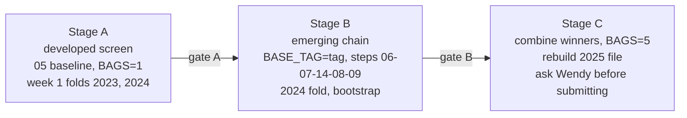

# Week 1 re-tune for week 2 (round B): week 1 engine on emerging-available fields only

Written 28 Oct 2026. Status: **implemented and smoke-tested (28 Oct 2026); no real run yet.** Results go in `retune_register.csv`
(same folder), one row per run, filled in at every stage, so each variant can be adopted or rejected on the record.
How to run everything is in `run_guide.md` (same folder).

## 0. Ground rules

### 0.1 Folder isolation: the week 1 folder is never touched

- `week1/` holds the week 1 models for the week 1 test data. It is **read-only** for this round: no script writes,
  copies over, renames or re-runs anything inside `week1/`, and no file in `week1/` is edited.
- All re-tune work lives in **`week2/week1_retune/`**:

| Folder | Holds |
|---|---|
| `week2/week1_retune/R/` | `r05_retune_baseline.R`: a **copy** of `week2/R/05_developed_baseline.R` with the new switches (including the tuning mode); `r08_score_vs_ref.R`: stage A scoring, bootstrap, checks and register update. `week2/R/05_developed_baseline.R` itself is not edited, so the current `baseline` stays reproducible byte for byte |
| `week2/week1_retune/inputs/` | A one-off **copy** of `week1/docs/assumptions_wendy07_final2.xlsx` (MD5 `422a8e964874cafe1758ed111be074d9`, identical to the original) and the per-run workbooks and tuned specs built from it. After the copy, nothing reads from `week1/` |
| `week2/week1_retune/run/` | `run_retune.ps1` (stage A, one variant), `run_retune_stageB.ps1` (emerging chain), console logs |
| `week2/week1_retune/models/<tag>/` | Fitted models, model card per run |
| `week2/week1_retune/output/<tag>/` | Line and peril scores, row predictions, diagnostics, bootstrap |
| `week2/week1_retune/docs/` | This plan, `retune_register.csv`, the round summary |
| `data/week_2/week1_retune/<tag>/` | Data caches and the baseline hand-off files (`baseline_emerging_{train,test}.parquet`) |

- Shared week 2 inputs (`data/week_2/optionB/features/`, claims, IBNR shares) are **read** only. The re-tune does not
  write to `week2/models/`, `week2/output/05_*`, `data/week_2/optionB/` or the week 2 decision/step logs until a
  variant is adopted (0.2).
- Fields: only columns that exist in the **emerging** data (the shared set from step 3, plus proxies built from shared
  columns). The B0 ablation runs put developed-only fields back purely to measure their cost; they are never handed to
  week 2.

### 0.2 Hand-off to the week 2 model

- The re-tune script writes the same hand-off files as the week 2 baseline (`baseline_emerging_{train,test}.parquet`:
  per-row, per-peril frequency and severity for every emerging training and test row) to
  `data/week_2/week1_retune/<tag>/`.
- Stage B uses them in the week 2 chain without moving them. `00_setup_week2.R` has three optional switches, all
  defaulting to the old behaviour: `BASE_DIR` (default `data/week_2/optionB`), `BASE_DIAG_DIR`, and `OUT_ROOT` /
  `DOCS_ROOT` (default `week2/output`, `week2/docs/optionB`). Steps 06, 07 and 09 read the baseline through `BASE_DIR`.
  `run_retune_stageB.ps1` sets them so that every output of the chain goes to `week2/week1_retune/output/chain_<tag>/`
  and `docs/chain_<tag>/`, and the tag-keyed data caches are `rt_<tag>*`. Nothing of an existing week 2 run is overwritten.
- Only an **adopted** variant is promoted: copied to `data/week_2/optionB/rt_<tag>/`, logged in the week 2 decision
  register, and then used as `BASE_TAG=rt_<tag>` for the final week 2 build.

### 0.3 Time and acceptance policy

- Take as much time as needed. Run every variant in the list, at 1 bag for screening and at 5 bags for anything that
  passes; repeat close calls with a second seed.
- **Small improvements are taken**, even below 2 standard errors, provided the overfitting checks in 0.4 pass.
  The 2 SE rule is a confidence label, not a veto.
- A variant is **rejected** if it loses, or if it gains only by a route that risks overfitting.

### 0.4 Overfitting checks (all must pass before a small gain is taken)

1. **Both folds agree.** It gains, or is flat within 0.0002, on the 2023 fold **and** the 2024 fold of the developed
   validation. A gain on one year and a loss on the other is noise.
2. **Broad, not one peril.** The ALL gain is not carried by a single peril; no line loses more than 1 SE.
3. **Bootstrap direction.** The challenger beats the reference in at least 70% of the 200 bootstrap draws.
4. **Seed stable.** A close call (under 1 SE) is re-run with a second seed and must keep its sign.
5. **Emerging agrees.** On the emerging 2024 fold (stage B) it does not lose on either view (as-is, 2025 mix).
6. **No tuning on the test of record.** Choices are made on developed folds (stage A) and checked once on the
   emerging fold (stage B). No grid is searched on the emerging 2024 fold, and the public board is never used to pick.
7. **Level unchanged.** The 2025 burn per line moves by less than 1% (a shape change must not be a hidden level change).
8. **Simplicity.** Between two variants within noise of each other, keep the one with fewer parameters, fewer
   features and the shallower trees.

## 1. Why this round

- The week 2 baseline (`week2/R/05_developed_baseline.R`, tag `baseline`) is the week 1 WENDY 7 C5 engine with the fields
  the emerging market lacks switched off (region, credit_band, annual_mileage, telematics_opt_in, telematics_score,
  plus excluded fields), ages replaced by bands, and frequency x severity for every peril.
- Its hyperparameters, feature lists, monotone constraints and caps are still the week 1 values, tuned on the **full**
  feature set. Only bags (X8), motor location fields (X6) and a pooled fit (X7) have been tested since.
- Measured cost so far (mean 2023-24 developed D2, ALL lines, reported_raw basis):

| Model | Fields | Form | Bags | D2 |
|---|---|---|---|---|
| Week 1 C5 | all | freq x sev, Tweedie for motor BI / contents EoW | 5 | 0.1026 |
| Week 2 `baseline` | shared | freq x sev everywhere | 5 | 0.0978 |

  Developed-actuals basis for `baseline`: ALL 0.1030, motor 0.0472, buildings 0.0719, contents 0.0646. Motor loses most
  (about 0.054 in week 1 to 0.047).
- The 0.0048 gap mixes two causes: dropped fields and the change of model form. It has not been split, so we do not yet
  know whether telematics, region, mileage or credit is the expensive loss, or whether re-tuning can recover any of it.

## 2. Test design: three stages, each with a gate

### Stage A: developed screen (cheap)

- Run: `BAGS=1 RUN_TAG=<tag> [ENV] Rscript week2/week1_retune/R/r05_retune_baseline.R` (about 10-15 min per run).
- Score: mean 2023-24 Tweedie D2 (p 1.5) on **developed actuals**, ALL and per line and per peril
  (`week2/week1_retune/output/<tag>/line_scores.csv`, `peril_scores.csv`), against a 1-bag reference run (`b0_ref`),
  never against the 5-bag baseline.
- Noise: paired bootstrap of the row predictions (`row_preds.parquet`, 200 draws, resampled by policy), each fold.
- **Gate A:** carry to stage B if ALL gains (any size) and checks 1-4 of 0.4 pass. Ablation runs (B0) are for
  information only and are not carried.

### Stage B: emerging chain (the decision that matters)

- A better developed model is not automatically better for the emerging market. The baseline only supplies the
  **shape**, and step 7 re-estimates the level per peril.
- Run on the x20_tblend chain with the re-tuned baseline: `BASE_DIR=data/week_2/week1_retune BASE_TAG=<tag>`, then
  06 -> 07 (core and sevem) -> 14 -> 08 -> 09, with `TREND_MODE=blend_freq TREND_FLOOR_FREQ=motor` (as
  `run_x21_win.ps1`), and step tags prefixed `rt_` so they never overwrite an existing week 2 run.
- Score:
  - `13_compare_runs.R` vs `x20_tblend`: constant-mean D2 as-is and at the 2025 mix, paired bootstrap 200;
  - the standard scorecard (`week2-model-scorecard` skill, model `OPTB_B<n>`): frequency, severity and cost D2 by
    peril, line and ALL.
- **Gate B:** adopt if it gains on at least one view, does not lose on the other, and all of 0.4 passes. Gains above
  2 SE are labelled `adopt (strong)`, smaller ones `adopt (small)`. If the 2025 level moves by 1% or more, relevel it
  to the current level and re-score before deciding.

### Stage C: combine and build

- Combine the stage B winners in one run, at `BAGS=5`, and re-score through stages A and B.
- Build the candidate with `SOURCE_TAG=<tag> Rscript week2/R/15_candidate_from_tag.R` (row checks, burn vs main).
- **Do not submit.** Offer it to Wendy with the scorecard. Public submissions are limited.

## 3. Variations to test

`ENV` = the switch in `week2/week1_retune/R/r05_retune_baseline.R`. Switches marked **new** are added only to that
copy, each defaulting to the current behaviour, so `b0_ref` reproduces the week 2 baseline at 1 bag.

### B0: reference and ablation (answers "which dropped field costs most")

| Tag | Change | ENV | Purpose |
|---|---|---|---|
| b0_ref | Current baseline, 1 bag | `BAGS=1` | Paired reference for every stage A run |
| b0_full | Week 1 C5 feature set on this harness (all fields back) | `FEATURE_OFF_KEEP=all` **new** | Upper bound; splits the 0.0048 into feature loss vs model-form loss |
| b0_tele | Shared fields + telematics_opt_in, telematics_score | `FEATURE_ADD=telematics_opt_in,telematics_score` **new** | Cost of losing telematics |
| b0_mile | Shared fields + annual_mileage | `FEATURE_ADD=annual_mileage` | Cost of losing mileage |
| b0_region | Shared fields + region | `FEATURE_ADD=region` | Cost of losing region |
| b0_credit | Shared fields + credit_band | `FEATURE_ADD=credit_band` | Cost of losing credit |
| b0_age | Exact driver / policyholder age instead of bands | `FEATURE_ADD=driver_age,policyholder_age` | Cost of banding ages |

- These cannot be used for emerging (the fields do not exist there). They tell us where to look for proxies (B3).
- Needs: step 3 developed feature files dropped these columns (see `week2/output/03_features/feature_map.csv`), so the
  re-tune script joins them back by `row_id` from `data/week_2/clean` (week 2 copy of the developed data), never from
  `week1/` or `data/week_1/`.
- Week 1 evidence: telematics added +0.00025 (SE 0.00036) on top of MOTOR 4, so b0_tele is expected to be about zero;
  region and mileage are the likely losses.

### B1: tree hyperparameters (re-tune for the smaller feature set)

| Tag | Change | ENV |
|---|---|---|
| b1_depth_m1 | `freq_max_depth` and `sev_max_depth` minus 1 for every peril | `HP_DEPTH_ADD=-1` **new** |
| b1_depth_p1 | depth plus 1 | `HP_DEPTH_ADD=1` **new** |
| b1_eta_half | learning rate halved (more rounds, early stopping unchanged) | `HP_ETA_MULT=0.5` **new** |
| b1_mcw_x2 | `min_child_weight` x2 (smoother, for thin perils) | `HP_MCW_MULT=2` **new** |
| b1_lambda20 | `reg_lambda` 5 -> 20 | `HP_REG_LAMBDA=20` **new** |
| b1_col1 | `colsample_bytree` 0.8 -> 1.0 (fewer fields, so less need to subsample) | `HP_COLSAMPLE=1` **new** |

- With fewer fields, each tree has less to split on. Shallower and more regularised trees are the more likely winners.

### B2: monotone constraints and banded fields

| Tag | Change | ENV |
|---|---|---|
| b2_mono_off | Remove all monotone constraints | `MONO_OFF=1` **new** |
| b2_band_ord | Treat the age bands as ordered numbers (1-5) with the week 1 monotone sign instead of categories | `AGE_BAND_ORD=1` **new** |

- The age bands are currently categories with no constraint. Ordered bands keep the week 1 shape with fewer splits.

### B3: proxies for the dropped fields (built only from fields both markets have)

| Tag | Proxy for | Feature | ENV |
|---|---|---|---|
| b3_loc | region | urban_density, flood_zone, address weather averages, on every motor and home peril | `LOC_ALL=1` (X6 tried motor only: noise) |
| b3_use | mileage | use_cover (vehicle_use x cover_type), age_use (named_young_driver x vehicle_use x vehicle_age band) | `PROXY=mileage` |
| b3_credit | credit | disc_flag, missed_any (any discount, any missed payment) | `PROXY=credit` |
| b3_young | exact age | novice_band (age band x years_licensed band) | `PROXY=age` |

- Each proxy must be built the same way in both markets (step 3 rules). Do **not** use marketing_segment or credit_tier:
  x21c lost 0.0019 on the public board.
- Gate A is the main test here: a proxy only earns a place if it recovers part of the B0 loss on developed data.

### B4: model form and caps

| Tag | Change | ENV |
|---|---|---|
| b4_sevglm | GLM severity for mid-sized perils (motor theft, buildings storm, contents theft) instead of trees | edit `sev_model` in a copy of the workbook Model_Spec for these perils (text field, not yet a switch) |
| b4_cap | `cap_quantile` one step lower for heavy perils (fire, flood, subsidence, BI) | `SPEC_OVERRIDE` rows `cap_quantile` |
| b4_sevrecent | `sev_exclude_recent_years` 1 -> 0 for long-tail perils | `SPEC_OVERRIDE` rows `sev_exclude_recent_years` |

- Tweedie (as week 1 C5 for BI and contents EoW) is **not** testable here: step 7 needs frequency and severity separately.

### B5: training window and weights (closer to the emerging use)

| Tag | Change | ENV |
|---|---|---|
| b5_recent | Fit on developed 2022-24 only (drop 2021) | `TRAIN_FROM=2022` **new** |
| b5_yw | Year weights 0.7 / 0.8 / 0.9 / 1.0 for 2021-24 | `YEAR_WEIGHTS=0.7,0.8,0.9,1` **new** |
| b5_dw | Importance weights: classifier developed vs emerging (shared fields), weight = p/(1-p), capped at 5 | `DOMAIN_W=1` **new** |

- b5_dw targets the actual goal: a developed model trained to look like the emerging book (77% broker new business in
  2025). Stage A scores it on the plain developed folds (a drop there is expected, since the fit is deliberately tilted);
  the real test is the emerging 2024 fold at the 2025 mix in stage B.

### B6: averaging

| Tag | Change | ENV |
|---|---|---|
| b6_bags10 | 10 bags (stage C only) | `BAGS=10` |

### B7: per-peril hyperparameter tuning (long run, the biggest time item)

B1 changes one setting for every peril at once. B7 instead searches settings **per peril and per part** (frequency model,
severity model), because a thin peril such as subsidence and a rich one such as motor own damage want different trees.

| Item | Rule |
|---|---|
| Run | `RUN_TAG=b7_tune TUNE=1 BAGS=1 Rscript week2/week1_retune/R/r05_retune_baseline.R` (resumable: finished perils are skipped on restart) |
| Search space | Around the current per-peril values: depth -2..+2, learning rate x0.5 / x1 / x2, min_child_weight x0.5..x4, reg_lambda 1 / 5 / 20 / 50, colsample 0.5-1, subsample 0.6-1, min_split_loss 0 / 0.5 / 2 |
| Search | Random search: 24 frequency configurations, then (for gradient-boosted severity perils only) 16 severity configurations on top of the best frequency one. Sizes set by `TUNE_N_FREQ`, `TUNE_N_SEV`; raise them if time allows |
| Selection fold | **2023 only** (fit 2021-22), seed A. The screening winner has a selection bias, so it is never trusted on its own |
| Confirmation | Winner and the default are re-fitted on 2023 with a second seed and on **2024 (untouched holdout, fit 2021-23)** with both seeds. A tuned setting is adopted for a peril only if it beats the default in **all three** confirmations; otherwise that peril keeps the default |
| Output | `output/b7_tune/tune_log.csv` (every evaluation: peril, setting, fold, seed, D2), `tune_summary.csv` (decision per peril with the confirmation gains), `inputs/tuned_spec_b7_tune.csv` |
| Use | `SPEC_OVERRIDE=week2/week1_retune/inputs/tuned_spec_b7_tune.csv`, run as variant `b7_applied` through stages A (full validation, both folds, bootstrap) and B |
| Time | Roughly 40 to 50 model fits per peril per fold at about 20 seconds each, so several hours for the full set. Run line by line with `LINES_ONLY` if needed |

- This is the most overfitting-prone item, so the safeguards are built in: fold-2023 selection, seed confirmation, a holdout
  fold that played no part in selection, and the same bootstrap checks as every other variant. A tuned setting that only
  wins on one seed or one fold is dropped.
- Tune on the best feature set and structure found in B0-B5, then re-tune once more at the end (B7b), because the
  best depth depends on which fields are present.
- Tuning scores the cost D2 (the project metric), not the frequency deviance alone.

## 4. Documentation for every run (required before any decision)

| What | Where | Written by |
|---|---|---|
| Model card: settings, workbook MD5, validation D2 by year and line, peril D2, diagnostics, burn | `week2/week1_retune/models/<tag>/model_card.md` | re-tune script |
| Line and peril scores, row predictions, features used, workbook edits, bootstrap per fold | `week2/week1_retune/output/<tag>/` | re-tune script |
| Step log entry per run (inputs and outputs with MD5, run time, key numbers) | `week2/week1_retune/docs/step_log.md` | re-tune script |
| **Register row**: tag, stage, change, ENV, developed D2 (ALL, lines, each fold) vs b0_ref with SE and bootstrap win share, overfitting checks 1-8, emerging D2 vs x20_tblend (as-is, 2025 mix) with SE, burn change, gate results, decision | `week2/week1_retune/docs/retune_register.csv` | after each stage |
| Stage B comparison and bootstrap | `week2/docs/optionB/experiment_log.csv` (rows tagged `rt_`) | `13_compare_runs.R` |
| Stage B scorecard (freq, sev, cost by peril, line, ALL) | `week2/output/scores/model_scores.csv` (model `OPTB_RT_<TAG>`) | scorecard skill |
| Run log row (stage B and C only) | `week2/docs/workflow_w2.md` | by hand |
| Adoption decision and promotion to `data/week_2/optionB/rt_<tag>/` (winners only) | `week2/docs/optionB/decision_register.csv` | by hand |
| Round summary: all runs, what was adopted and why | `week2/week1_retune/docs/retune_summary.md`, linked from `week2/docs/optionB/improvement_round_week2.md` | end of round |

Decision recorded in each register row: `adopt (strong)` (gate B, above 2 SE), `adopt (small)` (gate B, below 2 SE,
all overfitting checks pass), `carry` (passed gate A, waiting for B), `info` (B0 ablation), `reject` (lost, or failed
an overfitting check; the failed check is named).

## 5. Order of work and expected value

0. **Set-up (no model runs):** create the folders in 0.1, copy the week 1 workbook into `inputs/` and record its MD5,
   copy `05_developed_baseline.R` to `r05_retune_baseline.R` with output paths moved to `week1_retune`, add the
   `BASE_DIR` switch to `00_setup_week2.R`, then confirm with Wendy before the first run.
1. **B0** (7 runs, stage A only). It tells us where the 0.0048 went. If `b0_full` is within noise of `b0_ref`, the
   dropped fields cost little and the rest of the round is about form and tuning, not proxies.
2. **B1 and B2** (8 runs, stage A). These are cheap and independent.
3. **B3** for every proxy, giving priority to the fields that B0 shows are expensive.
4. **B4 and B5** (6 runs, stage A).
5. Re-run close calls with a second seed and at 5 bags.
6. Stage B for everything that passed gate A, one at a time, then stage C for the combination.

Time: no time limit. Run the whole list, including the low-priority variants, rather than stopping early.

Expected gain: small. The emerging chain is close to its simulated ceiling (0.151 vs 0.149 as-is), and frequency
shape matters more than severity shape. A realistic target is +0.001 to +0.003 of developed D2 and up to about +0.001
on the emerging fold. Small gains are taken if the overfitting checks pass (0.3, 0.4). Anything that moves the 2025
level is a level change, not a shape change, and is judged as such.
